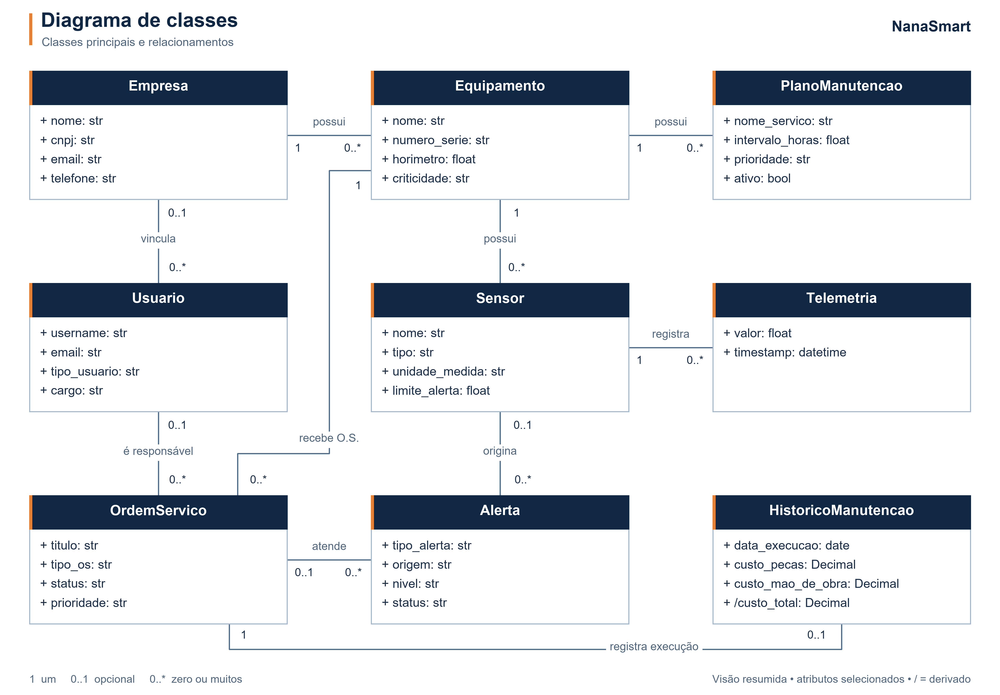

# Diagrama de classes para slide

## Classes principais — texto para o slide

- **Empresa e Usuario:** organizam os cadastros e os responsáveis pela manutenção.
- **Equipamento e Sensor:** representam os ativos monitorados e seus limites de operação.
- **Telemetria e Alerta:** armazenam as leituras e registram condições anormais.
- **PlanoManutencao:** define serviços recorrentes por horas de funcionamento.
- **OrdemServico e HistoricoManutencao:** controlam os serviços e registram a execução e os custos.

## Relações mais relevantes — texto para o slide

Uma empresa possui equipamentos e usuários. Cada equipamento pode ter sensores e planos de manutenção. Os sensores possuem leituras de telemetria e podem originar alertas. As ordens de serviço vinculam equipamento e responsável, podem atender alertas e possuem um histórico de execução.

## Arquivos e referência técnica

- `NanaSmart_Diagrama_Classes.png`: imagem em alta resolução (4800 × 3340 px), com fundo branco.
- `NanaSmart_Diagrama_Classes.svg`: versão vetorial para ampliar sem perder nitidez.
- `fontes/gerar.py`: fonte para regenerar as imagens usando Pillow no ambiente `.venv`.

Resumo baseado em `accounts/models.py`, `ativos/models.py`, `telemetria/models.py`, `alertas/models.py` e `manutencao/models.py`, conferidos em 17/11/2026. As classes e os atributos preservam os nomes do código. `username` e `email` de `Usuario` são herdados de `AbstractUser`. `/custo_total` é uma propriedade calculada de `HistoricoManutencao`.

O diagrama mostra associações estruturais e suas multiplicidades; as linhas não representam um fluxo de execução. `0..1` indica vínculo opcional, e `0..*` indica zero ou muitos registros. As cardinalidades representam as relações dos modelos, sem pressupor que todo equipamento já tenha sensores ou ordens.

Para manter a leitura no slide, foram omitidos modelos de configuração, catálogos, localização, auditoria e demonstração, além de atributos e associações secundárias. Entre os vínculos omitidos estão `Alerta.equipamento`, `OrdemServico.sensor_origem` e `OrdemServico.alerta_origem`. A associação “atende” corresponde a `Alerta.ordem_servico`: uma ordem pode atender vários alertas. O vínculo opcional um para um do alerta de origem da ordem é separado desse vínculo de atendimento.
