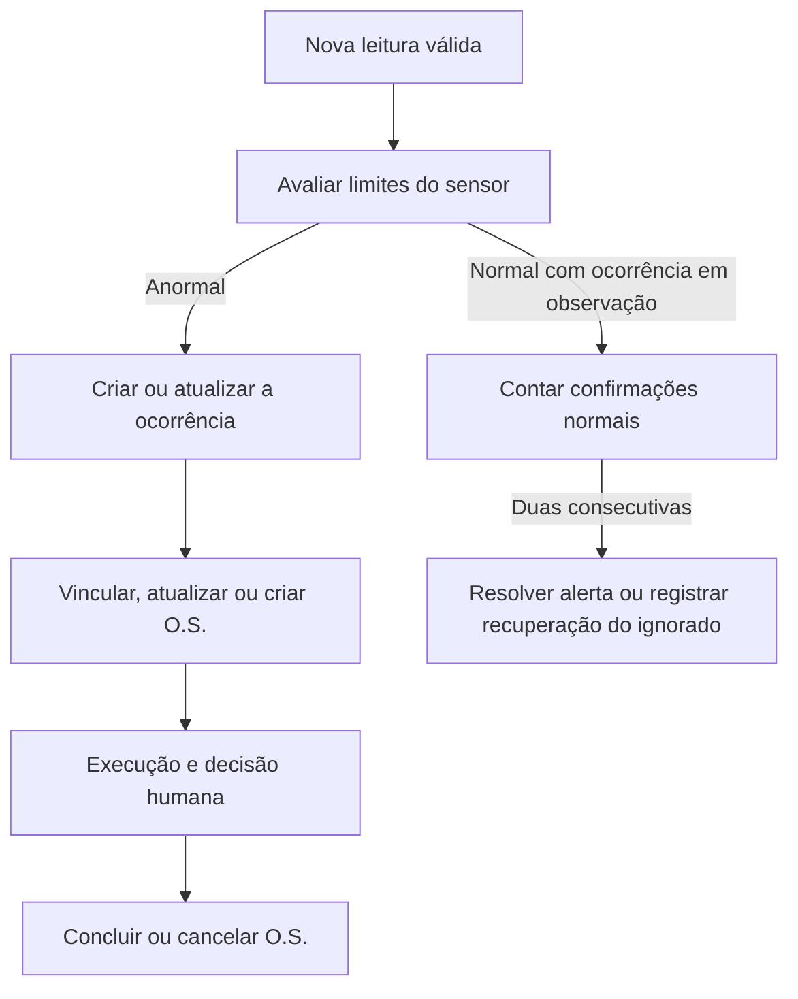

# Alertas e Ordens de Serviço: diagnóstico, regras e adequações

> A partir de 06/11/2026, a especificação vigente de interface, API e evidências está em [Histórico de alertas](HISTORICO_ALERTAS.md). Este documento conserva o diagnóstico anterior. As referências abaixo ao CRUD, criação manual e ações de ignorar/resolver não fazem mais parte da interface/API atual. As regras automáticas de recuperação e associação a O.S. permanecem, com registro da evidência inicial e da maior gravidade também em tendências.

Data: 04/11/2026. Escopo: monitoramento por limite, alertas manuais, integração com O.S. e preservação do fluxo preditivo existente.

Atualização de 06/11/2026: as referências deste documento aos critérios preditivos anteriores são históricas. A revisão em [Identificação de tendências](IDENTIFICACAO_TENDENCIAS.md) passa a definir persistência, desativação, sentidos anormais e geração de OS para toda anomalia confirmada. O fluxo de limites e alertas manuais descrito abaixo permanece vigente.

Este documento registra a análise do código e a especificação implementada. A autorização posterior para corrigir e documentar substituiu a restrição inicial de executar apenas a análise. Não foram criados estados, entidades, telas, integrações ou notificações. Foi acrescentado um relacionamento opcional entre entidades existentes, justificado na seção G.

## A. Diagnóstico do sistema encontrado antes das correções

| Componente e referência | Comportamento efetivamente encontrado |
| --- | --- |
| `telemetria/signals.py::checar_limites_telemetria` | Processava novas leituras de sensores ativos. Usava os percentuais configurados, com padrões 70/85/100. A faixa normal simplesmente retornava, sem resolver alertas. |
| Mesmo sinal | Buscava alerta por equipamento, texto do tipo e status ativo. Não filtrava sensor nem origem. Dois sensores de temperatura podiam compartilhar uma ocorrência e interferir em registros manuais. |
| Mesmo sinal | Só atualizava quando a gravidade aumentava. Não registrava a condição atual nem confirmação de recuperação. Criava alertas sem preencher sensor ou chave de evento. |
| `alertas/signals.py::vincular_ordem_servico_ao_alerta` | Encaminhava qualquer alerta ativo ao serviço de O.S. O comentário dizia médio/crítico, mas o código também criava ordens para nível baixo. |
| `manutencao/services.py::PrioridadeOSService.criar_por_alerta` | Reutilizava ordem aberta pelo título e equipamento. Não preenchia `alerta_origem` nem `sensor_origem`. Renomear uma ordem ou concluir/cancelar a anterior podia permitir outra criação durante a mesma ocorrência. |
| `manutencao/models.py::OrdemServico` | Já possuía `alerta_origem` OneToOne e `sensor_origem` FK opcionais, usados pelo preditivo. `save()` preenchia a data de conclusão. |
| `manutencao/views.py::perform_create/perform_update` | A conclusão pela API gerava histórico idempotente e atribuía o usuário quando necessário. A geração de histórico estava restrita a esse caminho. Não encerrava alertas, o que é coerente. |
| `manutencao/serializers.py::OrdemServicoSerializer` | Impedia reabrir uma ordem concluída, mas permitia reabrir cancelada. O recálculo de prioridade podia reescrever a criticidade registrada na abertura. |
| `telemetria/predictive_service.py::sync_sensor_trend` | Já distinguia origem e sensor, usava chave de evento, preservava episódios resolvidos e resolvia tendências não relevantes sem encerrar O.S. Dados insuficientes não confirmavam recuperação. |
| `manutencao/services.py::criar_por_tendencia` | Já utilizava o alerta de origem para idempotência, preservando ordens concluídas/canceladas. A criação concorrente precisava de bloqueio também quando a ordem ainda não existisse. |
| `alertas/serializers.py::AlertaSerializer` | A API podia criar alertas com origem automática; omitir a origem herdava o padrão `limite`, inclusive para cadastros humanos. A consulta de O.S. alcançava apenas o relacionamento originalmente preditivo. |
| `FrontATT/app.js::assumirOSFromAlerta` | Escolhia qualquer ordem aberta e sem responsável do equipamento, sem garantir que fosse a ordem do alerta selecionado. |

O diagnóstico foi feito sobre modelos, sinais, serviços, serializers, views, interface e testes. Não houve inspeção dos dados do PostgreSQL de desenvolvimento: o serviço local configurado recusou a conexão. Portanto, não se presume que existam ou deixem de existir duplicações históricas nesse banco.

## B. Avaliação das regras existentes

| Comportamento | Classificação inicial | Justificativa e tratamento |
| --- | --- | --- |
| Percentuais configuráveis e comparação inclusiva | Correto | Mantidos, incluindo os padrões existentes. |
| Toda condição fora da faixa, inclusive baixa, pode gerar O.S. | Decisão de negócio pendente | Adotou-se a continuidade do comportamento efetivo: uma O.S. corretiva para investigação, em qualquer nível. Não foi introduzido um novo limiar de criação. |
| Não encerrar O.S. quando o sensor normaliza | Correto | A medição não comprova execução do serviço. Mantido. |
| Não resolver alerta ao concluir O.S. | Correto | A execução não comprova recuperação medida. Mantido. |
| Alerta por equipamento e texto, sem sensor/origem | Inconsistente | Corrigido: identificação por sensor e origem; o texto serve para apresentação. |
| Manter alerta automático ativo indefinidamente após recuperação | Inconsistente | Corrigido com confirmação por duas novas leituras normais consecutivas. |
| Preservar somente a gravidade máxima sem condição atual | Inconsistente | Mantido o pico em `nivel`; condição atual e dados da última observação ficam em `dados_analise`. |
| Reutilizar O.S. apenas pelo título | Inconsistente | Substituído pelo vínculo da ocorrência e pelo sensor em ordens corretivas ainda abertas. |
| Recriar O.S. após cancelamento/conclusão no mesmo episódio | Inconsistente | A associação permanece; a decisão administrativa não é desfeita automaticamente. |
| Reabrir O.S. cancelada | Inconsistente | Cancelada e concluída são estados terminais quanto ao status. |
| Reescrever contexto de criticidade na abertura | Inconsistente | O contexto inicial é preservado; a condição pode evoluir; a prioridade herdada é preservada. |
| Resolução preditiva independente da O.S. | Correto | Algoritmo e critérios preditivos preservados. |
| Usar histerese com outro limite de retorno | Opcional | Não existe parâmetro próprio de recuperação. Criar um percentual novo sem evidência ampliaria a configuração; a confirmação por amostras atende ao escopo. |
| Reproduzir todos os estados e processos de um CMMS corporativo | Opcional | Excluído do escopo acadêmico. |

As decisões de implementação acima estão consolidadas nas regras da seção E; não são apresentadas como exigências normativas.

## C. Fluxo implementado

1. Uma nova leitura é salva em transação, com bloqueio do sensor. Leituras e efeitos dos sinais são confirmados ou revertidos juntos.
2. A análise preditiva existente é executada com seus próprios critérios. Em seguida, o serviço de limite avalia a leitura usando a configuração atual do sensor.
3. Sem anormalidade e sem episódio em observação, não há alerta nem O.S. de limite.
4. A primeira leitura anormal cria uma ocorrência vinculada ao sensor, com origem `limite` e chave `limite:<sensor_id>`.
5. O alerta ativo aciona o serviço de O.S. Se já estiver vinculado a uma ordem, usa essa associação. Caso contrário, uma recorrência pode utilizar a ordem corretiva ainda aberta do mesmo sensor; na ausência dela, cria uma ordem pendente.
6. Leituras anormais seguintes atualizam a condição atual, mantêm o maior nível atingido e zeram a confirmação de recuperação. A ordem aberta pode receber atualização de gravidade e registro textual da nova ocorrência ou agravamento.
7. A primeira leitura abaixo da faixa baixa mantém o alerta ativo. A segunda consecutiva confirma recuperação e resolve o alerta. A ordem permanece em seu estado administrativo atual.
8. O responsável conclui ou cancela a O.S. por ação humana. Concluir gera data e histórico; nenhuma dessas ações altera a condição monitorada.
9. Após recuperação confirmada, outra anormalidade cria outro registro de alerta. Uma ordem ainda aberta é reaproveitada; uma ordem terminal é preservada e uma nova ordem pode ser aberta.



Normalização, resolução e encerramento administrativo não têm uma ordem temporal obrigatória. A O.S. pode ser concluída enquanto o alerta permanece ativo; o alerta pode resolver enquanto a O.S. está pendente ou em andamento. Nem todo alerta preditivo recomenda uma ordem.

## D. Matriz de situações

| Situação | Alerta atual | O.S. atual | Ação | Justificativa |
| --- | --- | --- | --- | --- |
| Leitura abaixo da faixa baixa, sem episódio | Inexistente | Inexistente | Não criar registros operacionais | Condição dentro da faixa. |
| Primeira leitura na faixa baixa/média/crítica | Inexistente | Sem ordem aberta desse sensor | Criar alerta e ordem pendente | Preserva a política já efetiva de investigação em qualquer nível. |
| Mesma condição em várias leituras | Ativo | Pendente/andamento | Atualizar a ocorrência; manter a ordem | Evita duplicação por leitura. |
| Gravidade aumenta | Ativo | Aberta | Registrar pico e atualizar condição; preservar prioridade da OS | A prioridade manual permanece respeitada. |
| Gravidade diminui, mas segue anormal | Ativo | Aberta | Atualizar condição atual; manter pico e prioridade operacional | Evita perder gravidade histórica. |
| Uma leitura normal | Ativo | Qualquer estado | Contar uma confirmação; manter ativo | Normalização isolada não encerra o episódio. |
| Normal, anormal, normal | Ativo | Qualquer estado | Zerar na anormal e contar novamente | A sequência normal foi interrompida. |
| Duas leituras normais consecutivas | Ativo | Pendente | Resolver somente o alerta | A manutenção continua exigindo decisão humana. |
| Duas leituras normais consecutivas | Ativo | Andamento | Resolver somente o alerta | O trabalho em execução não é encerrado pelo sensor. |
| Nenhuma nova leitura, sensor inativo ou limite inválido | Ativo | Qualquer estado | Manter status e confirmação | Ausência de evidência não é recuperação. |
| Conclusão durante anormalidade persistente | Ativo | Concluída | Manter alerta ativo; não recriar ordem | A mesma ocorrência conserva sua associação. |
| Cancelamento durante anormalidade persistente | Ativo | Cancelada | Manter alerta ativo; não recriar ordem | Não desfazer uma decisão administrativa automaticamente. |
| Problema retorna após recuperação | Resolvido anterior | Pendente/andamento anterior | Criar outra ocorrência e vinculá-la à ordem aberta | Preserva episódios sem duplicar trabalho aberto do sensor. |
| Problema retorna após recuperação | Resolvido anterior | Concluída/cancelada anterior | Criar outra ocorrência e outra ordem | O novo episódio não altera o registro encerrado. |
| Usuário ignora alerta de limite | Ativo | Qualquer estado | Alterar para ignorado; manter ordem | Ignorar não significa recuperação nem cancelamento do trabalho. |
| Anormalidade continua após ignorar | Ignorado sem recuperação | Qualquer estado | Atualizar a observação sem outro alerta/O.S. | Respeita a supressão durante o mesmo episódio. |
| Ignorado recupera e depois volta a falhar | Ignorado com recuperação registrada | Aberta ou terminal | Criar outro episódio; reutilizar aberta ou criar ordem | Preserva a decisão de ignorar no histórico anterior. |
| Alerta humano com sensor associado recebe leituras normais | Manual ativo | Qualquer estado | Não resolver automaticamente | Encerramento humano permanece independente. |
| Tendência deixa de ser relevante | Preditivo ativo | Aberta | Resolver pelo serviço preditivo; manter ordem | Preserva o fluxo existente. |
| Dados preditivos insuficientes | Preditivo ativo | Qualquer estado | Não confirmar resolução | Dados insuficientes não provam reversão da tendência. |
| Outro sensor do mesmo tipo apresenta falha | Qualquer | Qualquer | Processar separadamente | Mesmo tipo não identifica o mesmo ponto de medição. |

## E. Regras de negócio definitivas da implementação

- **RN-01 — Origem:** cadastros pela API de alertas são manuais. A API não pode simular origem automática nem alterar a origem de uma ocorrência existente.
- **RN-02 — Faixas:** para limite operacional positivo e finito, calcular `percentual = valor / limite * 100`. Comparar, nesta ordem, com crítico, médio e baixo usando `>=`. Abaixo do baixo é normal. Valores ausentes de configuração mantêm os padrões existentes 70/85/100.
- **RN-03 — Identidade:** alertas de limite são separados por sensor e origem. `tipo_alerta` e título da O.S. não são chaves de deduplicação. A restrição existente de chave ativa única permanece aplicável.
- **RN-04 — Ocorrência:** `evento_chave = limite:<sensor_id>` identifica a condição monitorada, reutilizada entre episódios; o ID de cada alerta identifica a ocorrência histórica. Um episódio resolvido não é reaberto pela telemetria.
- **RN-05 — Gravidade:** `Alerta.nivel` preserva o maior nível do episódio. `dados_analise.nivel_atual` informa `baixo`, `medio`, `critico` ou `normal`. A descrição informa a última observação processada. Leituras brutas permanecem em `Telemetria`.
- **RN-06 — Recuperação:** duas novas leituras válidas consecutivas abaixo da faixa baixa confirmam recuperação. Outra leitura anormal zera a contagem. A escolha de duas amostras é o mínimo para distinguir uma observação isolada de uma confirmação; não representa garantia de estabilidade física ou duração mínima.
- **RN-07 — Evidência:** passagem do tempo, repetição do processamento da mesma leitura, edição de uma leitura já salva, sensor inativo, limite inválido e valores não finitos não confirmam recuperação. A API rejeita leituras não finitas. A análise operacional ocorre na criação individual, não em `bulk_create`, `update` ou carregamento bruto.
- **RN-08 — Configuração:** alterar percentuais ou o limite operacional reinicia a contagem na próxima leitura processada. Os limites da abertura são preservados separadamente dos limites usados na última avaliação.
- **RN-09 — Resolução por limite:** a recuperação confirma `ativo → resolvido`. A API permite ignorar um alerta de limite ativo, mas não forçar sua resolução nem reabrir histórico automático. Não há novo estado intermediário: a contagem fica nos dados da análise.
- **RN-10 — Ignorados:** o episódio ignorado continua sendo observado sem recriação durante a mesma anormalidade. Após duas leituras normais, registrar `recuperado_em` preservando status `ignorado`. Só uma anormalidade posterior inicia outra ocorrência.
- **RN-11 — Criação corretiva:** alertas ativos manuais e de limite, em qualquer nível, recebem O.S. corretiva se não houver associação válida. Alertas manuais distintos não são agrupados automaticamente por nome, equipamento ou sensor.
- **RN-12 — Recorrência com trabalho aberto:** uma nova ocorrência de limite utiliza a ordem corretiva pendente ou em andamento do mesmo sensor e equipamento, originada por limite. Em dados legados com mais de uma candidata, o serviço escolhe a de menor ID; a inconsistência histórica exige triagem, sem fusão automática.
- **RN-13 — Rastreabilidade:** cada alerta tem no máximo uma O.S. de atendimento; uma O.S. pode atender várias ocorrências. `OrdemServico.alerta_origem` mantém a primeira ocorrência; `Alerta.ordem_servico` aponta o atendimento de cada ocorrência. O relacionamento antigo OneToOne é mantido para compatibilidade.
- **RN-14 — Ordens terminais:** se a O.S. da ocorrência já está concluída ou cancelada, leituras e agravamentos mantêm o alerta atualizado, mas não reabrem, modificam ou substituem automaticamente aquela ordem. Persistência requer avaliação humana, inclusive para eventual criação manual de novo trabalho.
- **RN-15 — Recorrência após terminal:** se houve recuperação confirmada e uma nova ocorrência, uma ordem anterior concluída/cancelada não impede outra ordem pendente.
- **RN-16 — Autonomia:** resolução ou supressão de alertas não concluem nem cancelam O.S. Conclusão/cancelamento de O.S. não resolvem nem ignoram alertas.
- **RN-17 — Estados da O.S.:** manter `pendente`, `andamento`, `concluida`, `cancelada`. As duas primeiras são abertas. Concluída e cancelada não mudam de status pela API ou por `OrdemServico.save()`. Mantêm-se os demais caminhos existentes entre estados abertos e terminais, incluindo conclusão direta e cancelamento em andamento.
- **RN-18 — Conclusão:** ao salvar uma ordem concluída, preencher a data se ausente e garantir um único `HistoricoManutencao`, na mesma transação. Na API, se não houver responsável, atribuir o usuário que conclui. O histórico inicial deriva da descrição/título e pode receber o relato e custos pelos mecanismos existentes; não comprova automaticamente que o reparo foi eficaz.
- **RN-19 — Priorização:** copiar a classe ABC do equipamento na abertura. A automação registra agravamentos e novas ocorrências sem alterar a prioridade da OS nem sua referência da abertura. Gestor/admin pode ajustar a prioridade com justificativa e histórico. Ver [Priorização ABC](PRIORIZACAO_ABC.md).
- **RN-20 — Proteção da origem:** campos de diagnóstico automático e relações operacionais são controlados pelo backend na API. Um alerta vinculado não pode trocar de sensor/equipamento, e uma ordem não pode trocar para equipamento incompatível com sua origem.
- **RN-21 — Preditivo:** preservar detecção, resolução, configuração e recomendação de intervenção do serviço de tendência. A O.S. preditiva continua idempotente pelo alerta de origem. A nova FK de atendimento apenas torna esse vínculo acessível de forma uniforme. Ordens por horímetro não tiveram suas regras alteradas.
- **RN-22 — Transações:** ingestão individual bloqueia o sensor; criação/atualização de ordens bloqueia a ocorrência. O banco PostgreSQL é necessário para validar bloqueios de linha. O índice único de evento ativo e o OneToOne de origem permanecem barreiras adicionais.
- **RN-23 — Legado:** migrar automaticamente apenas associações já demonstradas por `alerta_origem` e equipamento compatível. Não inferir sensores, origens humanas ou vínculos corretivos por semelhança textual. Não resolver, cancelar nem excluir registros históricos na migração.

### Dados de análise de limite

`dados_analise` utiliza o campo JSON já existente. Não há tabela nova para contadores.

| Chave | Significado |
| --- | --- |
| `ultima_leitura_id`, `ultima_leitura_em` | Última observação efetivamente processada; evita contar duas vezes a mesma leitura. |
| `ultimo_valor`, `ultimo_percentual`, `nivel_atual` | Condição atual da ocorrência. |
| `nivel_maximo` | Maior gravidade do episódio, também exposta em `Alerta.nivel`. |
| `leituras_normais_consecutivas` | Confirmações consecutivas de recuperação. |
| `recuperado_em` | Instante da leitura que confirmou recuperação. |
| `limites_pct`, `limite_operacional` | Configuração da última avaliação. |
| `limites_na_abertura_pct`, `limite_na_abertura` | Configuração na abertura da ocorrência. |

## F. Cenários de validação

Exemplos abaixo usam limite 100 e percentuais 70/85/100, exclusivamente para tornar os testes reproduzíveis.

| Cenário | Sequência/ação | Resultado esperado |
| --- | --- | --- |
| Normal | `10, 60, 69.9` | Nenhum alerta ou ordem de limite. |
| Fronteiras | `70, 85, 100` | Uma ocorrência baixo → médio → crítico; uma ordem vinculada. |
| Repetição | `90, 90, 90`, reprocessar a última | Uma ocorrência e uma ordem; nenhuma confirmação extra. |
| Redução | `110, 75` | Pico crítico, condição atual baixa; ordem não perde prioridade. |
| Oscilação | `90, 60, 90, 60` | Alerta ativo, uma confirmação normal. |
| Recuperação | Acrescentar `60` à sequência anterior | Alerta resolvido; ordem permanece aberta. |
| Sem novas leituras | `90, 60`, apenas consultar/editar a leitura | Alerta ativo; confirmação permanece em uma. |
| Sensores iguais em tipo | Falhas em dois sensores de temperatura | Dois alertas e duas ordens separadas; recuperação de um não resolve o outro. |
| Recorrência com ordem aberta | `90, 60, 60, 110` | Dois alertas históricos e uma ordem compartilhada. |
| Ordem renomeada/em andamento | Renomear ordem, recuperar, falhar novamente | Reutilizar a mesma ordem pelo sensor, sem depender do título. |
| Conclusão antes da recuperação | `90`, concluir, `110, 110` | Alerta ativo e agravado; ordem concluída, sem duplicação. |
| Cancelamento antes da recuperação | `90`, cancelar, `110, 110` | Alerta ativo; ordem cancelada, sem recriação automática. |
| Falha após terminal e recuperação | Encerrar ordem, `60, 60, 90` | Novo alerta e nova ordem pendente. |
| Prioridade manual | Definir prioridade manual, elevar leitura | Preservar prioridade humana; atualizar gravidade sem alterar a prioridade ou a referência da abertura. |
| Ignorado | `90`, ignorar, `110, 60, 110` | Mesmo episódio ignorado; não abrir outros. |
| Recorrência após ignorado recuperado | Acrescentar `60, 60, 110` | Preservar ignorado anterior com recuperação; criar outro episódio. |
| Manual independente | Criar manual com sensor, `90, 60, 60` | Manual ativo; alerta automático resolvido. |
| Origem protegida | Tentar criar origem `limite` pela API | Rejeitar com 400. |
| Estados terminais | Tentar reabrir concluída/cancelada | Rejeitar pela API e pelo modelo. |
| Conclusão repetida | Concluir e salvar novamente | Mesma data e um único histórico. |
| Sensor inativo/limite inválido | Receber leituras baixas nessas condições | Não confirmar recuperação. |
| Configuração alterada | Uma normal, alterar faixa, outra normal | Reiniciar confirmação; exigir outra normal na configuração nova. |
| Falha de serviço | Exceção durante criação de ordem | Reverter leitura, alerta e ordem da transação. |
| Tendência | Série crescente, depois série estável | Resolver tendência pelo algoritmo existente; manter sua ordem. |
| Preditiva concluída | Reanalisar mesmo episódio após concluir O.S. | Mesma ordem concluída, sem recriação. |
| Migração | Origem conhecida e legado sem sensor/vínculo | Preencher somente o vínculo conhecido; preservar demais registros. |
| Concorrência | Duas ingestões ou processamentos simultâneos | Uma ocorrência/ordem por condição, sem corrida de criação. |

Testes: `telemetria/test_alert_lifecycle.py`, `telemetria/test_alert_concurrency.py`, `telemetria/test_trend_analysis.py`, `alertas/test_migrations.py`, além da suíte preexistente.

As fixtures preditivas foram ajustadas para gravar horários distintos após `bulk_create`, pois `auto_now_add` sobrescrevia os horários fornecidos. As expectativas de prioridade agora verificam a herança ABC imutável da abertura. Nenhuma fórmula preditiva foi alterada.

## G. Plano mínimo de adequação e resultado

| Prioridade/dependência | Adequação | Resultado |
| --- | --- | --- |
| 1 | Identificar ocorrências por sensor/origem e registrar condição atual/pico | Implementado em `telemetria/limit_service.py`, acionado pelo sinal de leitura. |
| 2, depende de 1 | Confirmar recuperação, tratar oscilação e ignorados | Implementado com JSON e status existentes. |
| 3 | Permitir várias ocorrências atendidas por uma ordem aberta | Acrescentada FK opcional `Alerta.ordem_servico`. |
| 4, depende de 1 e 3 | Vincular corretivas, reutilizar trabalho aberto, preservar terminais | Implementado em `PrioridadeOSService` e sinal do alerta. |
| 5 | Proteger conclusão, cancelamento e contexto de abertura | Implementado no modelo/serializer da O.S.; histórico centralizado no modelo. |
| 6, depende de 3 e 4 | Expor vínculo uniforme e assumir ordem correta | `ordem_servico_id` existente passou a servir a todas as origens; botão existente usa o ID vinculado. |
| 7 | Adequar formulários às permissões de edição e exibir atual/pico | Ajustes na tela existente de alertas; sem novas telas. |
| 8 | Assegurar persistência e reprodução das alterações | Migrações iniciais versionadas e migração incremental com preenchimento de vínculos conhecidos. |
| 9 | Validar cenários e publicar regras | Testes automatizados, este documento e referências em README/API/banco. |

### Necessidade da alteração estrutural

O OneToOne existente em `OrdemServico.alerta_origem` representa apenas a ocorrência inicial. Se o sensor recupera, volta a falhar e a ordem continua aberta, há duas ocorrências atendidas pelo mesmo trabalho. Trocar o alerta de origem apagaria a relação histórica anterior; criar outra ordem duplicaria o trabalho; esconder IDs no JSON perderia integridade referencial.

A FK opcional de alerta para ordem representa essa relação N:1 diretamente. O relacionamento original continua preservado. Não foi criado modelo de associação nem generalização para múltiplas ordens automáticas por alerta; isso não é necessário para a política adotada.

### Estrutura de migrações

O repositório ignorava todos os arquivos de migração, mantendo somente `__init__.py`. Para tornar o banco reproduzível, foram geradas migrações iniciais do esquema anterior para `accounts`, `ativos`, `telemetria`, `alertas`, `manutencao` e `gemini_api`.

`alertas/0002_alerta_ordem_servico_alter_alerta_origem` acrescenta a FK, altera o padrão de novas origens para `manual` e preenche vínculos demonstrados pelo relacionamento anterior. Alterar o padrão não reclassifica registros antigos. As migrações passam a ser versionadas pelo Git.

## H. Decisões e pendências reais

As escolhas necessárias ao fluxo novo foram tomadas e justificadas nas RN-06, RN-11, RN-12, RN-14 e RN-17. Não há uma lista de regras supostamente definitivas que dependa de aprovação não obtida para funcionar.

Há duas pendências de ambiente/dados que o código não pode decidir sozinho:

1. **Compatibilidade do banco de desenvolvimento:** o PostgreSQL configurado em `app/settings.py` estava indisponível. É necessário conferir o histórico real de migrações e o esquema antes de aplicar as alterações. Recomendação: utilizar uma cópia do banco e seguir o procedimento abaixo.
2. **Registros legados ambíguos:** sem sensor ou alerta de origem, o texto não demonstra qual ocorrência originou uma ordem nem se um alerta era humano. Recomendação: triagem humana dos registros ativos e das ordens abertas, preservando os IDs e o histórico. A automação nova não utiliza esses registros ambíguos como prova de identidade; durante a transição podem coexistir registros antigos não classificados e ocorrências novas corretas.

Ajustar a quantidade de amostras com evidência da cadência/ruído real, alterar a política de ordens de nível baixo ou restringir cancelamento de trabalho em andamento são revisões opcionais futuras, não bloqueios da implementação atual.

## Comparação conceitual com CMMS/GMAO e monitoramento

A documentação oficial do [IBM Maximo sobre monitoramento de condição](https://www.ibm.com/docs/en/masv-and-l/maximo-manage/cd?topic=monitoring-working-condition) descreve pontos de medição e faixas aceitáveis associados à possibilidade de gerar ordens quando as leituras saem dessas faixas. O conceito aproveitado aqui é distinguir a evidência medida do trabalho que a atende; a política de geração automática do NanaSmart é uma decisão própria.

A documentação oficial de [estados de ordens do Maximo](https://www.ibm.com/docs/en/masv-and-l/maximo-manage/cd?topic=orders-work-order-statuses) distingue execução física concluída, fechamento administrativo e cancelamento. Isso fundamenta a comparação entre condição e processo de manutenção, mas não obriga copiar os estados corporativos. O NanaSmart mantém seus quatro estados e utiliza `concluida` como encerramento simplificado, sem acrescentar outro fechamento. Também mantém a possibilidade existente de cancelar em andamento; essa é uma simplificação local, diferente das restrições padrão descritas pela IBM.

Rastrear o ponto monitorado, preservar episódios e evitar trabalho duplicado são objetivos de projeto coerentes com essa separação. Duas amostras, gravidade de pico, uma ordem aberta por sensor e supressão da recriação após cancelamento são decisões locais documentadas, não regras universais de mercado. Nenhuma exigência normativa específica foi demonstrada ou implementada como certificação.

## Atualização do banco e compatibilidade

### Banco novo e vazio

Com PostgreSQL disponível e dependências instaladas:

```powershell
python manage.py migrate --plan
python manage.py migrate
python manage.py check
```

### Banco existente

1. Preservar uma cópia do banco antes de alterações e conferir `python manage.py showmigrations --plan`.
2. Recuperar migrações locais anteriores, se existirem fora do Git, e comparar nomes, dependências e operações com as migrações iniciais agora versionadas. Não substituir um histórico divergente automaticamente.
3. Comparar o esquema existente com as migrações `0001_initial`: colunas, tipos, índices, restrições e relações. A presença das tabelas não comprova equivalência do esquema.
4. Somente se o banco corresponde ao esquema inicial, avaliar `python manage.py migrate --fake-initial --plan` e executar `python manage.py migrate --fake-initial`. O Django pode reconhecer tabelas iniciais já presentes; a migração `0002` deve ser executada de verdade para acrescentar a coluna e os vínculos. `--fake-initial` não faz uma validação completa do esquema.
5. Conferir os vínculos antigos conhecidos e executar os cenários funcionais. Fazer a triagem dos registros ambíguos descritos na seção H.

Não executar `--fake` indiscriminadamente, apagar tabelas ou executar o seed como forma de migração. A centralização do histórico exigiu que o seed use `update_or_create` para completar o histórico já criado pelo modelo. O seed destrutivo não foi usado para validar esta alteração.

## Verificação e limites da entrega

Configuração de testes: `app/test_settings.py`; SQLite em memória por padrão, sem uso das credenciais de desenvolvimento. A suíte deve incluir explicitamente `gemini_api.tests`, pois esse diretório não possui `__init__.py` e pode ser omitido pela descoberta padrão.

```powershell
python manage.py test accounts authentication ativos telemetria alertas manutencao exportacao gemini_api.tests --settings=app.test_settings --noinput
python manage.py check --settings=app.test_settings
python manage.py makemigrations --check --dry-run --settings=app.test_settings
node --check FrontATT/app.js
```

Para testar bloqueios de linha, `NANASMART_TEST_POSTGRES_PORT` seleciona um PostgreSQL dedicado em `127.0.0.1`, usuário `postgres`, banco administrativo `postgres`. O Django cria o banco separado `test_nanasmart_alertas`. Essa opção é destinada ao ambiente de testes dedicado, não ao servidor com dados de desenvolvimento.

Resultados observados em 04/11/2026:

- SQLite em memória: 87 testes, 85 aprovados e dois de bloqueios de linha pulados por indisponibilidade desse recurso no SQLite.
- PostgreSQL 18.6 temporário e exclusivo para testes: os 87 testes aprovados, incluindo ingestão simultânea e criação concorrente de ordem. O banco de testes foi destruído pelo Django e o servidor temporário foi encerrado.
- `manage.py check`: nenhuma inconsistência identificada.
- `makemigrations --check --dry-run`: nenhuma alteração de modelo sem migração.
- `node --check FrontATT/app.js`: sintaxe válida.
- `git diff --check`: sem erros de whitespace.

Ambiente de validação: Python 3.10.8, Django 5.2.12 e Django REST Framework 3.16.1, em `.venv` local. As dependências principais seguem as versões do projeto; algumas dependências auxiliares foram resolvidas nas versões disponíveis, sem alterar `requirements.txt`. Não houve chamadas reais ao Gemini durante os testes.

Para os testes PostgreSQL, utilizou-se a instalação PostgreSQL 18 disponível na máquina, cluster descartável em `.venv/nanasmart-pg-tests`, somente loopback, porta 55439, e `NANASMART_TEST_POSTGRES_PORT=55439`. A configuração de desenvolvimento em `app/settings.py` não foi alterada. As migrações foram executadas integralmente nos bancos de teste; não foram aplicadas ao banco de desenvolvimento indisponível.

A interface recebeu verificação de sintaxe e inspeção dos trechos alterados; isso não equivale a um teste visual completo no navegador.

Chamadas diretas a `QuerySet.update`, `bulk_create` e SQL não executam os ciclos de `save()`/sinais. Importadores históricos já utilizavam esse comportamento e não foram transformados em ingestão operacional. As garantias de transação e histórico descritas se aplicam aos caminhos suportados pelo modelo/API, preservadas as permissões existentes.
