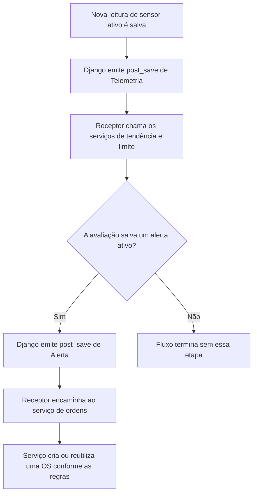
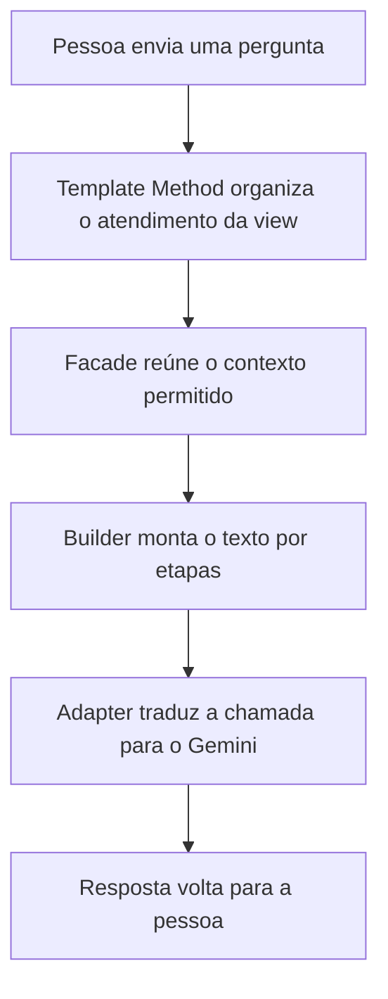

# Padrões de projeto em uso no NanaSmart

**Revisado em:** 16 de novembro de 2026.

Este documento apresenta primeiro os padrões que têm uso real no projeto, na ordem combinada: **criação, estruturais e comportamentais**. As seções explicam o conceito, mostram onde procurar no código e acompanham exemplos do funcionamento.

| Situação dos 12 padrões analisados | Quantidade | Padrões |
|---|---:|---|
| Aplicados nos componentes do projeto | **7** | Builder, Factory Method, Adapter, Facade, Observer, Strategy e Template Method |
| Utilizados por mecanismos do Python/Django | **3** | Singleton, Iterator e Composite no ORM |
| Sem implementação própria, por falta de necessidade | **2** | Abstract Factory e Decorator GoF |

**Total: 12 analisados, sendo 10 em uso e 2 sem necessidade de implementação própria.**

Observer e Template Method também aproveitam infraestrutura do Django/DRF, mas já estão contados entre os sete; não serão contados novamente.

Singleton está incluído nos três usos fornecidos pelo Python/Django, junto de Iterator e Composite.

## Como ler

Comece pela explicação cotidiana, veja a indicação de quem fornece o mecanismo e depois abra os arquivos vinculados. Os nomes de classes e funções correspondem ao código real. Os trechos Python são recortes do projeto; diagramas e sequências em texto ajudam a visualizar as chamadas.

**Criação** organiza como os objetos são construídos. **Estrutura** organiza como componentes se conectam. **Comportamento** organiza regras, etapas e reações. As linhas indicadas nos links correspondem ao código conferido e podem mudar em versões futuras.

## Sumário dos padrões e recursos relacionados

**Criação:**

- [1. Builder](#1-builder) — implementação do projeto.
- [2. Factory Method](#2-factory-method) — implementação do projeto.
- [3. Singleton](#3-singleton) — utilizado por recursos compartilhados do Django/Python.

**Estruturais:**

- [4. Adapter](#4-adapter) — implementação do projeto.
- [5. Facade](#5-facade) — implementação do projeto.
- [6. Composite](#6-composite) — fornecido pelo Django/ORM.

**Comportamentais:**

- [7. Iterator](#7-iterator) — fornecido pelo Python/Django.
- [8. Observer](#8-observer) — sinais do Django e receptores do projeto.
- [9. Strategy](#9-strategy) — implementação do projeto.
- [10. Template Method](#10-template-method) — implementação do projeto sobre o DRF.

## Mapa dos usos

| Categoria | Padrão | Quem fornece / implementa | Para que é usado |
|---|---|---|---|
| Criação | Builder | Implementação do projeto | Montar o texto da IA em etapas. |
| Criação | Factory Method | Implementação do projeto | Criar o gerador de CSV, Excel ou PDF. |
| Criação | Singleton | Recursos compartilhados gerenciados pelo Django/Python | Acessar configurações, loggers e gerenciamento de conexões já disponíveis. |
| Estruturais | Adapter | Implementação do projeto | Traduzir as chamadas para o Gemini. |
| Estruturais | Facade | Implementação do projeto | Reunir os dados da IA por uma entrada simples. |
| Estruturais | Composite | Fornecido pelo Django/ORM | Combinar grupos e condições nas consultas. |
| Comportamentais | Iterator | Fornecido pelo Python/Django | Percorrer leituras sem montar uma lista completa. |
| Comportamentais | Observer | Sinais do Django e receptores do projeto | Reagir ao salvamento de leituras e alertas. |
| Comportamentais | Strategy | Implementação do projeto | Escolher uma regra de permissão. |
| Comportamentais | Template Method | Implementação do projeto sobre o DRF | Reaproveitar a sequência de atendimento das views. |

## Padrões de criação

### 1. Builder

**Builder — montar em etapas.** Serve para construir um resultado que pode ter várias partes e combinações. Cada etapa acrescenta uma parte, e ao final o construtor entrega o resultado completo. É como montar um sanduíche escolhendo seus ingredientes. No NanaSmart, o Builder monta prompts para a IA com blocos como contexto, alertas, ordens e pergunta. Isso facilita criar prompts diferentes sem repetir toda a montagem.

**Como está disponível:** implementado no código do projeto e utilizado pelos endpoints indicados abaixo.

#### Problema resolvido

O chat, a análise de ordens e a análise financeira precisam de textos com partes diferentes. O Builder separa a preparação de cada bloco da receita que determina quais blocos entram em cada pedido.

#### Onde está e quais classes participam

| Classe ou função | Localização | Responsabilidade |
|---|---|---|
| `PromptBuilder` | [prompt_builder_pattern.py, linha 4](../../gemini_api/prompt_builder_pattern.py#L4) | Define as etapas disponíveis: contexto, alertas, ordens, telemetria, financeiro, instruções, pergunta, conclusão e reinicialização. |
| `PromptBuilderConcreto` | [prompt_builder_pattern.py, linha 42](../../gemini_api/prompt_builder_pattern.py#L42) | Guarda os blocos em `_blocos`, formata o texto, limita algumas listas e entrega o produto. |
| `PromptDirector` | [prompt_director.py, linha 4](../../gemini_api/prompt_director.py#L4) | Define as receitas de chat, análise de ordens, ordens não atribuídas e finanças. |
| `Prompt` | [prompt.py, linha 1](../../gemini_api/prompt.py#L1) | Guarda o texto final e o entrega por `obter_texto()`. |
| `build_chat_prompt` e funções semelhantes | [prompt_builder.py, linha 119](../../gemini_api/prompt_builder.py#L119) | Preparam cabeçalhos e instruções, criam o builder e chamam o diretor. |
| `GeminiBaseView.get_prompt` e subclasses | [views.py, linha 218](../../gemini_api/views.py#L218) | Conectam a construção do prompt aos endpoints. |

#### Código que mostra o padrão

O começo da receita de chat em `PromptDirector.montar_chat` mostra as etapas:

```python
builder.reset()
builder.com_contexto(context_str)
builder.com_alertas(context.get('alert_summary', []))
builder.com_ordens(context.get('open_order_summary', []), "ORDENS EM ABERTO")
```

A mesma receita acrescenta indicadores quando disponíveis, telemetria e pergunta. No builder concreto, a etapa final é:

```python
def build(self) -> Prompt:
    resultado = "\n".join(self._blocos)
    return Prompt(resultado)
```

Em `build_chat_prompt`, a conexão entre as peças é:

```python
builder = PromptBuilderConcreto()
prompt = PromptDirector.montar_chat(builder, context, context_str, message)
return prompt.obter_texto()
```

Em linguagem simples: cria-se um montador, escolhe-se a receita de chat e obtém-se o texto pronto.

#### Exemplo do fluxo real

1. Uma pessoa envia uma pergunta para `POST /api/gemini/chat/`.
2. `GeminiChatView` usa `build_chat_prompt`.
3. A função prepara o cabeçalho e cria `PromptBuilderConcreto`.
4. `PromptDirector.montar_chat` ordena as etapas.
5. O builder gera um `Prompt`, cujo texto será encaminhado à integração com a IA.

#### Por que a classificação é válida

Há um contrato de construção, um construtor concreto, um diretor com receitas e um produto final. Além de existirem, eles são chamados pelas funções utilizadas nas views.

**Benefício observado na organização:** a receita de cada solicitação fica separada das regras de formatação dos blocos. Isso facilita localizar onde alterar a ordem das informações ou sua apresentação.


### 2. Factory Method

**Factory Method — deixar um criador decidir o que produzir.** Serve para separar o código que precisa de um objeto do código que sabe construir o tipo concreto. Pense em uma oficina com criadores especializados: cada um sabe produzir seu tipo de peça. No NanaSmart, criadores de exportadores produzem o objeto adequado para CSV, Excel ou PDF; a view usa a interface comum para gerar o arquivo.

**Como está disponível:** implementado no código do projeto e utilizado pelos endpoints indicados abaixo.

#### Problema resolvido

Os dados de uma exportação são preparados pela view, enquanto o trabalho de gerar cada formato fica em classes próprias. A escolha e a criação do exportador são encaminhadas aos criadores.

#### Onde está e quais classes participam

| Classe ou arquivo | Localização | Papel |
|---|---|---|
| `Exportador` | [base_exporter.py, linha 4](../../exportacao/utils/base_exporter.py#L4) | Contrato do produto: `exportar(nome, titulo, colunas, linhas)`. |
| `ExportadorCSV` | [csv_exporter.py, linha 8](../../exportacao/utils/csv_exporter.py#L8) | Gera CSV com a biblioteca `csv`. |
| `ExportadorExcel` | [excel_exporter.py, linha 11](../../exportacao/utils/excel_exporter.py#L11) | Gera uma planilha `.xlsx` com `openpyxl`. |
| `ExportadorPDF` | [pdf_exporter.py, linha 20](../../exportacao/utils/pdf_exporter.py#L20) | Gera PDF com ReportLab. |
| `CriadorExportador` | [creators.py, linha 9](../../exportacao/utils/creators.py#L9) | Declara o método abstrato `criar_exportador()`. |
| `CriadorExportadorCSV`, `CriadorExportadorExcel`, `CriadorExportadorPDF` | [creators.py, linha 18](../../exportacao/utils/creators.py#L18) | Cada subclasse implementa o método e cria seu exportador. |
| `ExportadorFactory` | [exporter_factory.py, linha 4](../../exportacao/utils/exporter_factory.py#L4) | Localiza a classe criadora pelo nome do formato e delega a criação. |
| Registro dos formatos | [utils/__init__.py](../../exportacao/utils/__init__.py) | Associa `csv`, `excel` e `pdf` aos respectivos criadores. |
| `_despachar_formato` | [exportacao/views.py, linha 47](../../exportacao/views.py#L47) | Pede o exportador e chama `exportar`. |

#### Código que mostra o padrão

Em `creators.py`, o criador base define a operação e a subclasse decide qual objeto construir:

```python
class CriadorExportador(ABC):
    """Creator do Factory Method para uma família de exportadores."""

    @abstractmethod
    def criar_exportador(self) -> Exportador:
        """Cria o exportador escolhido pelo criador concreto."""
        raise NotImplementedError


class CriadorExportadorCSV(CriadorExportador):
    def criar_exportador(self) -> ExportadorCSV:
        return ExportadorCSV()
```

As subclasses de Excel e PDF fazem a mesma especialização para seus produtos. Na fábrica de apoio, a delegação aparece nesta linha:

```python
return criador_cls().criar_exportador()
```

Na view, o uso é comum a qualquer formato:

```python
exportador = ExportadorFactory.criar(formato)
return exportador.exportar(nome, titulo, colunas, linhas)
```

#### Exemplo do fluxo real

Uma requisição a `GET /api/exportar/equipamentos/pdf/` segue esta sequência explicativa:

```text
ExportarEquipamentosView prepara as colunas e linhas
    -> _despachar_formato recebe "pdf"
    -> ExportadorFactory encontra CriadorExportadorPDF
    -> criar_exportador() produz ExportadorPDF
    -> exportar(...) devolve o arquivo para download
```

O mesmo mecanismo atende ordens de serviço, equipamentos, alertas, telemetria, histórico e dashboard. As rotas estão em [exportacao/urls.py](../../exportacao/urls.py).

#### Por que a classificação é válida

O ponto que caracteriza **Factory Method** é o método de criação declarado no criador base e implementado pelas subclasses. O registro de formatos apenas escolhe o criador; ele não é, sozinho, a comprovação do padrão.

**Benefício observado na organização:** a função que despacha a exportação não precisa importar cada gerador concreto nem executar a lógica de geração dos três formatos.

#### Limites importantes

Para acrescentar outro formato, seria necessário implementar o produto, seu criador e o registro. Também seria preciso revisar validações, mensagens, documentação e opções da interface que enumerem os formatos. A extensão do mecanismo central não significa que todos esses pontos já aceitem qualquer formato novo.

Um formato sem registro resulta em `ValueError`, tratado pela view com resposta HTTP 400. A mensagem atual orienta usar CSV, Excel ou PDF.


### 3. Singleton

**Singleton — recursos compartilhados pelo Django/Python.** A ideia é reutilizar um recurso central em vez de criar uma cópia a cada solicitação. No NanaSmart, esse uso aparece nos objetos e serviços compartilhados que o Django e o Python já disponibilizam, como configurações e loggers.

**Como está disponível:** utilizado por meio dos recursos compartilhados do Django/Python.

#### Uma comparação simples

Pense em um quadro oficial de avisos: as pessoas consultam o mesmo quadro em vez de cada uma manter uma cópia. As configurações do Django funcionam como um ponto central de consulta. Os módulos da aplicação acessam o objeto disponibilizado pela biblioteca dentro do processo.

#### Onde aparece no NanaSmart

| Recurso | Onde procurar | Como é usado |
|---|---|---|
| Configurações `settings` | [app/urls.py, linha 19](../../app/urls.py#L19) e [app/settings.py](../../app/settings.py) | O arquivo de rotas consulta o objeto fornecido pelo Django para decidir a configuração de arquivos de mídia no ambiente de desenvolvimento. |
| Loggers por nome | [manutencao/views.py, linha 23](../../manutencao/views.py#L23) e [app/exceptions.py, linha 8](../../app/exceptions.py#L8) | O código pede um logger pelo nome do módulo. O Python reutiliza o logger para pedidos com o mesmo nome dentro do processo. |
| Gerenciamento de conexões | [gemini_api/context_service.py, linha 11](../../gemini_api/context_service.py#L11), consultas dos modelos e [configuração do banco](../../app/settings.py) | O ORM utiliza o gerenciador de conexões do Django; as views não precisam criar uma conexão PostgreSQL manual para cada consulta. |

#### Exemplo 1: consultar as configurações compartilhadas

Em `app/urls.py`, `from django.conf import settings` importa o ponto de acesso fornecido pelo Django. O mesmo arquivo o consulta neste trecho real:

```python
if settings.DEBUG:
    urlpatterns += static(settings.MEDIA_URL, document_root=settings.MEDIA_ROOT)
```

Em linguagem simples: o arquivo pergunta às configurações se o ambiente está em modo de desenvolvimento. Se estiver, usa as configurações de mídia para acrescentar as rotas correspondentes. Ele não precisa construir um objeto novo de configurações para fazer essa pergunta.

Internamente, `django.conf.settings` é um objeto `LazySettings`: um proxy compartilhado que carrega as configurações quando necessário.

#### Exemplo 2: reutilizar um logger pelo nome

Em `manutencao/views.py`, o projeto utiliza:

```python
import logging
logger = logging.getLogger(__name__)
```

`__name__` identifica o módulo. Pedir novamente `logging.getLogger` com o mesmo nome reutiliza o logger registrado naquele processo. Nomes diferentes podem produzir loggers diferentes.

É como procurar uma ficha pelo nome no mesmo catálogo: ao pedir a mesma ficha novamente, você reutiliza o registro já disponível.

#### Exemplo 3: usar o gerenciador de conexões do Django

As consultas por `Equipamento.objects`, `OrdemServico.objects` e outros modelos passam pelo ORM. No Django, `django.db.connections` disponibiliza um `ConnectionHandler`, e `django.db.connection` é um proxy para o alias padrão.

```text
Código do NanaSmart faz uma consulta pelo modelo
    -> ORM acessa o gerenciador de conexões do Django
    -> gerenciador obtém a conexão do alias e contexto de execução
    -> a consulta é encaminhada ao banco
```

O gerenciador obtém e reutiliza as conexões de acordo com o alias de banco e o contexto de execução.

A opção `CONN_MAX_AGE = 60`, presente em `app/settings.py`, permite reutilização conforme o ciclo de vida das conexões do Django.

#### Por que é usado

O projeto aproveita configurações centralizadas, loggers registrados e gerenciamento de conexões da biblioteca. Isso evita repetir no NanaSmart um gerenciamento que já é oferecido pelo Python/Django.

**Decisão:** manter o uso dos recursos já fornecidos pelo Python/Django. Singleton é contabilizado nesse grupo, junto de Iterator e Composite. O resumo fica em **7 + 3 + 2**.

## Padrões estruturais

### 4. Adapter

**Adapter — traduzir entre interfaces.** Serve para conectar dois componentes que esperam formatos ou formas de chamada diferentes. É como um adaptador de tomada: ele permite ligar um aparelho a uma tomada com outro encaixe. No NanaSmart, o adapter recebe instruções e histórico no formato da aplicação, converte esses dados para o formato do Gemini e entrega a resposta ao sistema. Isso concentra a tradução para o serviço externo em um lugar.

**Como está disponível:** implementado no código do projeto e utilizado pelos endpoints indicados abaixo.

#### Problema resolvido

As views não precisam montar diretamente os objetos `Content`, `Part` e `GenerateContentConfig` do SDK Google GenAI. Essa preparação fica concentrada no adaptador.

#### Onde está e quais classes participam

| Classe ou função | Localização | Responsabilidade |
|---|---|---|
| `AssistenteAdapter` | [adapters.py, linha 8](../../gemini_api/adapters.py#L8) | Define o contrato de disponibilidade e geração de conteúdo da aplicação. |
| `GeminiAdapter` | [adapters.py, linha 27](../../gemini_api/adapters.py#L27) | Implementa a tradução e chama o SDK Gemini. |
| `get_ai_adapter` | [adapters.py, linha 112](../../gemini_api/adapters.py#L112) | Fornece uma nova instância de `GeminiAdapter`. |
| `generate_content` e `is_gemini_available` | [cliente.py](../../gemini_api/cliente.py) | Mantêm as funções de entrada usadas pelo restante da aplicação e delegam ao adaptador. |
| `GeminiBaseView.run_gemini` | [views.py, linha 224](../../gemini_api/views.py#L224) | Encaminha a solicitação da view pela função de geração. |
| `OrdemServicoViewSet.analise_ia` | [manutencao/views.py, linha 54](../../manutencao/views.py#L54) | Também usa as funções de `cliente.py` na análise individual de OS. |

#### Código que mostra o padrão

Ao converter o histórico, `GeminiAdapter.generate_content` executa:

```python
role = "user" if item.get("role") == "user" else "model"
contents.append(
    types.Content(
        role=role,
        parts=[types.Part.from_text(text=item.get("text", ""))],
    )
)
```

O histórico simples da aplicação vira objetos do SDK, incluindo a conversão do papel da mensagem para `user` ou `model`. Na chamada ao provedor:

```python
response = client.models.generate_content(
    model=model_name,
    contents=contents,
    config=config,
)
return response.text, model_name
```

A aplicação recebe o texto e o nome do modelo utilizado, sem precisar manipular o objeto completo da resposta do SDK.

#### Exemplo do fluxo real

```text
View pede uma resposta com instrução, prompt e histórico
    -> cliente.generate_content(...)
    -> get_ai_adapter() fornece GeminiAdapter
    -> adaptador converte os dados para os tipos do SDK
    -> SDK faz a chamada ao Gemini
    -> adaptador devolve texto e modelo utilizado
```

#### Por que a classificação é válida

Existe um contrato voltado à aplicação e uma implementação que o traduz para a interface externa. A tradução de dados está presente no código e é utilizada pelos pontos de entrada da IA.

**Benefício observado na organização:** os detalhes de formatação da chamada ao Gemini ficam concentrados no adaptador.


### 5. Facade

**Facade — oferecer uma entrada mais simples.** Serve para apresentar uma operação de alto nível que coordena serviços ou partes de um sistema. Pense em uma recepção: você faz uma solicitação em um único lugar, e ela encaminha as etapas necessárias. No NanaSmart, a fachada prepara o contexto para a IA, reunindo os dados comuns e incluindo o resumo financeiro quando solicitado pela view.

**Como está disponível:** implementado no código do projeto e utilizado pelos endpoints indicados abaixo.

#### Problema resolvido

A view precisa de dados de equipamentos, ordens, alertas e telemetria. Algumas solicitações também precisam de informações financeiras. A fachada oferece um ponto para coordenar essa escolha.

#### Onde está e quem participa

| Classe ou função | Localização | Responsabilidade |
|---|---|---|
| `GeminiContextFacade` | [facades.py, linha 4](../../gemini_api/facades.py#L4) | Expõe `build_context` e coordena o contexto comum com a inclusão financeira opcional. |
| `build_base_context` | [context_service.py, linha 151](../../gemini_api/context_service.py#L151) | Reúne consultas, contagens e resumos operacionais. |
| `get_financial_summary` | [context_service.py, linha 115](../../gemini_api/context_service.py#L115) | Prepara os números e os resumos financeiros. |
| `get_user_equipment_queryset` e demais funções auxiliares | [context_service.py](../../gemini_api/context_service.py) | Buscam dados e aplicam os recortes usados pelo serviço de contexto. |
| `GeminiBaseView.build_context` | [views.py, linha 232](../../gemini_api/views.py#L232) | Usa a fachada e informa se precisa do resumo financeiro. |
| `GeminiFinanceView` | [views.py, linha 307](../../gemini_api/views.py#L307) | Configura `requires_financial_summary = True`. |

#### Código que mostra o padrão

A implementação da fachada é pequena:

```python
class GeminiContextFacade:
    """Oferece às views uma entrada única para montar o contexto da IA."""

    def build_context(self, user, *, include_financial_summary=False):
        context = build_base_context(user)
        if include_financial_summary:
            context["financial_summary"] = get_financial_summary(user)
        return context
```

Na view base, a entrada utilizada é:

```python
def build_context(self, user):
    return self.context_facade_class().build_context(
        user,
        include_financial_summary=self.requires_financial_summary,
    )
```

#### Exemplo do fluxo real

No chat, a configuração padrão pede o contexto comum. Na solicitação financeira, `GeminiFinanceView` ativa o resumo financeiro. A fachada recebe essa escolha e coordena os serviços necessários.

#### Por que a classificação é válida

A view usa uma entrada de nível mais alto, sem coordenar diretamente a combinação dos dois serviços. A maior parte do trabalho de consulta continua em `context_service.py`; a fachada é uma camada fina de coordenação.

**Benefício observado na organização:** a decisão de incluir os dados financeiros fica concentrada nessa entrada, e a view base mantém uma forma comum de solicitar o contexto.

#### Limites importantes

- A fachada não faz a chamada ao Gemini e não monta o texto final do prompt.
- Sua existência não prova redução de consultas ao banco nem ganho de velocidade. O benefício identificado é de organização.
- A fachada não substitui permissões nem validações de acesso. Ela delega a coleta aos serviços e recebe da view a opção financeira.
- A análise individual de uma OS usa `build_order_analysis_context` em `order_analysis.py`, sem passar por essa fachada.

### 6. Composite

**Composite — tratar itens e grupos pela mesma operação.** Imagine uma pasta que contém arquivos e outras pastas. É possível percorrer essa estrutura inteira usando a mesma operação. No NanaSmart, o exemplo em uso está na árvore de condições que o Django monta para consultar as ordens de serviço.

**Como está disponível:** fornecido pelo Django/ORM. Não há classe Composite própria de domínio no NanaSmart.

#### Onde está e quais classes participam

| Componente | Onde está | Responsabilidade |
|---|---|---|
| `visible_work_orders` | [manutencao/visibility.py, linha 7](../../manutencao/visibility.py#L7) | Monta o filtro de empresa e de responsável permitido ao usuário. |
| `Q` | `django.db.models.Q`, importado no arquivo acima | Permite combinar condições com `AND` e `OR`. |
| `WhereNode` | `django.db.models.sql.where`, fornecido pelo Django | Representa um grupo de condições, podendo conter outros grupos. |
| `Lookup`, incluindo `RelatedExact` e `RelatedIsNull` | Implementações fornecidas pelo ORM | Representam condições individuais, como igualdade e ausência de responsável. |

Os nomes internos foram conferidos no Django 5.2.12 instalado no projeto. Essas classes pertencem à biblioteca; não precisam ser copiadas para o backend.

#### Exemplo real e fácil de acompanhar

O técnico pode consultar ordens atribuídas a ele **ou** sem responsável, sempre dentro de sua empresa. Em `visible_work_orders`, a segunda parte desse filtro é:

```python
qs = qs.filter(Q(responsavel=user) | Q(responsavel__isnull=True))
```

Com o filtro da empresa, o ORM produz esta árvore interna:

```text
Grupo AND: as duas condições precisam ser satisfeitas
    -> Equipamento pertence à empresa do usuário
    -> Grupo OR: basta uma destas condições
        -> Responsável é o técnico
        -> Ordem está sem responsável
```

O grupo maior contém uma condição simples e outro grupo. `WhereNode` e as condições `Lookup` oferecem `as_sql(...)`; o compilador percorre os filhos para montar a expressão SQL. Essa composição recursiva pelo mesmo contrato é o exemplo de Composite fornecido pelo ORM.

#### Como é usado e por que é útil

O filtro começa em `visible_work_orders` e é aplicado ao conjunto de ordens que o usuário pode consultar. O Django cuida da montagem da expressão SQL; o projeto declara as condições e sua combinação.

Isso permite expressar “empresa correta **E** (responsável correto **OU** sem responsável)” de maneira agrupada, mantendo a regra de visibilidade. A árvore foi conferida sem executar SQL ou abrir uma conexão com o banco.

#### Limites da interpretação

O uso é interno ao ORM. Ele não transforma o relacionamento empresa/equipamento/sensor em um Composite de entidades e não significa que exista uma árvore própria de prompts. Nenhuma dessas estruturas adicionais é necessária para aproveitar o mecanismo de consultas já disponível.

## Padrões comportamentais

### 7. Iterator

**Iterator — percorrer uma coleção.** Serve para acessar os elementos de uma coleção em sequência sem expor sua representação interna. Imagine um fichário: você consulta as fichas pelo mesmo mecanismo de avanço, sem precisar reorganizar todo o arquivo.

**Como está disponível:** fornecido pelo Python/Django e utilizado pelo projeto; não há classe iteradora própria.

#### Problema resolvido e situação

A análise de tendências precisa percorrer leituras para selecionar uma amostra e acumular estatísticas. O projeto já utiliza o percurso oferecido pelo ORM e os geradores da linguagem, sem precisar implementar `__iter__` e `__next__` em uma classe própria.

#### Onde está e quem participa

| Componente | Arquivo | Responsabilidade |
|---|---|---|
| `_select_sample` | [trend_analysis.py, linha 33](../../telemetria/trend_analysis.py#L33) | Percorre as leituras retornadas pelo QuerySet para selecionar a amostra e acumular estatísticas. |
| `Command.handle` | [analisar_tendencias.py](../../telemetria/management/commands/analisar_tendencias.py) | Percorre os IDs dos sensores ativos e sincroniza cada tendência. |
| `reprocessar_limites_historicos` | [seed_db.py](../../scripts/seed_db.py) | Percorre leituras em ordem temporal para importar ocorrências sintéticas pelos serviços reais. |
| `gerar_historico_sensor` e `gerar_historico_apresentacao` | [seed_db.py](../../scripts/seed_db.py) | Usam `yield` para entregar pares de horário/valor como geradores Python. |
| `QuerySet.iterator` | Fornecido pelo Django | Oferece o percurso dos resultados sem usar o cache normal de resultados do QuerySet. Não é uma classe criada pelo projeto. |

#### Código que mostra o uso

Em `_select_sample`, o percurso começa assim:

```python
for row in rows.iterator(chunk_size=500):
    stamp, value = row['timestamp'], row['valor']
    if value is None or not math.isfinite(value) or stamp == previous_stamp:
        continue
```

`row` é a leitura corrente. A função verifica seu horário e valor, atualiza as estatísticas, mantém os pontos necessários e pode interromper o percurso com `break` ao satisfazer os critérios da seleção.

No comando de análise periódica, a operação percorre os sensores:

```python
for sensor_id in Sensor.objects.filter(ativo=True).values_list('id', flat=True).iterator():
    try:
        trend = sync_sensor_trend(sensor_id)
        processados += 1
```

O bloco completo trata também dados insuficientes e falhas individuais. O comando utiliza o iterador fornecido pelo QuerySet; a regra de tendência continua no serviço.

#### Como visualizar o fluxo

```text
QuerySet seleciona as leituras
    -> iterator() oferece o percurso dos resultados
    -> for recebe cada leitura
    -> _select_sample verifica valores e acumula estatísticas
    -> a função devolve a amostra selecionada e os resultados acumulados
```

#### Por que é usado e quais são os limites

O percurso evita depender do cache normal de resultados do QuerySet e permite processar cada item sem manipular sua representação interna. `chunk_size=500` é um parâmetro de busca, não a quantidade final de pontos da amostra.

Isso não significa que toda a operação use memória constante: a função mantém suas próprias estruturas, e o comportamento de busca também depende do backend/driver. Uma lista, um `for` isolado ou paginação HTTP não comprovam uma classe Iterator própria.

**Decisão:** manter o uso existente. Não criar um iterador manual que replique o mecanismo de Python/Django. O uso real pode ser demonstrado nos trechos acima, com essa distinção explícita.

### 8. Observer

**Observer — reagir a um acontecimento.** Serve para avisar componentes interessados quando um evento ocorre, permitindo que eles executem suas próprias ações. É parecido com uma inscrição em notificações: quando há uma novidade, os inscritos são avisados. No NanaSmart, sinais do Django acionam verificações quando uma leitura de telemetria, um alerta ou outro registro é salvo.

**Como está disponível:** infraestrutura de sinais fornecida pelo Django, com funções receptoras e reações definidas no NanaSmart.

#### Problema resolvido

O código que salva uma leitura não precisa chamar diretamente todas as reações em cada lugar. O sistema registra as funções interessadas no evento, e o mecanismo de sinais as aciona.

#### Onde está e quem participa

| Evento e modelo | Função receptora | Localização | Reação |
|---|---|---|---|
| `post_save` de `Telemetria` | `checar_limites_telemetria` | [telemetria/signals.py, linha 9](../../telemetria/signals.py#L9) | Em uma nova leitura elegível, chama a sincronização da tendência e dos limites. |
| `post_save` de `Alerta` | `vincular_ordem_servico_ao_alerta` | [alertas/signals.py, linha 6](../../alertas/signals.py#L6) | Se o alerta estiver ativo, encaminha-o ao serviço conforme sua origem e registra o vínculo da ordem. |
| `post_save` de `Equipamento` | `verificar_planos_por_horimetro` | [ativos/signals.py, linha 13](../../ativos/signals.py#L13) | Verifica planos ativos e pode abrir uma OS preditiva por horímetro. |
| `pre_save` de `OrdemServico` | `verificar_manutencao` | [ativos/signals.py, linha 66](../../ativos/signals.py#L66) | Se faltar descrição e houver configuração de chave, tenta obter texto pela integração com a IA. |

As classes de domínio envolvidas são `Telemetria`, `Sensor`, `Alerta`, `Equipamento`, `PlanoManutencao` e `OrdemServico`. Nesta implementação, os observadores são **funções**, registradas no mecanismo de sinais do Django; não há necessidade de uma classe própria chamada `Observer`.

O registro ocorre ao importar os módulos de sinais em `ready()`: [AtivosConfig](../../ativos/apps.py#L4), [AlertasConfig](../../alertas/apps.py#L4) e [TelemetriaConfig](../../telemetria/apps.py#L4). O método `ready()` é executado na inicialização da aplicação pelo Django.

#### Código que mostra o padrão

Este é o receptor da telemetria:

```python
@receiver(post_save, sender=Telemetria)
def checar_limites_telemetria(sender, instance, created, raw=False, **kwargs):
    if raw or not created or not instance.sensor.ativo:
        return
    sync_sensor_trend(instance.sensor_id)
    sync_limit_reading(instance)
```

`@receiver` registra a função para o aviso de salvamento de `Telemetria`. A função ignora carregamentos brutos, alterações de leituras existentes e sensores inativos. Se a leitura for elegível, chama os dois serviços na ordem mostrada.

#### Exemplo do fluxo real



As decisões de negócio ficam nos serviços, como [sync_limit_reading](../../telemetria/limit_service.py), [sync_sensor_trend](../../telemetria/predictive_service.py#L21) e [PrioridadeOSService](../../manutencao/services.py#L62). O sinal aciona o trabalho; não substitui as regras desses serviços.

#### Por que a classificação é válida

Há eventos, receptores registrados e reações a esses eventos. É uma aplicação de Observer fornecida pelo framework, utilizada explicitamente pelo projeto.

**Benefício observado na organização:** diferentes pontos que salvam um modelo pelo fluxo normal podem acionar as mesmas reações registradas.

#### Limites importantes

- Esses receptores são síncronos: o trabalho acontece durante o fluxo de salvamento. Não existe, nesses trechos, uma fila em segundo plano ou um serviço de mensagens.
- Nem todo salvamento gera uma ordem nova. Os serviços verificam condições e vínculos existentes. A recuperação do sensor não conclui a manutenção automaticamente.
- O receptor de alertas não restringe a execução a `created=True`. O que efetivamente filtra no começo da função é `raw` e o status ativo, apesar do comentário interno mencionar alerta “novo ou escalado”.
- O vínculo `ordem_servico` é gravado com `QuerySet.update()` para evitar disparar novamente o mesmo sinal apenas para registrar essa associação.
- Operações como `QuerySet.update()` e `bulk_create()` não percorrem o salvamento individual normal com esses sinais. Assim, “salvar por qualquer caminho sempre avisa os observadores” seria uma afirmação ampla demais.
- No fluxo normal de `Telemetria.save()`, o projeto usa transação e bloqueio do sensor. Isso é um mecanismo adicional de consistência, não um padrão Observer separado.

### 9. Strategy

**Strategy — escolher uma regra.** Serve quando há maneiras diferentes de realizar uma tarefa e todas podem ser chamadas pelo mesmo contrato. Imagine escolher uma rota de carro, a pé ou de bicicleta: o destino é o mesmo, mas a regra para chegar muda. No NanaSmart, políticas de permissão usam o mesmo método para avaliar acesso, com regras diferentes para gestores, técnicos e outros casos.

**Como está disponível:** implementado no código do projeto e utilizado pelos endpoints indicados abaixo.

#### Problema resolvido

As regras de perfil e método HTTP ficam em políticas separadas. As classes que integram essas regras ao Django REST Framework delegam a avaliação, em vez de repetir cada condição.

#### Onde está e quais classes participam

| Classe | Localização | Responsabilidade |
|---|---|---|
| `BasePermissionPolicy` | [permission_policies.py, linha 4](../../accounts/permission_policies.py#L4) | Contrato comum `can_access(user, method, obj=None, request=None)`. |
| `GestorPolicy` | [permission_policies.py, linha 12](../../accounts/permission_policies.py#L12) | Exige autenticação e perfil gestor/admin ou condição de superusuário. |
| `TecnicoPolicy` | [permission_policies.py, linha 19](../../accounts/permission_policies.py#L19) | Exige autenticação e perfil técnico. |
| `GestorOrReadOnlyPolicy` | [permission_policies.py, linha 26](../../accounts/permission_policies.py#L26) | Permite leitura a admin/gestor/técnico e escrita a gestor/admin ou superusuário. Operador usa permissão específica nos recursos básicos. |
| `AuthenticatedNoDeleteForTecnicoPolicy` | [permission_policies.py, linha 37](../../accounts/permission_policies.py#L37) | Permite leitura a admin/gestor/técnico; nas demais ações, aplica as restrições de perfil do código. Operador não acessa estes recursos. |
| `PermissionPolicyFactory` | [permission_policies.py, linha 51](../../accounts/permission_policies.py#L51) | Fornece a política registrada para um nome. |
| `IsGestor`, `IsTecnico`, `IsGestorOrReadOnly`, `IsAuthenticatedNoDeleteForTecnico` | [accounts/permissions.py](../../accounts/permissions.py) | Integram a decisão das políticas às permissões do DRF. |

#### Código que mostra o padrão

Em `accounts/permissions.py`, a permissão escolhe uma regra e delega:

```python
class IsGestorOrReadOnly(permissions.BasePermission):
    """Gestores podem tudo. Técnicos/Outros apenas leitura."""

    def has_permission(self, request, view):
        policy = PermissionPolicyFactory.create('gestor_or_readonly')
        return policy.can_access(request.user, request.method)
```

Em `permission_policies.py`, a estratégia concreta contém a regra:

```python
class GestorOrReadOnlyPolicy(BasePermissionPolicy):
    def can_access(self, user, method: str, obj=None, request=None) -> bool:
        if not user or not getattr(user, 'is_authenticated', False):
            return False

        if method in ['GET', 'HEAD', 'OPTIONS']:
            return True

        return user.tipo_usuario in ['gestor', 'admin'] or getattr(user, 'is_superuser', False)
```

#### Exemplo do fluxo real

`EquipamentoViewSet`, em [ativos/views.py, linha 16](../../ativos/views.py#L16), configura `IsGestorOrReadOnly` como permissão.

1. Um técnico autenticado pede uma consulta com `GET`.
2. A permissão obtém `GestorOrReadOnlyPolicy`.
3. A política permite a leitura.
4. Se esse técnico tentar criar um equipamento com `POST`, essa mesma política não autoriza a ação.

Outros usos confirmados são `IsGestor` no cadastro de usuários e nas ações de ajuste de prioridade, e `IsAuthenticatedNoDeleteForTecnico` nos recursos de telemetria.

#### Por que a classificação é válida

As políticas implementam um contrato comum e oferecem comportamentos diferentes. As permissões funcionam como os componentes que utilizam essas estratégias. A escolha atual é feita pelo nome da política em cada permissão; não é necessário que uma tela permita trocar a estratégia para que essa organização exista.

**Benefício observado na organização:** uma regra compartilhada pode ser localizada e revisada na política correspondente.


### 10. Template Method

**Template Method — compartilhar uma sequência e variar etapas.** Serve para manter o roteiro de uma operação em uma classe base e permitir que subclasses especializem algumas partes. É como uma ficha de atendimento com etapas comuns, preenchidas de forma diferente por cada setor. No NanaSmart, o atendimento comum das views Gemini segue essa organização.

**Como está disponível:** implementado no código do projeto e utilizado pelos endpoints indicados abaixo.

#### Problema resolvido

Os endpoints de chat, ordens, finanças e tendências compartilham boa parte do atendimento. O Template Method permite reaproveitar essa sequência e personalizar pontos específicos por herança.

#### Onde está e quais classes participam

| Classe ou método | Localização | Papel |
|---|---|---|
| `GeminiBaseView` | [views.py, linha 198](../../gemini_api/views.py#L198) | Classe base com a sequência comum. |
| `GeminiBaseView.post` | [views.py, linha 238](../../gemini_api/views.py#L238) | Método que organiza validação, verificações, contexto, prompt, chamada e resposta. |
| `check_access`, `get_prompt`, `run_gemini`, `build_context` | [views.py, linha 215](../../gemini_api/views.py#L215) | Etapas separadas chamadas pela sequência. Algumas são especializadas nas subclasses. |
| `GeminiChatView` | [views.py, linha 264](../../gemini_api/views.py#L264) | Define a função de prompt de chat, propósito e temperatura. |
| `GeminiOsAnalysisView` | [views.py, linha 279](../../gemini_api/views.py#L279) | Define a função de prompt para análise de ordens em conjunto. |
| `GeminiUnassignedOrdersView` | [views.py, linha 292](../../gemini_api/views.py#L292) | Especializa `get_prompt` para ordens sem atribuição. |
| `GeminiFinanceView` | [views.py, linha 307](../../gemini_api/views.py#L307) | Especializa acesso e prompt, além de solicitar contexto financeiro. |
| `GeminiTrendAnalysisView` | [views.py, linha 330](../../gemini_api/views.py#L330) | Especializa o prompt e envolve o atendimento comum com validações e tratamento próprios. |

#### O que o Django REST Framework já fornece

A classe `APIView`, da qual `GeminiBaseView` herda, já possui o método `dispatch`. Ele organiza a inicialização da requisição, a escolha do método HTTP, o tratamento de exceções e a finalização da resposta. Esse roteiro com etapas especializáveis é fornecido pelo DRF 3.16.1 usado no projeto.

No NanaSmart, há também um roteiro próprio em `GeminiBaseView.post`: preparar contexto, montar o prompt, chamar a IA e devolver a resposta. As subclasses especializam partes desse atendimento. O exemplo abaixo mostra essa aplicação no código do projeto.

#### Código que mostra o padrão

Este recorte de `GeminiBaseView.post` mostra a sequência após as verificações iniciais:

```python
context = self.build_context(user)

system_instruction = build_system_instruction(user, self.system_purpose)
user_prompt = self.get_prompt(user, context, message)

try:
    response_text, model_used = self.run_gemini(system_instruction, user_prompt, history)
    return Response({"response": response_text, "model_used": model_used})
except Exception as e:
    return Response({"response": f"Erro ao gerar resposta da IA: {e}"})
```

O método da classe base chama `self.get_prompt`. Na subclasse financeira, esse ponto é especializado:

```python
def get_prompt(self, user, context, message):
    return build_finance_prompt(user, context, message)
```

Assim, a sequência comum permanece na classe base, enquanto a versão financeira determina qual texto preparar. As subclasses de chat e análise de ordens também personalizam o comportamento por atributos usados pela base.

#### Exemplo do fluxo real

1. Uma solicitação chega a `POST /api/gemini/gestao/financeira/`.
2. A subclasse chama `super().post(request)`, reutilizando o atendimento da classe base.
3. A classe base valida a mensagem e aplica a verificação de acesso configurada para esse endpoint.
4. Com a IA configurada, solicita contexto, prepara as instruções e chama `self.get_prompt`.
5. O método financeiro prepara o prompt apropriado, e a classe base realiza a chamada e devolve a resposta.

#### Por que a classificação é válida

Existe uma sequência de operações na classe base, com pontos chamados por `self` que podem variar nas subclasses. Isso caracteriza Template Method, mesmo sem uma classe com esse nome e sem exigir que todos os passos sejam abstratos.

**Benefício observado na organização:** os endpoints compartilham o atendimento comum, e diferenças específicas ficam em atributos ou métodos especializados.

#### Relação com os outros padrões

Template Method organiza **a sequência de atendimento da view**. Builder organiza **a construção do texto**. Facade organiza **a obtenção do contexto**, e Adapter organiza **a tradução da chamada externa**.

## Como os padrões trabalham juntos

No chat, cada componente tem uma responsabilidade:



Na exportação, Factory Method cria o exportador e o contrato comum permite gerar o arquivo. Na telemetria, Observer aciona as reações aos eventos; Iterator ajuda no percurso das leituras; as políticas de Strategy participam das permissões dos recursos. Nenhum desses papéis substitui o outro.

## Glossário para acompanhar o código

| Termo | Explicação simples |
|---|---|
| Classe | Definição de um tipo de componente do programa. |
| Objeto ou instância | Um componente concreto criado a partir de uma classe. |
| Método | Uma função definida em uma classe para executar uma ação. |
| Contrato ou interface | Conjunto de operações que um componente promete oferecer. |
| Classe abstrata / `ABC` | Base que define operações e pode exigir sua implementação nas subclasses. |
| Subclasse / herança | Classe que aproveita uma base e pode especializar seu comportamento. |
| Sobrescrever um método | Fornecer na subclasse uma versão específica de um método da classe base. |
| View | Parte do backend que atende uma requisição e prepara uma resposta. |
| Endpoint | Endereço da API usado para uma operação, como enviar uma pergunta. |
| API | Forma organizada de um programa solicitar operações a outro. |
| DRF | Django REST Framework, biblioteca usada para construir a API do projeto. |
| Modelo | Classe que representa dados persistidos, como equipamento ou ordem de serviço. |
| QuerySet / ORM | Recursos do Django para consultar e manipular dados usando Python. |
| Sinal / receptor | Aviso de um evento e função registrada para reagir a ele. |
| Prompt | Texto com informações e instruções enviado à inteligência artificial. |
| Contexto | Dados usados para orientar uma operação ou resposta. |
| SDK | Biblioteca que facilita conversar com um serviço externo. |
| HTTP `GET` / `POST` / `PATCH` / `DELETE` | Métodos normalmente associados a consultar, enviar/criar, alterar parcialmente e excluir. O comportamento exato depende da rota. |
| Mock ou simulação | Substituto controlado de uma dependência durante uma verificação. |
| OS / O.S. | Ordem de serviço: registro de um trabalho de manutenção. |
| Horímetro | Medida das horas de funcionamento de um equipamento. |
| JSON | Formato de dados estruturados que programas conseguem trocar. |

## Conferência do código e referências

A organização deste documento não alterou o backend. As explicações foram confrontadas com classes, pontos de chamada e trechos do projeto. Os exemplos de infraestrutura foram conferidos no Django 5.2.12 e no Django REST Framework 3.16.1 instalados.

A verificação funcional anterior executou 292 testes de backend: 287 aprovados e cinco pulados por dependerem de bloqueios de linha do PostgreSQL, indisponíveis no SQLite. Esses resultados pertencem à execução de 16/11/2026; esta reorganização documental não é apresentada como uma nova execução da suíte. Comandos e limites estão no [índice da documentação](../README.md#verificação-da-revisão-de-16112026).

As versões históricas ficam em [old](../old/README.md). As regras funcionais e os demais guias atuais estão no [índice principal](../README.md).

## Padrões avaliados sem aplicação GoF própria

| Padrão | Por que não foi acrescentado |
|---|---|
| Abstract Factory | A exportação escolhe um gerador por vez; não precisa criar uma família de vários tipos de produtos relacionados. Factory Method já atende ao caso atual. |
| Decorator | O projeto usa decoradores de função, como `@receiver` e `@transaction.atomic`; isso não comprova uma cadeia de objetos Decorator GoF. Não há necessidade atual dessa composição adicional. |
