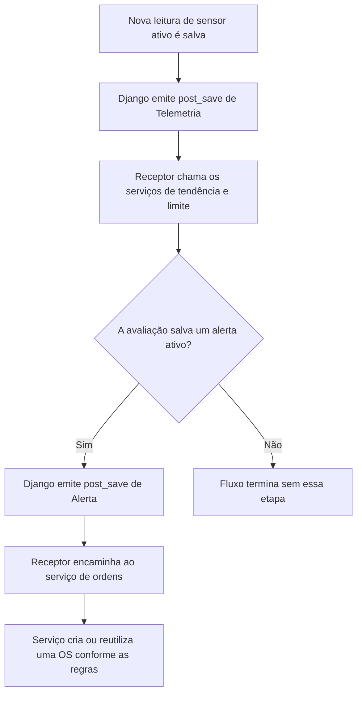
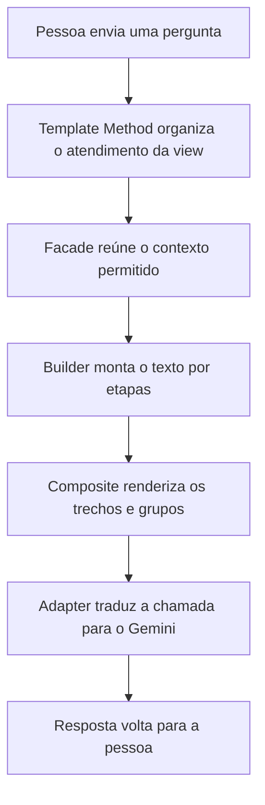

# Padrões de projeto do NanaSmart: verificação e guia didático

**Revisado em:** 16 de novembro de 2026.

**Referência principal:** este arquivo, originalmente dedicado aos padrões GoF destacados em verde.

**Escopo atual:** os 12 padrões solicitados, conferidos no código local com base no commit `89db73e` e nas implementações desta revisão.

Um padrão de projeto é uma solução conhecida para um problema recorrente de organização do código. Ele ajuda a decidir qual parte recebe um pedido, escolhe uma regra, prepara dados ou reage a um acontecimento. Não é uma funcionalidade que precisa ser adicionada apenas para completar uma lista.

Este guia começa cada padrão com uma explicação e um exemplo cotidiano. Em seguida, mostra a situação real no NanaSmart, onde procurar, como o fluxo funciona e por que a solução foi escolhida. Os nomes das classes são os mesmos do código, e os trechos Python foram conferidos contra os arquivos da aplicação.

**Resultado:** os 12 padrões agora têm aplicações no backend. Abstract Factory, Singleton, Composite, Decorator e Iterator receberam implementações próprias e pontos de uso nesta etapa. Os outros sete foram mantidos nos fluxos já existentes, incluindo Observer pelos sinais e receptores da aplicação.

O código e seus pontos de chamada são a evidência principal. Uma classe apenas definida, uma sugestão antiga ou um nome parecido com um padrão não comprovam uso real. Nesta revisão, as cinco implementações novas foram integradas e testadas antes da atualização de seu status. A adoção explícita dos 12 padrões também atende ao objetivo didático do projeto; não significa que cada um fosse indispensável ao funcionamento anterior.

## Como ler e localizar o código

Abra primeiro os links de arquivos indicados em cada seção. Nas tabelas, veja quem pede a operação e quem a executa. Os diagramas e sequências em texto ilustram o fluxo; blocos identificados como código real são recortes do projeto. Os números de linha correspondem à revisão indicada e podem mudar em versões futuras.

As categorias significam: **criação** organiza como objetos são construídos; **estrutura** organiza como componentes são conectados; **comportamento** organiza regras, etapas e reações. O levantamento trata do backend Python/Django e dos pontos auxiliares mencionados, sem pretender inventariar todos os padrões internos das bibliotecas.

## Sumário dos padrões

**Criação:**

- [1. Abstract Factory](#1-abstract-factory) — criar famílias de objetos relacionados.
- [2. Builder](#2-builder) — montar prompts por etapas.
- [3. Factory Method](#3-factory-method) — criar o exportador adequado.
- [4. Singleton](#4-singleton) — controlar uma única instância.

**Estruturais:**

- [5. Adapter](#5-adapter) — traduzir a comunicação com o Gemini.
- [6. Facade](#6-facade) — reunir o contexto por uma entrada simples.
- [7. Composite](#7-composite) — tratar itens e grupos de uma árvore.
- [8. Decorator](#8-decorator) — combinar responsabilidades por envolvimento.

**Comportamentais:**

- [9. Iterator](#9-iterator) — percorrer uma coleção sem expor sua representação.
- [10. Observer](#10-observer) — reagir aos eventos de salvamento.
- [11. Strategy](#11-strategy) — selecionar uma regra de acesso.
- [12. Template Method](#12-template-method) — compartilhar a sequência de atendimento.

## Diagnóstico dos 12 padrões

| Categoria | Padrão | Situação atual |
|---|---|---|
| Criação | Abstract Factory | Implementado e usado; classe própria no backend |
| Criação | Builder | Implementado e usado |
| Criação | Factory Method | Implementado e usado |
| Criação | Singleton | Implementado e usado; classe própria no backend |
| Estruturais | Adapter | Implementado e usado |
| Estruturais | Facade | Implementado e usado |
| Estruturais | Composite | Implementado e usado; classe própria no backend |
| Estruturais | Decorator | Implementado e usado; classe própria no backend |
| Comportamentais | Iterator | Implementado e usado; classe própria no backend |
| Comportamentais | Observer | Aplicado pelos sinais do Django e receptores do projeto |
| Comportamentais | Strategy | Implementado e usado |
| Comportamentais | Template Method | Implementado e usado |

A ordem desta tabela é a mesma das seções. As análises anteriores que recomendavam não acrescentar certos padrões estão preservadas no histórico; esta versão descreve as implementações próprias agora concluídas.

## Padrões de criação

### 1. Abstract Factory

**Abstract Factory — criar uma família de objetos relacionados.** Imagine escolher uma linha de produtos: cada linha fornece peças diferentes que precisam combinar entre si. No NanaSmart, a família CSV cria um exportador CSV e os metadados de download CSV; Excel e PDF fazem o mesmo para seus formatos.

**Situação:** implementado no backend e usado nas exportações atuais.

#### Problema resolvido e onde está

Além de produzir o conteúdo do relatório, é preciso informar o tipo do arquivo (`Content-Type`) e o nome/extensão do download (`Content-Disposition`). A fábrica abstrata reúne esses dois tipos de produtos relacionados, de modo que a mesma família forneça o gerador e seu contrato de download.

| Componente | Localização | Responsabilidade |
|---|---|---|
| `FabricaFamiliaExportacao` | [families.py](../../exportacao/utils/families.py) | Contrato com duas operações: criar o exportador e criar seus metadados. |
| `FamiliaCSV`, `FamiliaExcel`, `FamiliaPDF` | [families.py](../../exportacao/utils/families.py) | Implementam as famílias concretas. |
| `Exportador` e suas implementações | [base_exporter.py](../../exportacao/utils/base_exporter.py) | Primeiro tipo de produto: gera o arquivo. |
| `MetadadosDownload`, `MetadadosCSV`, `MetadadosExcel`, `MetadadosPDF` | [download_metadata.py](../../exportacao/utils/download_metadata.py) | Segundo tipo de produto: aplica o MIME e a extensão correspondentes à resposta. |
| `ExportadorFactory` e registros | [exporter_factory.py](../../exportacao/utils/exporter_factory.py) e [utils/__init__.py](../../exportacao/utils/__init__.py) | Localizam a família solicitada e ligam a criação ao caminho usado pelas views. |

#### Código real e fluxo

```python
class FamiliaCSV(FabricaFamiliaExportacao):
    def criar_exportador(self) -> Exportador:
        return CriadorExportadorCSV(self.criar_metadados()).criar_exportador()

    def criar_metadados(self) -> MetadadosDownload:
        return MetadadosCSV()
```

`criar_exportador()` chama `criar_metadados()` e entrega esse segundo produto ao criador do primeiro. O exportador usa o objeto recebido para preparar seus cabeçalhos. Os dois produtos participam da resposta; não são classes sem chamada.

```text
GET /api/exportar/equipamentos/csv/
    -> ExportadorFactory consulta a família registrada
    -> FamiliaCSV cria MetadadosCSV
    -> CriadorExportadorCSV recebe esses metadados e cria ExportadorCSV
    -> o exportador gera o conteúdo e aplica os metadados de download
    -> a resposta contém o CSV, seu MIME e o nome .csv
```

#### Por que é Abstract Factory e como convive com Factory Method

A família oferece **dois tipos de produto relacionados**: exportador e metadados. O Factory Method continua sendo o método especializado que instancia o exportador concreto. O primeiro padrão coordena a família; o segundo decide a criação do gerador.

**Decisão:** implementação concluída e ligada aos três formatos. As classes antigas ainda podem ser instanciadas diretamente, usando seus metadados padrão. MIME, extensões, conteúdo e rotas foram preservados. A nova estrutura torna a família explícita; não constitui um ganho de desempenho medido.

### 2. Builder

**Builder — montar em etapas.** Serve para construir um resultado que pode ter várias partes e combinações. Cada etapa acrescenta uma parte, e ao final o construtor entrega o resultado completo. É como montar um sanduíche escolhendo seus ingredientes. No NanaSmart, o Builder monta prompts para a IA com blocos como contexto, alertas, ordens e pergunta. Isso facilita criar prompts diferentes sem repetir toda a montagem.

**Situação:** Implementado e usado.

#### Problema resolvido

O chat, a análise de ordens e a análise financeira precisam de textos com partes diferentes. O Builder separa a preparação de cada bloco da receita que determina quais blocos entram em cada pedido.

#### Onde está e quais classes participam

| Classe ou função | Localização | Responsabilidade |
|---|---|---|
| `PromptBuilder` | [prompt_builder_pattern.py, linha 5](../../gemini_api/prompt_builder_pattern.py#L5) | Define as etapas disponíveis: contexto, alertas, ordens, telemetria, financeiro, instruções, pergunta, conclusão e reinicialização. |
| `PromptBuilderConcreto` | [prompt_builder_pattern.py, linha 43](../../gemini_api/prompt_builder_pattern.py#L43) | Guarda componentes em `_blocos`, limita algumas listas e renderiza a árvore Composite para entregar o texto do produto. |
| `PromptDirector` | [prompt_director.py, linha 4](../../gemini_api/prompt_director.py#L4) | Define as receitas de chat, análise de ordens, ordens não atribuídas e finanças. |
| `Prompt` | [prompt.py, linha 1](../../gemini_api/prompt.py#L1) | Guarda o texto final e o entrega por `obter_texto()`. |
| `build_chat_prompt` e funções semelhantes | [prompt_builder.py, linha 119](../../gemini_api/prompt_builder.py#L119) | Preparam cabeçalhos e instruções, criam o builder e chamam o diretor. |
| `GeminiBaseView.get_prompt` e subclasses | [views.py, linha 218](../../gemini_api/views.py#L218) | Conectam a construção do prompt aos endpoints. |

#### Código que mostra o padrão

O começo da receita de chat em `PromptDirector.montar_chat` mostra as etapas:

```python
builder.reset()
builder.com_contexto(context_str)
builder.com_alertas(context.get('alert_summary', []))
builder.com_ordens(context.get('open_order_summary', []), "ORDENS EM ABERTO")
```

A mesma receita acrescenta indicadores quando disponíveis, telemetria e pergunta. No builder concreto, a etapa final é:

```python
def build(self) -> Prompt:
    resultado = GrupoPrompt(tuple(self._blocos)).renderizar()
    return Prompt(resultado)
```

Em `build_chat_prompt`, a conexão entre as peças é:

```python
builder = PromptBuilderConcreto()
prompt = PromptDirector.montar_chat(builder, context, context_str, message)
return prompt.obter_texto()
```

Em linguagem simples: cria-se um montador, escolhe-se a receita de chat e obtém-se o texto pronto.

#### Exemplo do fluxo real

1. Uma pessoa envia uma pergunta para `POST /api/gemini/chat/`.
2. `GeminiChatView` usa `build_chat_prompt`.
3. A função prepara o cabeçalho e cria `PromptBuilderConcreto`.
4. `PromptDirector.montar_chat` ordena as etapas.
5. O builder gera um `Prompt`, cujo texto será encaminhado à integração com a IA.

#### Por que a classificação é válida

Há um contrato de construção, um construtor concreto, um diretor com receitas e um produto final. O construtor agora usa `TrechoPrompt` e `GrupoPrompt` (Composite) para representar os blocos, preservando o texto final. Além de existirem, eles são chamados pelas funções utilizadas nas views.

**Benefício observado na organização:** a receita de cada solicitação fica separada das regras de formatação dos blocos. Isso facilita localizar onde alterar a ordem das informações ou sua apresentação.

#### Limites importantes

- O limite de cinco itens em alguns blocos vem de `_max_linhas = 5`. Ele reduz listas, mas **não garante** um tamanho máximo total de texto ou de tokens da IA.
- `reset()` limpa os blocos antes de uma nova montagem. `build()` não faz essa limpeza automaticamente.
- `com_financeiro()` é exercitado nos testes do Builder, mas não é chamado pelas receitas atuais de `PromptDirector`. A receita financeira atual usa cabeçalho, `com_ordens`, instruções e pergunta.
- `build_trend_analysis_prompt`, em [prompt_builder.py, linha 188](../../gemini_api/prompt_builder.py#L188), monta sua própria lista de textos e não usa essas classes Builder.
- A análise de **uma OS específica**, em [order_analysis.py, linha 118](../../gemini_api/order_analysis.py#L118), também tem montagem própria de instruções e JSON. Não se deve afirmar que toda mensagem enviada à IA passa pelo Builder.

#### Decisão e necessidade

**Manter a implementação existente.** A estrutura e seus pontos de chamada já estão no código. O fluxo continua em uso. A integração das novas estruturas preservou suas regras de negócio.

### 3. Factory Method

**Factory Method — deixar um criador decidir o que produzir.** Serve para separar o código que precisa de um objeto do código que sabe construir o tipo concreto. Pense em uma oficina com criadores especializados: cada um sabe produzir seu tipo de peça. No NanaSmart, criadores de exportadores produzem o objeto adequado para CSV, Excel ou PDF; a view usa a interface comum para gerar o arquivo.

**Situação:** já implementado e mantido em uso, agora também integrado às famílias de Abstract Factory.

#### Onde está e quais classes participam

| Componente | Localização | Papel |
|---|---|---|
| `CriadorExportador` | [creators.py](../../exportacao/utils/creators.py) | Declara `criar_exportador()` e recebe opcionalmente o produto de metadados. |
| `CriadorExportadorCSV`, `CriadorExportadorExcel`, `CriadorExportadorPDF` | [creators.py](../../exportacao/utils/creators.py) | Sobrescrevem o método para criar o gerador concreto, com seus metadados. |
| `ExportadorCSV`, `ExportadorExcel`, `ExportadorPDF` | [csv_exporter.py](../../exportacao/utils/csv_exporter.py), [excel_exporter.py](../../exportacao/utils/excel_exporter.py), [pdf_exporter.py](../../exportacao/utils/pdf_exporter.py) | Geram CSV, XLSX e PDF pelo contrato comum `Exportador`. |
| `ExportadorFactory` | [exporter_factory.py](../../exportacao/utils/exporter_factory.py) | Resolve o formato e devolve um `Exportador`, envolvido pelo Decorator de log. |
| `_despachar_formato` | [exportacao/views.py](../../exportacao/views.py) | Usa o mesmo contrato para solicitar todos os formatos. |

#### Código real e uso

```python
class CriadorExportadorCSV(CriadorExportador):
    def criar_exportador(self) -> ExportadorCSV:
        return ExportadorCSV(metadados=self._metadados)
```

O método sobrescrito é o Factory Method. A view continua usando estas linhas:

```python
exportador = ExportadorFactory.criar(formato)
return exportador.exportar(nome, titulo, colunas, linhas)
```

As famílias chamam os criadores concretos; o cliente não precisa conhecer a lógica de geração de cada arquivo. A assinatura `exportar(nome, titulo, colunas, linhas)` foi preservada.

#### Benefício, compatibilidade e limites

O método de criação fica separado do código que prepara os dados e atende a requisição. O registro `registrar(formato, criador_cls)` continua funcionando para criadores sem família; os formatos padrão usam também o argumento `familia_cls`.

Formato inexistente continua provocando `ValueError`, tratado como HTTP 400 pela view. Incluir um formato novo ainda exige revisar opções, mensagens e documentação da interface. Não se deve confundir o registro de formatos, sozinho, com a hierarquia de criadores que caracteriza Factory Method.

**Decisão:** manter. Os testes verificam a extensão pelo registro antigo, a criação pelos novos caminhos e as respostas dos endpoints existentes.

### 4. Singleton

**Singleton — controlar uma única instância.** Pense em um catálogo oficial de formatos dentro de uma execução do servidor: quem o consulta ou registra um formato deve encontrar o mesmo catálogo. O controle de criação fica na própria classe.

**Situação:** implementação própria em `CatalogoExportadores`, utilizada pela exportação.

#### Onde está e o que fica compartilhado

| Componente | Arquivo | Responsabilidade |
|---|---|---|
| `CatalogoExportadores` | [catalog.py](../../exportacao/utils/catalog.py) | Garante a identidade da instância e mantém o registro de classes de criadores/famílias. |
| `ExportadorFactory.registrar` | [exporter_factory.py](../../exportacao/utils/exporter_factory.py) | Registra o par de classes no catálogo compartilhado. |
| `ExportadorFactory.criar` | [exporter_factory.py](../../exportacao/utils/exporter_factory.py) | Consulta o mesmo catálogo para resolver o formato. |
| Registro inicial | [utils/__init__.py](../../exportacao/utils/__init__.py) | Registra as famílias CSV, Excel e PDF. |

#### Código real: garantia da instância

```python
def __new__(cls):
    with cls._criacao_lock:
        if cls._instancia is None:
            instancia = super().__new__(cls)
            instancia._registro = {}
            instancia._registro_lock = RLock()
            cls._instancia = instancia
        return cls._instancia
```

`_criacao_lock` é um `Lock` de classe. Ele protege a primeira construção. O registro e seu `RLock` são criados somente nessa primeira vez; outra chamada a `CatalogoExportadores()` não apaga os formatos existentes. `registrar()` e `resolver()` também protegem o acesso ao registro.

```text
Registro dos formatos -> CatalogoExportadores() -> mesma instância
Pedido de exportação -> CatalogoExportadores() -> mesma instância
Outro pedido          -> CatalogoExportadores() -> mesma instância
```

#### Por que é usado e quais são os limites

O catálogo tem identidade única para evitar registros independentes dentro do mesmo processo. Ele guarda **classes de criadores/famílias**, nunca usuário, empresa, token, linhas de relatório ou QuerySets de uma requisição. Os exportadores continuam sendo criados por operação.

Cada processo de servidor terá seu próprio Singleton. Ele não é um catálogo distribuído entre máquinas, não gerencia conexões com o banco e não cria um cliente de IA global. O gerenciamento do Django continua com seus próprios ciclos de vida.

**Decisão:** implementação concluída. Os testes conferem a identidade em construções concorrentes por oito threads e a preservação dos registros ao obter a instância novamente.

## Padrões estruturais

### 5. Adapter

**Adapter — traduzir entre interfaces.** Serve para conectar dois componentes que esperam formatos ou formas de chamada diferentes. É como um adaptador de tomada: ele permite ligar um aparelho a uma tomada com outro encaixe. No NanaSmart, o adapter recebe instruções e histórico no formato da aplicação, converte esses dados para o formato do SDK Gemini e entrega a resposta ao sistema. Isso concentra a tradução para o serviço externo em um lugar.

**Situação:** Implementado e usado.

#### Problema resolvido

As views não precisam montar diretamente os objetos `Content`, `Part` e `GenerateContentConfig` do SDK Google GenAI. Essa preparação fica concentrada no adaptador.

#### Onde está e quais classes participam

| Classe ou função | Localização | Responsabilidade |
|---|---|---|
| `AssistenteAdapter` | [adapters.py, linha 8](../../gemini_api/adapters.py#L8) | Define o contrato de disponibilidade e geração de conteúdo da aplicação. |
| `GeminiAdapter` | [adapters.py, linha 27](../../gemini_api/adapters.py#L27) | Implementa a tradução e chama o SDK Gemini. |
| `get_ai_adapter` | [adapters.py, linha 112](../../gemini_api/adapters.py#L112) | Fornece uma nova instância de `GeminiAdapter`. |
| `generate_content` e `is_gemini_available` | [cliente.py](../../gemini_api/cliente.py) | Mantêm as funções de entrada usadas pelo restante da aplicação e delegam ao adaptador. |
| `GeminiBaseView.run_gemini` | [views.py, linha 224](../../gemini_api/views.py#L224) | Encaminha a solicitação da view pela função de geração. |
| `OrdemServicoViewSet.analise_ia` | [manutencao/views.py, linha 54](../../manutencao/views.py#L54) | Também usa as funções de `cliente.py` na análise individual de OS. |

#### Código que mostra o padrão

Ao converter o histórico, `GeminiAdapter.generate_content` executa:

```python
role = "user" if item.get("role") == "user" else "model"
contents.append(
    types.Content(
        role=role,
        parts=[types.Part.from_text(text=item.get("text", ""))],
    )
)
```

O histórico simples da aplicação vira objetos do SDK, incluindo a conversão do papel da mensagem para `user` ou `model`. Na chamada ao provedor:

```python
response = client.models.generate_content(
    model=model_name,
    contents=contents,
    config=config,
)
return response.text, model_name
```

A aplicação recebe o texto e o nome do modelo utilizado, sem precisar manipular o objeto completo da resposta do SDK.

#### Exemplo do fluxo real

```text
View pede uma resposta com instrução, prompt e histórico
    -> cliente.generate_content(...)
    -> get_ai_adapter() fornece GeminiAdapter
    -> adaptador converte os dados para os tipos do SDK
    -> SDK faz a chamada ao Gemini
    -> adaptador devolve texto e modelo utilizado
```

#### Por que a classificação é válida

Existe um contrato voltado à aplicação e uma implementação que o traduz para a interface externa. A tradução de dados está presente no código e é utilizada pelos pontos de entrada da IA.

**Benefício observado na organização:** os detalhes de formatação da chamada ao Gemini ficam concentrados no adaptador.

#### Limites importantes

- Há apenas um provedor concreto implementado: Gemini. Trocar de provedor exigiria implementar outro adaptador e revisar diferenças de contrato e configuração.
- `get_ai_adapter()` retorna `GeminiAdapter()` a cada chamada. Não é um Singleton.
- `is_available()` verifica se `get_client()` consegue fornecer um cliente com a configuração local. Isso não comprova que uma requisição externa será bem-sucedida ou que haverá cota disponível.
- O código tenta modelos alternativos para determinadas mensagens de erro. Isso descreve a implementação local; não comprova disponibilidade atual desses modelos no provedor.
- `get_gemini_client()` permanece como função de compatibilidade em `cliente.py` e expõe o cliente do SDK. Não foi encontrada uma chamada a essa função nos demais arquivos Python pesquisados.

#### Decisão e necessidade

**Manter a implementação existente.** A estrutura e seus pontos de chamada já estão no código. O fluxo continua em uso. A integração das novas estruturas preservou suas regras de negócio.

### 6. Facade

**Facade — oferecer uma entrada mais simples.** Serve para apresentar uma operação de alto nível que coordena serviços ou partes de um sistema. Pense em uma recepção: você faz uma solicitação em um único lugar, e ela encaminha as etapas necessárias. No NanaSmart, a fachada prepara o contexto para a IA, reunindo os dados comuns e incluindo o resumo financeiro quando solicitado pela view.

**Situação:** Implementado e usado.

#### Problema resolvido

A view precisa de dados de equipamentos, ordens, alertas e telemetria. Algumas solicitações também precisam de informações financeiras. A fachada oferece um ponto para coordenar essa escolha.

#### Onde está e quem participa

| Classe ou função | Localização | Responsabilidade |
|---|---|---|
| `GeminiContextFacade` | [facades.py, linha 4](../../gemini_api/facades.py#L4) | Expõe `build_context` e coordena o contexto comum com a inclusão financeira opcional. |
| `build_base_context` | [context_service.py, linha 151](../../gemini_api/context_service.py#L151) | Reúne consultas, contagens e resumos operacionais. |
| `get_financial_summary` | [context_service.py, linha 115](../../gemini_api/context_service.py#L115) | Prepara os números e os resumos financeiros. |
| `get_user_equipment_queryset` e demais funções auxiliares | [context_service.py](../../gemini_api/context_service.py) | Buscam dados e aplicam os recortes usados pelo serviço de contexto. |
| `GeminiBaseView.build_context` | [views.py, linha 232](../../gemini_api/views.py#L232) | Usa a fachada e informa se precisa do resumo financeiro. |
| `GeminiFinanceView` | [views.py, linha 307](../../gemini_api/views.py#L307) | Configura `requires_financial_summary = True`. |

#### Código que mostra o padrão

A implementação da fachada é pequena:

```python
class GeminiContextFacade:
    """Oferece às views uma entrada única para montar o contexto da IA."""

    def build_context(self, user, *, include_financial_summary=False):
        context = build_base_context(user)
        if include_financial_summary:
            context["financial_summary"] = get_financial_summary(user)
        return context
```

Na view base, a entrada utilizada é:

```python
def build_context(self, user):
    return self.context_facade_class().build_context(
        user,
        include_financial_summary=self.requires_financial_summary,
    )
```

#### Exemplo do fluxo real

No chat, a configuração padrão pede o contexto comum. Na solicitação financeira, `GeminiFinanceView` ativa o resumo financeiro. A fachada recebe essa escolha e coordena os serviços necessários.

#### Por que a classificação é válida

A view usa uma entrada de nível mais alto, sem coordenar diretamente a combinação dos dois serviços. A maior parte do trabalho de consulta continua em `context_service.py`; a fachada é uma camada fina de coordenação.

**Benefício observado na organização:** a decisão de incluir os dados financeiros fica concentrada nessa entrada, e a view base mantém uma forma comum de solicitar o contexto.

#### Limites importantes

- A fachada não faz a chamada ao Gemini e não monta o texto final do prompt.
- Sua existência não prova redução de consultas ao banco nem ganho de velocidade. O benefício identificado é de organização.
- A fachada não substitui permissões nem validações de acesso. Ela delega a coleta aos serviços e recebe da view a opção financeira.
- A análise individual de uma OS usa `build_order_analysis_context` em `order_analysis.py`, sem passar por essa fachada.

#### Decisão e necessidade

**Manter a implementação existente.** A estrutura e seus pontos de chamada já estão no código. O fluxo continua em uso. A integração das novas estruturas preservou suas regras de negócio.

### 7. Composite

**Composite — tratar itens e grupos pela mesma operação.** Uma pasta pode conter arquivos e outras pastas; uma operação comum percorre essa árvore. No NanaSmart, um prompt contém trechos simples e grupos que podem conter outros grupos.

**Situação:** implementação própria utilizada pelo Builder de prompts.

#### Onde está e quais classes participam

| Componente | Localização | Responsabilidade |
|---|---|---|
| `ComponentePrompt` | [prompt_components.py](../../gemini_api/prompt_components.py) | Contrato comum `renderizar()`. |
| `TrechoPrompt` | [prompt_components.py](../../gemini_api/prompt_components.py) | Folha: devolve seu próprio texto. |
| `GrupoPrompt` | [prompt_components.py](../../gemini_api/prompt_components.py) | Composição: chama `renderizar()` nos filhos e junta os resultados com quebra de linha. |
| `PromptBuilderConcreto` | [prompt_builder_pattern.py](../../gemini_api/prompt_builder_pattern.py) | Cria trechos e grupos; sua operação final renderiza o grupo raiz. |

#### Código real

```python
@dataclass(frozen=True)
class TrechoPrompt(ComponentePrompt):
    texto: str

    def renderizar(self) -> str:
        return self.texto
```

```python
@dataclass(frozen=True)
class GrupoPrompt(ComponentePrompt):
    componentes: tuple[ComponentePrompt, ...]

    def __post_init__(self):
        # Uma lista recebida do chamador não deve modificar a árvore depois.
        object.__setattr__(self, 'componentes', tuple(self.componentes))

    def renderizar(self) -> str:
        return '\n'.join(componente.renderizar() for componente in self.componentes)
```

Tanto a folha quanto o grupo implementam o mesmo contrato. Um grupo aceita outros grupos, permitindo uma estrutura recursiva. Os dados das classes são congelados e os filhos são convertidos em tupla, evitando que uma lista externa modifique um grupo depois da construção.

#### Como está usado no prompt

O método `_adicionar_secao` cria um grupo com o título e outro grupo com as linhas. No final, `build()` renderiza a composição completa:

```python
def _adicionar_secao(self, titulo, linhas):
    self._blocos.append(GrupoPrompt((
        TrechoPrompt(f"\n{titulo}:"),
        GrupoPrompt(tuple(TrechoPrompt(linha) for linha in linhas)),
    )))
```

```text
Grupo raiz do prompt
    -> Trecho de contexto
    -> Grupo de alertas
        -> Trecho do título
        -> Grupo de linhas
            -> Trecho do alerta 1
            -> Trecho do alerta 2
    -> Grupo da pergunta
```

#### Por que é usado e o que foi preservado

O Builder decide quais partes entram; o Composite representa e renderiza a estrutura dessas partes por uma operação uniforme. Esse é o caso real de árvore neste projeto, independentemente dos relacionamentos do banco.

As quebras de linha, os títulos, o limite de itens e os textos produzidos pelos quatro diretores foram preservados em testes de igualdade. Um produto já construído não muda ao reinicializar o Builder. Nem toda mensagem de IA usa esse Builder; a análise individual de OS e a montagem de tendência mantêm seus caminhos próprios.

**Decisão:** implementação concluída, sem mudar modelos ou o texto esperado dos prompts existentes.

### 8. Decorator

**Decorator — acrescentar uma responsabilidade envolvendo um objeto.** Imagine um serviço de impressão ao qual se acrescenta uma etapa de registro, mantendo a mesma forma de solicitar a impressão. Um objeto envolve outro de mesmo contrato e delega o trabalho principal.

**Situação:** implementação GoF própria na geração de exportações.

#### Onde está e quais classes participam

| Componente | Localização | Responsabilidade |
|---|---|---|
| `Exportador` | [base_exporter.py](../../exportacao/utils/base_exporter.py) | Contrato comum `exportar(...)`. |
| `ExportadorDecorator` | [decorators.py](../../exportacao/utils/decorators.py) | Implementa o contrato e guarda um exportador para delegar a chamada. |
| `ExportadorComLog` | [decorators.py](../../exportacao/utils/decorators.py) | Acrescenta o registro de uma geração concluída. |
| `ExportadorFactory.criar` | [exporter_factory.py](../../exportacao/utils/exporter_factory.py) | Envolve o exportador criado com `ExportadorComLog`, inclusive no registro legado. |

#### Código real e fluxo

```python
class ExportadorComLog(ExportadorDecorator):
    def exportar(self, nome, titulo, colunas, linhas):
        response = super().exportar(nome, titulo, colunas, linhas)
        # Não registra valores das células, usuários, tokens ou dados da empresa.
        logger.info(
            'Exportação concluída: gerador=%s bytes=%d',
            type(self._exportador).__name__, len(response.content),
        )
        return response
```

```text
View chama exportar(...)
    -> ExportadorComLog recebe a chamada
    -> exportador interno gera o arquivo e os cabeçalhos
    -> decorator registra o nome da classe e a quantidade de bytes
    -> devolve o mesmo objeto de resposta
```

#### Por que é usado e quais são os limites

A responsabilidade de log fica em uma composição de objetos, sem repetir o registro em cada gerador. É possível envolver outro decorator porque todos mantêm o contrato `Exportador`. Isso é diferente de reconhecer o símbolo `@` de Python como prova de Decorator GoF.

O log não inclui células, nomes de usuários, empresas, tokens ou valores do relatório. A mensagem é de nível INFO e sua emissão depende da configuração de logging. Ela registra que o arquivo foi gerado no backend, não que o navegador concluiu o download.

O decorator devolve a mesma resposta e não modifica seu conteúdo ou cabeçalhos. Se a geração falhar, a exceção original continua sendo propagada e não há registro de conclusão.

**Decisão:** implementação concluída e utilizada nos endpoints de exportação. Os testes cobrem composição de decorators, preservação da resposta, falha do gerador e ausência de valores das células no log.

## Padrões comportamentais

### 9. Iterator

**Iterator — percorrer uma coleção sem expor sua representação interna.** É como avançar pelas fichas de um arquivo uma por vez. O cliente solicita o próximo item por uma operação comum, sem precisar carregar e reorganizar toda a coleção.

**Situação:** classe própria `IteradorLeituras`, integrada à seleção de amostras da análise de tendências.

#### Onde está e quem participa

| Componente | Localização | Responsabilidade |
|---|---|---|
| `IteradorLeituras` | [iterators.py](../../telemetria/iterators.py) | Implementa `__iter__` e `__next__` e mantém o estado do percurso sobre a consulta. |
| `_select_sample` | [trend_analysis.py](../../telemetria/trend_analysis.py) | Consome o iterador próprio, seleciona a amostra e acumula as estatísticas existentes. |
| `QuerySet.iterator` | Fornecido pelo Django | Continua sendo usado internamente como fonte incremental de resultados, com `chunk_size=500` por padrão. |

#### Código real

```python
class IteradorLeituras(Iterator):
    def __init__(self, queryset, *, chunk_size=500):
        self._leituras = iter(queryset.iterator(chunk_size=chunk_size))

    def __iter__(self):
        return self

    def __next__(self):
        # Ordem, filtros e valores pertencem à consulta e ao serviço de análise.
        return next(self._leituras)
```

Na função de análise, o consumo agora começa por:

```python
for row in IteradorLeituras(rows):
    stamp, value = row['timestamp'], row['valor']
    if value is None or not math.isfinite(value) or stamp == previous_stamp:
        continue
```

`iter(objeto)` devolve o próprio percurso. `next(objeto)` avança para a próxima leitura e, ao terminar, propaga `StopIteration`. Uma nova instância representa outro percurso; uma instância esgotada não é reiniciada automaticamente.

#### Como visualizar o fluxo

```text
QuerySet seleciona as leituras na ordem definida
    -> IteradorLeituras mantém o percurso
    -> for pede cada item por __next__
    -> _select_sample aplica as verificações e estatísticas existentes
    -> devolve a mesma estrutura de amostra e resultados
```

#### Benefício, compatibilidade e limites

O protocolo de percurso agora tem uma classe explícita do backend, que pode ser demonstrada e testada diretamente. Ela reutiliza a busca do ORM sem substituí-la por uma lista de todas as leituras. A construção não consome as leituras antecipadamente.

O iterador não muda filtros, ordenação, datas, valores, regressão, critérios de anomalia ou contagem de amostras válidas. Erros da fonte não são ocultados. A análise mantém suas próprias estruturas em memória: o padrão não representa uma promessa de memória constante ou de ganho de desempenho.

Os outros usos de `.iterator()` e `yield`, por exemplo no comando periódico e no seed, continuam existindo; não é necessário substituir todo percurso Python por essa classe de leituras.

**Decisão:** implementação concluída e ligada a `_select_sample`. Testes específicos cobrem ordem, esgotamento, ausência de consumo antecipado e propagação de falhas; os testes da análise exercitam o caminho completo com o banco de testes.

### 10. Observer

**Observer — reagir a um acontecimento.** Serve para avisar componentes interessados quando um evento ocorre, permitindo que eles executem suas próprias ações. É parecido com uma inscrição em notificações: quando há uma novidade, os inscritos são avisados. No NanaSmart, sinais do Django acionam verificações quando uma leitura de telemetria, um alerta ou outro registro é salvo.

**Situação:** Aplicado pelos sinais do Django e receptores do projeto.

#### Problema resolvido

O código que salva uma leitura não precisa chamar diretamente todas as reações em cada lugar. O sistema registra as funções interessadas no evento, e o mecanismo de sinais as aciona.

#### Onde está e quem participa

| Evento e modelo | Função receptora | Localização | Reação |
|---|---|---|---|
| `post_save` de `Telemetria` | `checar_limites_telemetria` | [telemetria/signals.py, linha 9](../../telemetria/signals.py#L9) | Em uma nova leitura elegível, chama a sincronização da tendência e dos limites. |
| `post_save` de `Alerta` | `vincular_ordem_servico_ao_alerta` | [alertas/signals.py, linha 6](../../alertas/signals.py#L6) | Se o alerta estiver ativo, encaminha-o ao serviço conforme sua origem e registra o vínculo da ordem. |
| `post_save` de `Equipamento` | `verificar_planos_por_horimetro` | [ativos/signals.py, linha 13](../../ativos/signals.py#L13) | Verifica planos ativos e pode abrir uma OS preditiva por horímetro. |
| `pre_save` de `OrdemServico` | `verificar_manutencao` | [ativos/signals.py, linha 66](../../ativos/signals.py#L66) | Se faltar descrição e houver configuração de chave, tenta obter texto pela integração com a IA. |

As classes de domínio envolvidas são `Telemetria`, `Sensor`, `Alerta`, `Equipamento`, `PlanoManutencao` e `OrdemServico`. Nesta implementação, os observadores são **funções**, registradas no mecanismo de sinais do Django; não há necessidade de uma classe própria chamada `Observer`.

O registro ocorre ao importar os módulos de sinais em `ready()`: [AtivosConfig](../../ativos/apps.py#L4), [AlertasConfig](../../alertas/apps.py#L4) e [TelemetriaConfig](../../telemetria/apps.py#L4). O método `ready()` é executado na inicialização da aplicação pelo Django.

#### Código que mostra o padrão

Este é o receptor da telemetria:

```python
@receiver(post_save, sender=Telemetria)
def checar_limites_telemetria(sender, instance, created, raw=False, **kwargs):
    if raw or not created or not instance.sensor.ativo:
        return
    sync_sensor_trend(instance.sensor_id)
    sync_limit_reading(instance)
```

`@receiver` registra a função para o aviso de salvamento de `Telemetria`. A função ignora carregamentos brutos, alterações de leituras existentes e sensores inativos. Se a leitura for elegível, chama os dois serviços na ordem mostrada.

#### Exemplo do fluxo real



As decisões de negócio ficam nos serviços, como [sync_limit_reading](../../telemetria/limit_service.py), [sync_sensor_trend](../../telemetria/predictive_service.py#L21) e [PrioridadeOSService](../../manutencao/services.py#L62). O sinal aciona o trabalho; não substitui as regras desses serviços.

#### Por que a classificação é válida

Há eventos, receptores registrados e reações a esses eventos. É uma aplicação de Observer fornecida pelo framework, utilizada explicitamente pelo projeto.

**Benefício observado na organização:** diferentes pontos que salvam um modelo pelo fluxo normal podem acionar as mesmas reações registradas.

#### Limites importantes

- Esses receptores são síncronos: o trabalho acontece durante o fluxo de salvamento. Não existe, nesses trechos, uma fila em segundo plano ou um serviço de mensagens.
- Nem todo salvamento gera uma ordem nova. Os serviços verificam condições e vínculos existentes. A recuperação do sensor não conclui a manutenção automaticamente.
- O receptor de alertas não restringe a execução a `created=True`. O que efetivamente filtra no começo da função é `raw` e o status ativo, apesar do comentário interno mencionar alerta “novo ou escalado”.
- O vínculo `ordem_servico` é gravado com `QuerySet.update()` para evitar disparar novamente o mesmo sinal apenas para registrar essa associação.
- Operações como `QuerySet.update()` e `bulk_create()` não percorrem o salvamento individual normal com esses sinais. Assim, “salvar por qualquer caminho sempre avisa os observadores” seria uma afirmação ampla demais.
- No fluxo normal de `Telemetria.save()`, o projeto usa transação e bloqueio do sensor. Isso é um mecanismo adicional de consistência, não um padrão Observer separado.

#### Decisão e necessidade

**Manter a implementação existente.** A estrutura e seus pontos de chamada já estão no código. O fluxo continua em uso. A integração das novas estruturas preservou suas regras de negócio.

### 11. Strategy

**Strategy — escolher uma regra.** Serve quando há maneiras diferentes de realizar uma tarefa e todas podem ser chamadas pelo mesmo contrato. Imagine escolher uma rota de carro, a pé ou de bicicleta: o destino é o mesmo, mas a regra para chegar muda. No NanaSmart, políticas de permissão usam o mesmo método para avaliar acesso, com regras diferentes para gestores, técnicos e outros casos.

**Situação:** Implementado e usado.

#### Problema resolvido

As regras de perfil e método HTTP ficam em políticas separadas. As classes que integram essas regras ao Django REST Framework delegam a avaliação, em vez de repetir cada condição.

#### Onde está e quais classes participam

| Classe | Localização | Responsabilidade |
|---|---|---|
| `BasePermissionPolicy` | [permission_policies.py, linha 4](../../accounts/permission_policies.py#L4) | Contrato comum `can_access(user, method, obj=None, request=None)`. |
| `GestorPolicy` | [permission_policies.py, linha 12](../../accounts/permission_policies.py#L12) | Exige autenticação e perfil gestor/admin ou condição de superusuário. |
| `TecnicoPolicy` | [permission_policies.py, linha 19](../../accounts/permission_policies.py#L19) | Exige autenticação e perfil técnico. |
| `GestorOrReadOnlyPolicy` | [permission_policies.py, linha 26](../../accounts/permission_policies.py#L26) | Permite leitura a autenticados e escrita a gestor/admin ou superusuário. |
| `AuthenticatedNoDeleteForTecnicoPolicy` | [permission_policies.py, linha 37](../../accounts/permission_policies.py#L37) | Permite leitura a autenticados; nas demais ações, aplica as restrições de perfil do código. |
| `PermissionPolicyFactory` | [permission_policies.py, linha 51](../../accounts/permission_policies.py#L51) | Fornece a política registrada para um nome. |
| `IsGestor`, `IsTecnico`, `IsGestorOrReadOnly`, `IsAuthenticatedNoDeleteForTecnico` | [accounts/permissions.py](../../accounts/permissions.py) | Integram a decisão das políticas às permissões do DRF. |

#### Código que mostra o padrão

Em `accounts/permissions.py`, a permissão escolhe uma regra e delega:

```python
class IsGestorOrReadOnly(permissions.BasePermission):
    """Gestores podem tudo. Técnicos/Outros apenas leitura."""

    def has_permission(self, request, view):
        policy = PermissionPolicyFactory.create('gestor_or_readonly')
        return policy.can_access(request.user, request.method)
```

Em `permission_policies.py`, a estratégia concreta contém a regra:

```python
class GestorOrReadOnlyPolicy(BasePermissionPolicy):
    def can_access(self, user, method: str, obj=None, request=None) -> bool:
        if not user or not getattr(user, 'is_authenticated', False):
            return False

        if method in ['GET', 'HEAD', 'OPTIONS']:
            return True

        return user.tipo_usuario in ['gestor', 'admin'] or getattr(user, 'is_superuser', False)
```

#### Exemplo do fluxo real

`EquipamentoViewSet`, em [ativos/views.py, linha 16](../../ativos/views.py#L16), configura `IsGestorOrReadOnly` como permissão.

1. Um técnico autenticado pede uma consulta com `GET`.
2. A permissão obtém `GestorOrReadOnlyPolicy`.
3. A política permite a leitura.
4. Se esse técnico tentar criar um equipamento com `POST`, essa mesma política não autoriza a ação.

Outros usos confirmados são `IsGestor` no cadastro de usuários e nas ações de ajuste de prioridade, e `IsAuthenticatedNoDeleteForTecnico` nos recursos de telemetria.

#### Por que a classificação é válida

As políticas implementam um contrato comum e oferecem comportamentos diferentes. As permissões funcionam como os componentes que utilizam essas estratégias. A escolha atual é feita pelo nome da política em cada permissão; não é necessário que uma tela permita trocar a estratégia para que essa organização exista.

**Benefício observado na organização:** uma regra compartilhada pode ser localizada e revisada na política correspondente.

#### Limites importantes

- `PermissionPolicyFactory` é uma **fábrica simples com registro de objetos**. Não possui a hierarquia de criadores que caracteriza o Factory Method da exportação.
- `create()` devolve objetos já guardados em `_policies`; ele não cria uma nova política a cada chamada. Isso também não comprova Singleton, pois nada impede construir outra instância dessas classes.
- Apesar do nome `AuthenticatedNoDeleteForTecnicoPolicy`, um técnico também recebe negativa para `POST`, `PUT` e `PATCH` nessa política. Após liberar leitura, o retorno final exige gestor/admin ou superusuário, com bloqueio explícito de `DELETE` para perfil técnico.
- `TecnicoPolicy` e `IsTecnico` existem, mas não foi encontrada uma referência a `IsTecnico` fora de sua própria definição nos arquivos Python pesquisados. O uso ativo de Strategy está comprovado pelas outras permissões citadas.
- Nem toda permissão do projeto usa essas políticas. Por exemplo, `IsCompanyManager` e a permissão de ordens de serviço possuem suas próprias verificações.
- Permitir uma ação e filtrar os dados da empresa são responsabilidades diferentes. As consultas e as verificações de objeto também participam do controle de acesso.

#### Decisão e necessidade

**Manter a implementação existente.** A estrutura e seus pontos de chamada já estão no código. O fluxo continua em uso. A integração das novas estruturas preservou suas regras de negócio.

### 12. Template Method

**Template Method — compartilhar uma sequência e variar etapas.** Serve para manter o roteiro de uma operação em uma classe base e permitir que subclasses especializem algumas partes. É como uma ficha de atendimento com etapas comuns, preenchidas de forma diferente por cada setor. No NanaSmart, o atendimento comum das views Gemini segue essa organização.

**Situação:** Implementado e usado.

#### Problema resolvido

Os endpoints de chat, ordens, finanças e tendências compartilham boa parte do atendimento. O Template Method permite reaproveitar essa sequência e personalizar pontos específicos por herança.

#### Onde está e quais classes participam

| Classe ou método | Localização | Papel |
|---|---|---|
| `GeminiBaseView` | [views.py, linha 198](../../gemini_api/views.py#L198) | Classe base com a sequência comum. |
| `GeminiBaseView.post` | [views.py, linha 238](../../gemini_api/views.py#L238) | Método que organiza validação, verificações, contexto, prompt, chamada e resposta. |
| `check_access`, `get_prompt`, `run_gemini`, `build_context` | [views.py, linha 215](../../gemini_api/views.py#L215) | Etapas separadas chamadas pela sequência. Algumas são especializadas nas subclasses. |
| `GeminiChatView` | [views.py, linha 264](../../gemini_api/views.py#L264) | Define a função de prompt de chat, propósito e temperatura. |
| `GeminiOsAnalysisView` | [views.py, linha 279](../../gemini_api/views.py#L279) | Define a função de prompt para análise de ordens em conjunto. |
| `GeminiUnassignedOrdersView` | [views.py, linha 292](../../gemini_api/views.py#L292) | Especializa `get_prompt` para ordens sem atribuição. |
| `GeminiFinanceView` | [views.py, linha 307](../../gemini_api/views.py#L307) | Especializa acesso e prompt, além de solicitar contexto financeiro. |
| `GeminiTrendAnalysisView` | [views.py, linha 330](../../gemini_api/views.py#L330) | Especializa o prompt e envolve o atendimento comum com validações e tratamento próprios. |

#### Código que mostra o padrão

Este recorte de `GeminiBaseView.post` mostra a sequência após as verificações iniciais:

```python
context = self.build_context(user)

system_instruction = build_system_instruction(user, self.system_purpose)
user_prompt = self.get_prompt(user, context, message)

try:
    response_text, model_used = self.run_gemini(system_instruction, user_prompt, history)
    return Response({"response": response_text, "model_used": model_used})
except Exception as e:
    return Response({"response": f"Erro ao gerar resposta da IA: {e}"})
```

O método da classe base chama `self.get_prompt`. Na subclasse financeira, esse ponto é especializado:

```python
def get_prompt(self, user, context, message):
    return build_finance_prompt(user, context, message)
```

Assim, a sequência comum permanece na classe base, enquanto a versão financeira determina qual texto preparar. As subclasses de chat e análise de ordens também personalizam o comportamento por atributos usados pela base.

#### Exemplo do fluxo real

1. Uma solicitação chega a `POST /api/gemini/gestao/financeira/`.
2. A subclasse chama `super().post(request)`, reutilizando o atendimento da classe base.
3. A classe base valida a mensagem e aplica a verificação de acesso configurada para esse endpoint.
4. Com a IA configurada, solicita contexto, prepara as instruções e chama `self.get_prompt`.
5. O método financeiro prepara o prompt apropriado, e a classe base realiza a chamada e devolve a resposta.

#### Por que a classificação é válida

Existe uma sequência de operações na classe base, com pontos chamados por `self` que podem variar nas subclasses. Isso caracteriza Template Method, mesmo sem uma classe com esse nome e sem exigir que todos os passos sejam abstratos.

**Benefício observado na organização:** os endpoints compartilham o atendimento comum, e diferenças específicas ficam em atributos ou métodos especializados.

#### Relação com os outros padrões

Template Method organiza **a sequência de atendimento da view**. Builder organiza **a construção do texto**. Facade organiza **a obtenção do contexto**, e Adapter organiza **a tradução da chamada externa**.

#### Decisão e necessidade

**Manter a implementação existente.** A estrutura e seus pontos de chamada já estão no código. O fluxo continua em uso. A integração das novas estruturas preservou suas regras de negócio.

## Como os padrões trabalham juntos

No chat, cada componente tem uma responsabilidade:



Na exportação, Singleton mantém o catálogo; Abstract Factory cria o gerador e os metadados da família; Factory Method instancia o gerador concreto; Decorator acrescenta o registro de geração. Na telemetria, Observer aciona as reações aos eventos e o Iterator próprio percorre as leituras da análise. Strategy organiza as políticas de permissão. Cada papel pode ser acompanhado nos arquivos indicados.

## Implementação e verificações de 16/11/2026

Esta etapa acrescentou Abstract Factory, Singleton, Composite, Decorator e Iterator próprios. As rotas HTTP, campos da API e modelos do banco não foram alterados. Os testes verificam também os mecanismos anteriores que continuam em uso.

| Testes novos | O que comprovam |
|---|---|
| [exportacao/test_patterns.py](../../exportacao/test_patterns.py) | Identidade do Singleton entre threads; famílias e metadados compatíveis; registro legado; decorators; códigos HTTP e exportação com isolamento por empresa. |
| [gemini_api/test_prompt_components.py](../../gemini_api/test_prompt_components.py) | Folhas e grupos aninhados; isolamento da lista de filhos; igualdade do texto dos quatro diretores; truncamento; reset e preservação do produto anterior. |
| [telemetria/test_iterators.py](../../telemetria/test_iterators.py) | Percurso ordenado, `StopIteration`, ausência de consumo antecipado e propagação de falhas. |
| [telemetria/test_trend_analysis.py](../../telemetria/test_trend_analysis.py) | Integração do iterador à análise real, preservando amostra, resultados e ciclo de alertas/OS nos cenários existentes. |

No Python 3.10.8 do `.venv`, com SQLite em memória e sem acessar o PostgreSQL de desenvolvimento, foi executado:

```powershell
$env:NANASMART_TEST_POSTGRES_PORT = ''
.\.venv\Scripts\python.exe manage.py test accounts authentication ativos telemetria alertas manutencao exportacao gemini_api.tests gemini_api.test_order_analysis gemini_api.test_prompt_components app.test_schema --settings=app.test_settings --noinput --verbosity=1
```

**Resultado:** 310 testes executados, 305 aprovados e cinco pulados por dependerem de bloqueios de linha indisponíveis no SQLite. São 18 testes novos em relação à revisão documental anterior. `manage.py check` não encontrou problemas e `makemigrations --check --dry-run` não encontrou alterações de modelos.

Os resultados de 292 testes da etapa anterior e de 75 testes de 15/11 pertencem a execuções anteriores. As verificações atuais, a validação da documentação e o arquivamento estão resumidos no [índice da documentação](../README.md#verificação-da-revisão-de-16112026).

Os testes não comprovam disponibilidade real do Gemini, ganhos de desempenho em produção ou concorrência no PostgreSQL. O log de exportação não comprova recebimento do arquivo pelo navegador. Não foram aplicadas migrações nem executado o seed nesta etapa.

## Glossário para acompanhar o código

| Termo | Explicação simples |
|---|---|
| Classe | Definição de um tipo de componente do programa. |
| Objeto ou instância | Um componente concreto criado a partir de uma classe. |
| Método | Uma função definida em uma classe para executar uma ação. |
| Contrato ou interface | Conjunto de operações que um componente promete oferecer. |
| Classe abstrata / `ABC` | Base que define operações e pode exigir sua implementação nas subclasses. |
| Subclasse / herança | Classe que aproveita uma base e pode especializar seu comportamento. |
| Sobrescrever um método | Fornecer na subclasse uma versão específica de um método da classe base. |
| View | Parte do backend que atende uma requisição e prepara uma resposta. |
| Endpoint | Endereço da API usado para uma operação, como enviar uma pergunta. |
| API | Forma organizada de um programa solicitar operações a outro. |
| DRF | Django REST Framework, biblioteca usada para construir a API do projeto. |
| Modelo | Classe que representa dados persistidos, como equipamento ou ordem de serviço. |
| QuerySet / ORM | Recursos do Django para consultar e manipular dados usando Python. |
| Sinal / receptor | Aviso de um evento e função registrada para reagir a ele. |
| Prompt | Texto com informações e instruções enviado à inteligência artificial. |
| Contexto | Dados usados para orientar uma operação ou resposta. |
| SDK | Biblioteca que facilita conversar com um serviço externo. |
| HTTP `GET` / `POST` / `PATCH` / `DELETE` | Métodos normalmente associados a consultar, enviar/criar, alterar parcialmente e excluir. O comportamento exato depende da rota. |
| Mock ou simulação | Substituto controlado de uma dependência durante uma verificação. |
| OS / O.S. | Ordem de serviço: registro de um trabalho de manutenção. |
| Horímetro | Medida das horas de funcionamento de um equipamento. |
| JSON | Formato de dados estruturados que programas conseguem trocar. |

## Roteiro para apresentação

Para cada padrão, explique primeiro o conceito. Depois mostre a situação no NanaSmart, abra um arquivo indicado, acompanhe o ponto que chama a operação e explique o resultado. Nos cinco padrões acrescentados nesta etapa, mostre também a chamada que os conecta ao fluxo real; não basta abrir a definição de uma classe.

Uma síntese possível é: “A exportação usa Abstract Factory, Factory Method, Singleton e Decorator. Os prompts usam Builder e Composite. A integração com IA usa Adapter, Facade e Template Method. A análise de leituras tem um Iterator próprio, os eventos aplicam Observer e as permissões aplicam Strategy. Os 12 padrões podem ser acompanhados em código usado pelo backend.”

## Histórico e fontes complementares

As versões sobrepostas e os diagramas antigos foram reunidos em [old](../old/README.md). Eles registram versões anteriores e não substituem esta análise. As regras de negócio vigentes estão no [índice da documentação](../README.md), com referências específicas para alertas, tendências, prioridade ABC, IA e API.

Ao modificar uma funcionalidade, confira novamente a estrutura, os pontos de chamada e os testes afetados antes de atualizar o status de um padrão.
