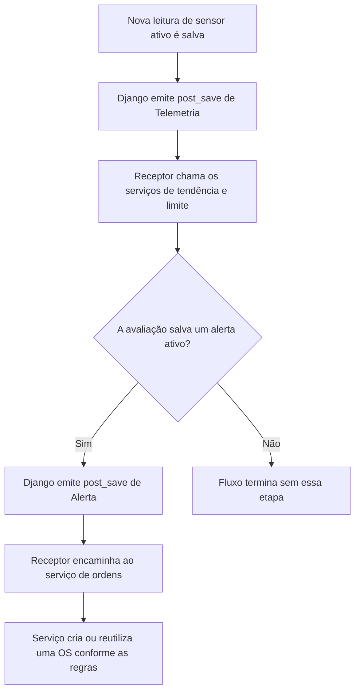
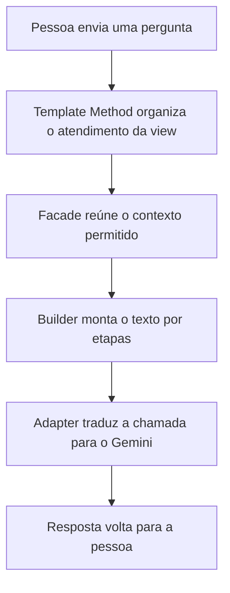

# Padrões de projeto do NanaSmart: verificação e guia didático

**Revisado em:** 16 de novembro de 2026.

**Referência principal:** este arquivo, originalmente dedicado aos padrões GoF destacados em verde.

**Escopo atual:** os 12 padrões solicitados, conferidos no código local com base no commit `89db73e`.

Um padrão de projeto é uma solução conhecida para um problema recorrente de organização do código. Ele ajuda a decidir qual parte recebe um pedido, escolhe uma regra, prepara dados ou reage a um acontecimento. Não é uma funcionalidade que precisa ser adicionada apenas para completar uma lista.

Este guia começa cada padrão com uma explicação e um exemplo cotidiano. Em seguida, mostra a situação real no NanaSmart, onde procurar, como o fluxo funciona e por que a solução foi escolhida. Os nomes das classes são os mesmos do código, e os trechos Python foram conferidos contra os arquivos da aplicação.

**Resultado:** sete padrões foram confirmados nos fluxos da aplicação: Builder, Factory Method, Adapter, Facade, Observer, Strategy e Template Method. Iterator é utilizado por mecanismos de Python/Django. Não foi identificada necessidade atual de implementar Abstract Factory, Singleton próprio, Composite ou Decorator GoF próprio.

O código e seus pontos de chamada são a evidência principal. Uma classe apenas definida, uma sugestão antiga ou um nome parecido com um padrão não comprovam uso real. Quando uma implementação for necessária, ela deverá existir no fluxo e ser verificada antes de receber o status de implementada nesta documentação.

## Como ler e localizar o código

Abra primeiro os links de arquivos indicados em cada seção. Nas tabelas, veja quem pede a operação e quem a executa. Os diagramas e sequências em texto ilustram o fluxo; blocos identificados como código real são recortes do projeto. Os números de linha correspondem à revisão indicada e podem mudar em versões futuras.

As categorias significam: **criação** organiza como objetos são construídos; **estrutura** organiza como componentes são conectados; **comportamento** organiza regras, etapas e reações. O levantamento trata do backend Python/Django e dos pontos auxiliares mencionados, sem pretender inventariar todos os padrões internos das bibliotecas.

## Sumário dos padrões

**Criação:**

- [1. Abstract Factory](#1-abstract-factory) — criar famílias de objetos relacionados.
- [2. Builder](#2-builder) — montar prompts por etapas.
- [3. Factory Method](#3-factory-method) — criar o exportador adequado.
- [4. Singleton](#4-singleton) — controlar uma única instância.

**Estruturais:**

- [5. Adapter](#5-adapter) — traduzir a comunicação com o Gemini.
- [6. Facade](#6-facade) — reunir o contexto por uma entrada simples.
- [7. Composite](#7-composite) — tratar itens e grupos de uma árvore.
- [8. Decorator](#8-decorator) — combinar responsabilidades por envolvimento.

**Comportamentais:**

- [9. Iterator](#9-iterator) — percorrer uma coleção sem expor sua representação.
- [10. Observer](#10-observer) — reagir aos eventos de salvamento.
- [11. Strategy](#11-strategy) — selecionar uma regra de acesso.
- [12. Template Method](#12-template-method) — compartilhar a sequência de atendimento.

## Diagnóstico dos 12 padrões

| Categoria | Padrão | Situação atual |
|---|---|---|
| Criação | Abstract Factory | Não aplicado; sem necessidade atual |
| Criação | Builder | Implementado e usado |
| Criação | Factory Method | Implementado e usado |
| Criação | Singleton | Sem implementação própria; recursos compartilhados não comprovam Singleton |
| Estruturais | Adapter | Implementado e usado |
| Estruturais | Facade | Implementado e usado |
| Estruturais | Composite | Não aplicado; sem necessidade atual |
| Estruturais | Decorator | Não aplicado como GoF próprio |
| Comportamentais | Iterator | Utilizado por recursos de Python/Django; sem classe própria |
| Comportamentais | Observer | Aplicado pelos sinais do Django e receptores do projeto |
| Comportamentais | Strategy | Implementado e usado |
| Comportamentais | Template Method | Implementado e usado |

A ordem desta tabela é a mesma das seções. “Não implementar agora” significa ausência de necessidade identificada, e não uma tarefa de implementação que ficou incompleta.

## Padrões de criação

### 1. Abstract Factory

**Abstract Factory — criar uma família de objetos relacionados.** Serve quando vários objetos precisam ser criados juntos e pertencer à mesma família. Por exemplo, uma fábrica de tema claro poderia criar botão, menu e janela claros, enquanto outra criaria os mesmos componentes em tema escuro. No NanaSmart, cada exportação escolhe apenas um formato; não há uma família de produtos que precise ser criada em conjunto.

**Situação:** Não aplicado; sem necessidade atual.

#### Situação e onde procurar

**Não existe uma implementação própria de Abstract Factory nos fluxos examinados.** O ponto que pode causar confusão é o módulo [exportacao/utils](../../exportacao/utils/creators.py): ele cria formatos alternativos de um mesmo produto, o exportador.

Os componentes reais são `CriadorExportadorCSV`, `CriadorExportadorExcel`, `CriadorExportadorPDF` e seus exportadores. Eles pertencem à demonstração de **Factory Method**, explicada na seção 3. Não há uma fábrica que produza, em conjunto, vários tipos de produtos de uma família.

#### Como visualizar a diferença

```text
Código atual: escolher PDF -> criar um ExportadorPDF -> gerar o arquivo.
Abstract Factory: escolher uma família -> criar vários tipos de produtos relacionados dessa família.
```

A segunda linha é uma explicação conceitual; não descreve classes existentes no NanaSmart. Ter uma classe abstrata e uma classe chamada Factory não basta para caracterizar Abstract Factory.

#### Por que não implementar agora

O projeto precisa escolher um formato por exportação. Os criadores atuais já resolvem esse problema. Acrescentar famílias artificiais exigiria classes sem uma responsabilidade real adicional.

**Decisão:** não implementar agora. Reavaliar se surgir uma funcionalidade que precise construir vários tipos de objetos relacionados e alternar famílias completas desses objetos. Isso é um critério futuro, não uma funcionalidade pendente desta entrega.

### 2. Builder

**Builder — montar em etapas.** Serve para construir um resultado que pode ter várias partes e combinações. Cada etapa acrescenta uma parte, e ao final o construtor entrega o resultado completo. É como montar um sanduíche escolhendo seus ingredientes. No NanaSmart, o Builder monta prompts para a IA com blocos como contexto, alertas, ordens e pergunta. Isso facilita criar prompts diferentes sem repetir toda a montagem.

**Situação:** Implementado e usado.

#### Problema resolvido

O chat, a análise de ordens e a análise financeira precisam de textos com partes diferentes. O Builder separa a preparação de cada bloco da receita que determina quais blocos entram em cada pedido.

#### Onde está e quais classes participam

| Classe ou função | Localização | Responsabilidade |
|---|---|---|
| `PromptBuilder` | [prompt_builder_pattern.py, linha 4](../../gemini_api/prompt_builder_pattern.py#L4) | Define as etapas disponíveis: contexto, alertas, ordens, telemetria, financeiro, instruções, pergunta, conclusão e reinicialização. |
| `PromptBuilderConcreto` | [prompt_builder_pattern.py, linha 42](../../gemini_api/prompt_builder_pattern.py#L42) | Guarda os blocos em `_blocos`, formata o texto, limita algumas listas e entrega o produto. |
| `PromptDirector` | [prompt_director.py, linha 4](../../gemini_api/prompt_director.py#L4) | Define as receitas de chat, análise de ordens, ordens não atribuídas e finanças. |
| `Prompt` | [prompt.py, linha 1](../../gemini_api/prompt.py#L1) | Guarda o texto final e o entrega por `obter_texto()`. |
| `build_chat_prompt` e funções semelhantes | [prompt_builder.py, linha 119](../../gemini_api/prompt_builder.py#L119) | Preparam cabeçalhos e instruções, criam o builder e chamam o diretor. |
| `GeminiBaseView.get_prompt` e subclasses | [views.py, linha 218](../../gemini_api/views.py#L218) | Conectam a construção do prompt aos endpoints. |

#### Código que mostra o padrão

O começo da receita de chat em `PromptDirector.montar_chat` mostra as etapas:

```python
builder.reset()
builder.com_contexto(context_str)
builder.com_alertas(context.get('alert_summary', []))
builder.com_ordens(context.get('open_order_summary', []), "ORDENS EM ABERTO")
```

A mesma receita acrescenta indicadores quando disponíveis, telemetria e pergunta. No builder concreto, a etapa final é:

```python
def build(self) -> Prompt:
    resultado = "\n".join(self._blocos)
    return Prompt(resultado)
```

Em `build_chat_prompt`, a conexão entre as peças é:

```python
builder = PromptBuilderConcreto()
prompt = PromptDirector.montar_chat(builder, context, context_str, message)
return prompt.obter_texto()
```

Em linguagem simples: cria-se um montador, escolhe-se a receita de chat e obtém-se o texto pronto.

#### Exemplo do fluxo real

1. Uma pessoa envia uma pergunta para `POST /api/gemini/chat/`.
2. `GeminiChatView` usa `build_chat_prompt`.
3. A função prepara o cabeçalho e cria `PromptBuilderConcreto`.
4. `PromptDirector.montar_chat` ordena as etapas.
5. O builder gera um `Prompt`, cujo texto será encaminhado à integração com a IA.

#### Por que a classificação é válida

Há um contrato de construção, um construtor concreto, um diretor com receitas e um produto final. Além de existirem, eles são chamados pelas funções utilizadas nas views.

**Benefício observado na organização:** a receita de cada solicitação fica separada das regras de formatação dos blocos. Isso facilita localizar onde alterar a ordem das informações ou sua apresentação.

#### Limites importantes

- O limite de cinco itens em alguns blocos vem de `_max_linhas = 5`. Ele reduz listas, mas **não garante** um tamanho máximo total de texto ou de tokens da IA.
- `reset()` limpa os blocos antes de uma nova montagem. `build()` não faz essa limpeza automaticamente.
- `com_financeiro()` está definido, mas não foi encontrada uma chamada a ele nos arquivos Python examinados. A receita financeira atual usa cabeçalho, `com_ordens`, instruções e pergunta.
- `build_trend_analysis_prompt`, em [prompt_builder.py, linha 188](../../gemini_api/prompt_builder.py#L188), monta sua própria lista de textos e não usa essas classes Builder.
- A análise de **uma OS específica**, em [order_analysis.py, linha 118](../../gemini_api/order_analysis.py#L118), também tem montagem própria de instruções e JSON. Não se deve afirmar que toda mensagem enviada à IA passa pelo Builder.

#### Decisão e necessidade

**Manter a implementação existente.** A estrutura e seus pontos de chamada já estão no código. Não foi identificada necessidade de acrescentar outro padrão a esse fluxo. Esta revisão não alterou suas regras de negócio.

### 3. Factory Method

**Factory Method — deixar um criador decidir o que produzir.** Serve para separar o código que precisa de um objeto do código que sabe construir o tipo concreto. Pense em uma oficina com criadores especializados: cada um sabe produzir seu tipo de peça. No NanaSmart, criadores de exportadores produzem o objeto adequado para CSV, Excel ou PDF; a view usa a interface comum para gerar o arquivo.

**Situação:** Implementado e usado.

#### Problema resolvido

Os dados de uma exportação são preparados pela view, enquanto o trabalho de gerar cada formato fica em classes próprias. A escolha e a criação do exportador são encaminhadas aos criadores.

#### Onde está e quais classes participam

| Classe ou arquivo | Localização | Papel |
|---|---|---|
| `Exportador` | [base_exporter.py, linha 4](../../exportacao/utils/base_exporter.py#L4) | Contrato do produto: `exportar(nome, titulo, colunas, linhas)`. |
| `ExportadorCSV` | [csv_exporter.py, linha 8](../../exportacao/utils/csv_exporter.py#L8) | Gera CSV com a biblioteca `csv`. |
| `ExportadorExcel` | [excel_exporter.py, linha 11](../../exportacao/utils/excel_exporter.py#L11) | Gera uma planilha `.xlsx` com `openpyxl`. |
| `ExportadorPDF` | [pdf_exporter.py, linha 20](../../exportacao/utils/pdf_exporter.py#L20) | Gera PDF com ReportLab. |
| `CriadorExportador` | [creators.py, linha 9](../../exportacao/utils/creators.py#L9) | Declara o método abstrato `criar_exportador()`. |
| `CriadorExportadorCSV`, `CriadorExportadorExcel`, `CriadorExportadorPDF` | [creators.py, linha 18](../../exportacao/utils/creators.py#L18) | Cada subclasse implementa o método e cria seu exportador. |
| `ExportadorFactory` | [exporter_factory.py, linha 4](../../exportacao/utils/exporter_factory.py#L4) | Localiza a classe criadora pelo nome do formato e delega a criação. |
| Registro dos formatos | [utils/__init__.py](../../exportacao/utils/__init__.py) | Associa `csv`, `excel` e `pdf` aos respectivos criadores. |
| `_despachar_formato` | [exportacao/views.py, linha 47](../../exportacao/views.py#L47) | Pede o exportador e chama `exportar`. |

#### Código que mostra o padrão

Em `creators.py`, o criador base define a operação e a subclasse decide qual objeto construir:

```python
class CriadorExportador(ABC):
    """Creator do Factory Method para uma família de exportadores."""

    @abstractmethod
    def criar_exportador(self) -> Exportador:
        """Cria o exportador escolhido pelo criador concreto."""
        raise NotImplementedError


class CriadorExportadorCSV(CriadorExportador):
    def criar_exportador(self) -> ExportadorCSV:
        return ExportadorCSV()
```

As subclasses de Excel e PDF fazem a mesma especialização para seus produtos. Na fábrica de apoio, a delegação aparece nesta linha:

```python
return criador_cls().criar_exportador()
```

Na view, o uso é comum a qualquer formato:

```python
exportador = ExportadorFactory.criar(formato)
return exportador.exportar(nome, titulo, colunas, linhas)
```

#### Exemplo do fluxo real

Uma requisição a `GET /api/exportar/equipamentos/pdf/` segue esta sequência explicativa:

```text
ExportarEquipamentosView prepara as colunas e linhas
    -> _despachar_formato recebe "pdf"
    -> ExportadorFactory encontra CriadorExportadorPDF
    -> criar_exportador() produz ExportadorPDF
    -> exportar(...) devolve o arquivo para download
```

O mesmo mecanismo atende ordens de serviço, equipamentos, alertas, telemetria, histórico e dashboard. As rotas estão em [exportacao/urls.py](../../exportacao/urls.py).

#### Por que a classificação é válida

O ponto que caracteriza **Factory Method** é o método de criação declarado no criador base e implementado pelas subclasses. O registro de formatos apenas escolhe o criador; ele não é, sozinho, a comprovação do padrão.

**Benefício observado na organização:** a função que despacha a exportação não precisa importar cada gerador concreto nem executar a lógica de geração dos três formatos.

#### Limites importantes

Para acrescentar outro formato, seria necessário implementar o produto, seu criador e o registro. Também seria preciso revisar validações, mensagens, documentação e opções da interface que enumerem os formatos. A extensão do mecanismo central não significa que todos esses pontos já aceitem qualquer formato novo.

Um formato sem registro resulta em `ValueError`, tratado pela view com resposta HTTP 400. A mensagem atual orienta usar CSV, Excel ou PDF.

**Por que não é Abstract Factory:** são três alternativas para um mesmo tipo de produto, o exportador. Não há criação coordenada de vários tipos de produtos pertencentes a famílias diferentes. A palavra “família” no comentário do criador não altera essa estrutura.

#### Decisão e necessidade

**Manter a implementação existente.** A estrutura e seus pontos de chamada já estão no código. Não foi identificada necessidade de acrescentar outro padrão a esse fluxo. Esta revisão não alterou suas regras de negócio.

### 4. Singleton

**Singleton — controlar uma única instância.** Serve quando uma classe precisa garantir uma única instância dentro de um processo e fornecer acesso a ela. O Django já oferece pontos centralizados para recursos usados pelo projeto, como configurações e gerenciamento de conexões. A ideia de acesso compartilhado lembra Singleton, mas cada recurso tem suas próprias regras: isso não significa que exista uma única conexão com o banco para toda a aplicação.

**Situação:** Sem implementação própria; recursos compartilhados não comprovam Singleton.

#### Situação no código

**Não foi encontrada uma classe própria que controle sua criação para garantir uma única instância.** Não há uma implementação de Singleton a apontar como funcionalidade do NanaSmart.

O que existe é o uso de recursos do Django e de objetos compartilhados em registros. Compartilhar um objeto não significa impedir que outras instâncias sejam criadas.

#### Onde estão os recursos relacionados

| Recurso real | Onde aparece | O que ele demonstra |
|---|---|---|
| Configurações da aplicação | [app/settings.py](../../app/settings.py) e imports de `django.conf.settings` | Um ponto de acesso às configurações fornecido pelo Django. |
| Consultas ao banco | [get_user_equipment_queryset](../../gemini_api/context_service.py#L11) e demais consultas pelo ORM | O projeto utiliza o gerenciamento de conexões do Django, sem abrir conexões manualmente em cada view. |
| Registro de políticas | [PermissionPolicyFactory](../../accounts/permission_policies.py#L51) | `_policies` guarda instâncias reutilizadas, mas outras instâncias das políticas ainda podem ser construídas. |
| Construção do adaptador de IA | [get_ai_adapter](../../gemini_api/adapters.py#L112) | Retorna `GeminiAdapter()` a cada chamada, sem garantia de instância única. |

#### Código real e interpretação

```python
def get_ai_adapter() -> AssistenteAdapter:
    """Ponto de composição: views dependem do contrato, não do SDK."""
    return GeminiAdapter()
```

Esse trecho mostra uma construção comum de objeto. Não é uma implementação de Singleton.

#### Por que não implementar agora

Não foi identificado um requisito que exija uma única instância própria por processo. Uma instância global também não seria automaticamente única entre vários processos ou servidores.

O acesso centralizado ao banco **não significa uma única conexão física para toda a aplicação**. `CONN_MAX_AGE` configura reutilização de conexões pelo Django; não comprova Singleton ou um pool global.

**Decisão:** manter o gerenciamento atual. Reavaliar somente diante de um recurso que precise de identidade única por processo e de um ciclo de vida explicitamente controlado. Nenhuma classe Singleton foi adicionada nesta revisão.

## Padrões estruturais

### 5. Adapter

**Adapter — traduzir entre interfaces.** Serve para conectar dois componentes que esperam formatos ou formas de chamada diferentes. É como um adaptador de tomada: ele permite ligar um aparelho a uma tomada com outro encaixe. No NanaSmart, o adapter recebe instruções e histórico no formato da aplicação, converte esses dados para o formato do SDK Gemini e entrega a resposta ao sistema. Isso concentra a tradução para o serviço externo em um lugar.

**Situação:** Implementado e usado.

#### Problema resolvido

As views não precisam montar diretamente os objetos `Content`, `Part` e `GenerateContentConfig` do SDK Google GenAI. Essa preparação fica concentrada no adaptador.

#### Onde está e quais classes participam

| Classe ou função | Localização | Responsabilidade |
|---|---|---|
| `AssistenteAdapter` | [adapters.py, linha 8](../../gemini_api/adapters.py#L8) | Define o contrato de disponibilidade e geração de conteúdo da aplicação. |
| `GeminiAdapter` | [adapters.py, linha 27](../../gemini_api/adapters.py#L27) | Implementa a tradução e chama o SDK Gemini. |
| `get_ai_adapter` | [adapters.py, linha 112](../../gemini_api/adapters.py#L112) | Fornece uma nova instância de `GeminiAdapter`. |
| `generate_content` e `is_gemini_available` | [cliente.py](../../gemini_api/cliente.py) | Mantêm as funções de entrada usadas pelo restante da aplicação e delegam ao adaptador. |
| `GeminiBaseView.run_gemini` | [views.py, linha 224](../../gemini_api/views.py#L224) | Encaminha a solicitação da view pela função de geração. |
| `OrdemServicoViewSet.analise_ia` | [manutencao/views.py, linha 54](../../manutencao/views.py#L54) | Também usa as funções de `cliente.py` na análise individual de OS. |

#### Código que mostra o padrão

Ao converter o histórico, `GeminiAdapter.generate_content` executa:

```python
role = "user" if item.get("role") == "user" else "model"
contents.append(
    types.Content(
        role=role,
        parts=[types.Part.from_text(text=item.get("text", ""))],
    )
)
```

O histórico simples da aplicação vira objetos do SDK, incluindo a conversão do papel da mensagem para `user` ou `model`. Na chamada ao provedor:

```python
response = client.models.generate_content(
    model=model_name,
    contents=contents,
    config=config,
)
return response.text, model_name
```

A aplicação recebe o texto e o nome do modelo utilizado, sem precisar manipular o objeto completo da resposta do SDK.

#### Exemplo do fluxo real

```text
View pede uma resposta com instrução, prompt e histórico
    -> cliente.generate_content(...)
    -> get_ai_adapter() fornece GeminiAdapter
    -> adaptador converte os dados para os tipos do SDK
    -> SDK faz a chamada ao Gemini
    -> adaptador devolve texto e modelo utilizado
```

#### Por que a classificação é válida

Existe um contrato voltado à aplicação e uma implementação que o traduz para a interface externa. A tradução de dados está presente no código e é utilizada pelos pontos de entrada da IA.

**Benefício observado na organização:** os detalhes de formatação da chamada ao Gemini ficam concentrados no adaptador.

#### Limites importantes

- Há apenas um provedor concreto implementado: Gemini. Trocar de provedor exigiria implementar outro adaptador e revisar diferenças de contrato e configuração.
- `get_ai_adapter()` retorna `GeminiAdapter()` a cada chamada. Não é um Singleton.
- `is_available()` verifica se `get_client()` consegue fornecer um cliente com a configuração local. Isso não comprova que uma requisição externa será bem-sucedida ou que haverá cota disponível.
- O código tenta modelos alternativos para determinadas mensagens de erro. Isso descreve a implementação local; não comprova disponibilidade atual desses modelos no provedor.
- `get_gemini_client()` permanece como função de compatibilidade em `cliente.py` e expõe o cliente do SDK. Não foi encontrada uma chamada a essa função nos demais arquivos Python pesquisados.

#### Decisão e necessidade

**Manter a implementação existente.** A estrutura e seus pontos de chamada já estão no código. Não foi identificada necessidade de acrescentar outro padrão a esse fluxo. Esta revisão não alterou suas regras de negócio.

### 6. Facade

**Facade — oferecer uma entrada mais simples.** Serve para apresentar uma operação de alto nível que coordena serviços ou partes de um sistema. Pense em uma recepção: você faz uma solicitação em um único lugar, e ela encaminha as etapas necessárias. No NanaSmart, a fachada prepara o contexto para a IA, reunindo os dados comuns e incluindo o resumo financeiro quando solicitado pela view.

**Situação:** Implementado e usado.

#### Problema resolvido

A view precisa de dados de equipamentos, ordens, alertas e telemetria. Algumas solicitações também precisam de informações financeiras. A fachada oferece um ponto para coordenar essa escolha.

#### Onde está e quem participa

| Classe ou função | Localização | Responsabilidade |
|---|---|---|
| `GeminiContextFacade` | [facades.py, linha 4](../../gemini_api/facades.py#L4) | Expõe `build_context` e coordena o contexto comum com a inclusão financeira opcional. |
| `build_base_context` | [context_service.py, linha 151](../../gemini_api/context_service.py#L151) | Reúne consultas, contagens e resumos operacionais. |
| `get_financial_summary` | [context_service.py, linha 115](../../gemini_api/context_service.py#L115) | Prepara os números e os resumos financeiros. |
| `get_user_equipment_queryset` e demais funções auxiliares | [context_service.py](../../gemini_api/context_service.py) | Buscam dados e aplicam os recortes usados pelo serviço de contexto. |
| `GeminiBaseView.build_context` | [views.py, linha 232](../../gemini_api/views.py#L232) | Usa a fachada e informa se precisa do resumo financeiro. |
| `GeminiFinanceView` | [views.py, linha 307](../../gemini_api/views.py#L307) | Configura `requires_financial_summary = True`. |

#### Código que mostra o padrão

A implementação da fachada é pequena:

```python
class GeminiContextFacade:
    """Oferece às views uma entrada única para montar o contexto da IA."""

    def build_context(self, user, *, include_financial_summary=False):
        context = build_base_context(user)
        if include_financial_summary:
            context["financial_summary"] = get_financial_summary(user)
        return context
```

Na view base, a entrada utilizada é:

```python
def build_context(self, user):
    return self.context_facade_class().build_context(
        user,
        include_financial_summary=self.requires_financial_summary,
    )
```

#### Exemplo do fluxo real

No chat, a configuração padrão pede o contexto comum. Na solicitação financeira, `GeminiFinanceView` ativa o resumo financeiro. A fachada recebe essa escolha e coordena os serviços necessários.

#### Por que a classificação é válida

A view usa uma entrada de nível mais alto, sem coordenar diretamente a combinação dos dois serviços. A maior parte do trabalho de consulta continua em `context_service.py`; a fachada é uma camada fina de coordenação.

**Benefício observado na organização:** a decisão de incluir os dados financeiros fica concentrada nessa entrada, e a view base mantém uma forma comum de solicitar o contexto.

#### Limites importantes

- A fachada não faz a chamada ao Gemini e não monta o texto final do prompt.
- Sua existência não prova redução de consultas ao banco nem ganho de velocidade. O benefício identificado é de organização.
- A fachada não substitui permissões nem validações de acesso. Ela delega a coleta aos serviços e recebe da view a opção financeira.
- A análise individual de uma OS usa `build_order_analysis_context` em `order_analysis.py`, sem passar por essa fachada.

#### Decisão e necessidade

**Manter a implementação existente.** A estrutura e seus pontos de chamada já estão no código. Não foi identificada necessidade de acrescentar outro padrão a esse fluxo. Esta revisão não alterou suas regras de negócio.

### 7. Composite

**Composite — tratar itens e grupos de forma parecida.** Serve para organizar objetos em uma árvore, permitindo que uma operação trabalhe tanto com um item individual quanto com um grupo que contém outros itens ou grupos. Uma pasta com arquivos e subpastas é uma forma simples de imaginar essa estrutura. O domínio analisado do NanaSmart não exige esse tratamento recursivo.

**Situação:** Não aplicado; sem necessidade atual.

#### Situação e onde foi conferido

**Não aplicado nos fluxos examinados.** Foram conferidas as relações de [equipamentos e planos](../../ativos/models.py), [sensores e leituras](../../telemetria/models.py) e [ordens de serviço](../../manutencao/models.py).

Uma empresa possuir equipamentos e um equipamento possuir sensores não basta para formar Composite. No padrão, itens individuais e grupos precisam compartilhar uma operação comum; os grupos podem conter outros grupos e executar essa operação de forma recursiva.

#### Como o projeto está organizado

```text
Empresa -> Equipamento -> Sensor -> Leituras
```

Essa é uma sequência explicativa de relacionamentos do domínio. Ela não representa classes com um contrato comum para tratar folhas e grupos da mesma maneira. Por exemplo, não existe uma operação de componente que seja executada igualmente sobre um sensor e sobre um grupo recursivo de sensores.

#### Necessidade e decisão

As consultas atuais usam os relacionamentos dos modelos e os serviços existentes. Não foi encontrado um caso que precise de uma árvore recursiva de componentes.

**Decisão:** não implementar agora. Reavaliar se aparecer uma hierarquia de grupos dentro de grupos que precise aceitar as mesmas operações dos itens individuais. Não há classe Composite própria a demonstrar no código atual.

### 8. Decorator

**Decorator — acrescentar comportamento envolvendo um objeto.** Serve para adicionar responsabilidades a um objeto por meio de outro objeto que mantém a mesma interface. Por exemplo, um serviço de envio poderia ser envolvido por um componente que registra cada envio e por outro que acrescenta criptografia. O uso de `@` em Python, por si só, não comprova esse padrão GoF. No NanaSmart, não foi encontrada uma necessidade atual dessa composição de objetos.

**Situação:** Não aplicado como GoF próprio.

#### Situação e onde foi conferido

**Não foi comprovada uma implementação GoF própria de Decorator.** Existem decoradores Python, como `@receiver` em [telemetria/signals.py](../../telemetria/signals.py#L9), `@action` em [manutencao/views.py](../../manutencao/views.py) e `@transaction.atomic` nos serviços.

Esses recursos registram funções ou acrescentam comportamento a chamadas. O símbolo `@`, sozinho, não demonstra a estrutura GoF de objetos que envolvem outros objetos de mesmo contrato para combinar responsabilidades.

#### Exemplo real que pode causar confusão

```python
@receiver(post_save, sender=Telemetria)
def checar_limites_telemetria(sender, instance, created, raw=False, **kwargs):
    if raw or not created or not instance.sensor.ativo:
        return
    sync_sensor_trend(instance.sensor_id)
    sync_limit_reading(instance)
```

O trecho registra um receptor de eventos. Neste projeto, ele serve à explicação de **Observer**, na seção 10. Não há aqui uma cadeia própria de objetos decoradores com a mesma interface.

#### Necessidade e decisão

Não foi encontrado um requisito atual de combinar dinamicamente responsabilidades por envolvimento de objetos. Criar wrappers apenas para utilizar o nome do padrão acrescentaria camadas sem resolver um problema identificado.

**Decisão:** não implementar agora. Reavaliar se uma funcionalidade passar a precisar dessas combinações, com contrato comum e benefícios concretos. Os decoradores Python existentes continuam com suas responsabilidades atuais.

## Padrões comportamentais

### 9. Iterator

**Iterator — percorrer uma coleção.** Serve para acessar os elementos de uma coleção em sequência sem expor sua representação interna. Imagine um fichário: você consulta as fichas pelo mesmo mecanismo de avanço, sem precisar reorganizar todo o arquivo.

**Situação:** Utilizado por recursos de Python/Django; sem classe própria.

#### Problema resolvido e situação

Iterator permite percorrer os elementos de uma coleção sem precisar conhecer sua representação interna. É como consultar as fichas de um arquivo uma por vez, seguindo uma forma comum de avançar.

**O mecanismo já é utilizado, por recursos nativos de Python e do ORM Django.** Não foi encontrada uma classe iteradora própria com `__iter__` e `__next__`; essa estrutura é fornecida pela linguagem/framework.

#### Onde está e quem participa

| Componente | Arquivo | Responsabilidade |
|---|---|---|
| `_select_sample` | [trend_analysis.py, linha 33](../../telemetria/trend_analysis.py#L33) | Percorre as leituras retornadas pelo QuerySet para selecionar a amostra e acumular estatísticas. |
| `Command.handle` | [analisar_tendencias.py](../../telemetria/management/commands/analisar_tendencias.py) | Percorre os IDs dos sensores ativos e sincroniza cada tendência. |
| `reprocessar_limites_historicos` | [seed_db.py](../../scripts/seed_db.py) | Percorre leituras em ordem temporal para importar ocorrências sintéticas pelos serviços reais. |
| `gerar_historico_sensor` e `gerar_historico_apresentacao` | [seed_db.py](../../scripts/seed_db.py) | Usam `yield` para entregar pares de horário/valor como geradores Python. |
| `QuerySet.iterator` | Fornecido pelo Django | Oferece o percurso dos resultados sem usar o cache normal de resultados do QuerySet. Não é uma classe criada pelo projeto. |

#### Código que mostra o uso

Em `_select_sample`, o percurso começa assim:

```python
for row in rows.iterator(chunk_size=500):
    stamp, value = row['timestamp'], row['valor']
    if value is None or not math.isfinite(value) or stamp == previous_stamp:
        continue
```

`row` é a leitura corrente. A função verifica seu horário e valor, atualiza as estatísticas, mantém os pontos necessários e pode interromper o percurso com `break` ao satisfazer os critérios da seleção.

No comando de análise periódica, a operação percorre os sensores:

```python
for sensor_id in Sensor.objects.filter(ativo=True).values_list('id', flat=True).iterator():
    try:
        trend = sync_sensor_trend(sensor_id)
        processados += 1
```

O bloco completo trata também dados insuficientes e falhas individuais. O comando utiliza o iterador fornecido pelo QuerySet; a regra de tendência continua no serviço.

#### Como visualizar o fluxo

```text
QuerySet seleciona as leituras
    -> iterator() oferece o percurso dos resultados
    -> for recebe cada leitura
    -> _select_sample verifica valores e acumula estatísticas
    -> a função devolve a amostra selecionada e os resultados acumulados
```

#### Por que é usado e quais são os limites

O percurso evita depender do cache normal de resultados do QuerySet e permite processar cada item sem manipular sua representação interna. `chunk_size=500` é um parâmetro de busca, não a quantidade final de pontos da amostra.

Isso não significa que toda a operação use memória constante: a função mantém suas próprias estruturas, e o comportamento de busca também depende do backend/driver. Uma lista, um `for` isolado ou paginação HTTP não comprovam uma classe Iterator própria.

**Decisão:** manter o uso existente. Não criar um iterador manual que replique o mecanismo de Python/Django. O uso real pode ser demonstrado nos trechos acima, com essa distinção explícita.

### 10. Observer

**Observer — reagir a um acontecimento.** Serve para avisar componentes interessados quando um evento ocorre, permitindo que eles executem suas próprias ações. É parecido com uma inscrição em notificações: quando há uma novidade, os inscritos são avisados. No NanaSmart, sinais do Django acionam verificações quando uma leitura de telemetria, um alerta ou outro registro é salvo.

**Situação:** Aplicado pelos sinais do Django e receptores do projeto.

#### Problema resolvido

O código que salva uma leitura não precisa chamar diretamente todas as reações em cada lugar. O sistema registra as funções interessadas no evento, e o mecanismo de sinais as aciona.

#### Onde está e quem participa

| Evento e modelo | Função receptora | Localização | Reação |
|---|---|---|---|
| `post_save` de `Telemetria` | `checar_limites_telemetria` | [telemetria/signals.py, linha 9](../../telemetria/signals.py#L9) | Em uma nova leitura elegível, chama a sincronização da tendência e dos limites. |
| `post_save` de `Alerta` | `vincular_ordem_servico_ao_alerta` | [alertas/signals.py, linha 6](../../alertas/signals.py#L6) | Se o alerta estiver ativo, encaminha-o ao serviço conforme sua origem e registra o vínculo da ordem. |
| `post_save` de `Equipamento` | `verificar_planos_por_horimetro` | [ativos/signals.py, linha 13](../../ativos/signals.py#L13) | Verifica planos ativos e pode abrir uma OS preditiva por horímetro. |
| `pre_save` de `OrdemServico` | `verificar_manutencao` | [ativos/signals.py, linha 66](../../ativos/signals.py#L66) | Se faltar descrição e houver configuração de chave, tenta obter texto pela integração com a IA. |

As classes de domínio envolvidas são `Telemetria`, `Sensor`, `Alerta`, `Equipamento`, `PlanoManutencao` e `OrdemServico`. Nesta implementação, os observadores são **funções**, registradas no mecanismo de sinais do Django; não há necessidade de uma classe própria chamada `Observer`.

O registro ocorre ao importar os módulos de sinais em `ready()`: [AtivosConfig](../../ativos/apps.py#L4), [AlertasConfig](../../alertas/apps.py#L4) e [TelemetriaConfig](../../telemetria/apps.py#L4). O método `ready()` é executado na inicialização da aplicação pelo Django.

#### Código que mostra o padrão

Este é o receptor da telemetria:

```python
@receiver(post_save, sender=Telemetria)
def checar_limites_telemetria(sender, instance, created, raw=False, **kwargs):
    if raw or not created or not instance.sensor.ativo:
        return
    sync_sensor_trend(instance.sensor_id)
    sync_limit_reading(instance)
```

`@receiver` registra a função para o aviso de salvamento de `Telemetria`. A função ignora carregamentos brutos, alterações de leituras existentes e sensores inativos. Se a leitura for elegível, chama os dois serviços na ordem mostrada.

#### Exemplo do fluxo real



As decisões de negócio ficam nos serviços, como [sync_limit_reading](../../telemetria/limit_service.py), [sync_sensor_trend](../../telemetria/predictive_service.py#L21) e [PrioridadeOSService](../../manutencao/services.py#L62). O sinal aciona o trabalho; não substitui as regras desses serviços.

#### Por que a classificação é válida

Há eventos, receptores registrados e reações a esses eventos. É uma aplicação de Observer fornecida pelo framework, utilizada explicitamente pelo projeto.

**Benefício observado na organização:** diferentes pontos que salvam um modelo pelo fluxo normal podem acionar as mesmas reações registradas.

#### Limites importantes

- Esses receptores são síncronos: o trabalho acontece durante o fluxo de salvamento. Não existe, nesses trechos, uma fila em segundo plano ou um serviço de mensagens.
- Nem todo salvamento gera uma ordem nova. Os serviços verificam condições e vínculos existentes. A recuperação do sensor não conclui a manutenção automaticamente.
- O receptor de alertas não restringe a execução a `created=True`. O que efetivamente filtra no começo da função é `raw` e o status ativo, apesar do comentário interno mencionar alerta “novo ou escalado”.
- O vínculo `ordem_servico` é gravado com `QuerySet.update()` para evitar disparar novamente o mesmo sinal apenas para registrar essa associação.
- Operações como `QuerySet.update()` e `bulk_create()` não percorrem o salvamento individual normal com esses sinais. Assim, “salvar por qualquer caminho sempre avisa os observadores” seria uma afirmação ampla demais.
- No fluxo normal de `Telemetria.save()`, o projeto usa transação e bloqueio do sensor. Isso é um mecanismo adicional de consistência, não um padrão Observer separado.

#### Decisão e necessidade

**Manter a implementação existente.** A estrutura e seus pontos de chamada já estão no código. Não foi identificada necessidade de acrescentar outro padrão a esse fluxo. Esta revisão não alterou suas regras de negócio.

### 11. Strategy

**Strategy — escolher uma regra.** Serve quando há maneiras diferentes de realizar uma tarefa e todas podem ser chamadas pelo mesmo contrato. Imagine escolher uma rota de carro, a pé ou de bicicleta: o destino é o mesmo, mas a regra para chegar muda. No NanaSmart, políticas de permissão usam o mesmo método para avaliar acesso, com regras diferentes para gestores, técnicos e outros casos.

**Situação:** Implementado e usado.

#### Problema resolvido

As regras de perfil e método HTTP ficam em políticas separadas. As classes que integram essas regras ao Django REST Framework delegam a avaliação, em vez de repetir cada condição.

#### Onde está e quais classes participam

| Classe | Localização | Responsabilidade |
|---|---|---|
| `BasePermissionPolicy` | [permission_policies.py, linha 4](../../accounts/permission_policies.py#L4) | Contrato comum `can_access(user, method, obj=None, request=None)`. |
| `GestorPolicy` | [permission_policies.py, linha 12](../../accounts/permission_policies.py#L12) | Exige autenticação e perfil gestor/admin ou condição de superusuário. |
| `TecnicoPolicy` | [permission_policies.py, linha 19](../../accounts/permission_policies.py#L19) | Exige autenticação e perfil técnico. |
| `GestorOrReadOnlyPolicy` | [permission_policies.py, linha 26](../../accounts/permission_policies.py#L26) | Permite leitura a autenticados e escrita a gestor/admin ou superusuário. |
| `AuthenticatedNoDeleteForTecnicoPolicy` | [permission_policies.py, linha 37](../../accounts/permission_policies.py#L37) | Permite leitura a autenticados; nas demais ações, aplica as restrições de perfil do código. |
| `PermissionPolicyFactory` | [permission_policies.py, linha 51](../../accounts/permission_policies.py#L51) | Fornece a política registrada para um nome. |
| `IsGestor`, `IsTecnico`, `IsGestorOrReadOnly`, `IsAuthenticatedNoDeleteForTecnico` | [accounts/permissions.py](../../accounts/permissions.py) | Integram a decisão das políticas às permissões do DRF. |

#### Código que mostra o padrão

Em `accounts/permissions.py`, a permissão escolhe uma regra e delega:

```python
class IsGestorOrReadOnly(permissions.BasePermission):
    """Gestores podem tudo. Técnicos/Outros apenas leitura."""

    def has_permission(self, request, view):
        policy = PermissionPolicyFactory.create('gestor_or_readonly')
        return policy.can_access(request.user, request.method)
```

Em `permission_policies.py`, a estratégia concreta contém a regra:

```python
class GestorOrReadOnlyPolicy(BasePermissionPolicy):
    def can_access(self, user, method: str, obj=None, request=None) -> bool:
        if not user or not getattr(user, 'is_authenticated', False):
            return False

        if method in ['GET', 'HEAD', 'OPTIONS']:
            return True

        return user.tipo_usuario in ['gestor', 'admin'] or getattr(user, 'is_superuser', False)
```

#### Exemplo do fluxo real

`EquipamentoViewSet`, em [ativos/views.py, linha 16](../../ativos/views.py#L16), configura `IsGestorOrReadOnly` como permissão.

1. Um técnico autenticado pede uma consulta com `GET`.
2. A permissão obtém `GestorOrReadOnlyPolicy`.
3. A política permite a leitura.
4. Se esse técnico tentar criar um equipamento com `POST`, essa mesma política não autoriza a ação.

Outros usos confirmados são `IsGestor` no cadastro de usuários e nas ações de ajuste de prioridade, e `IsAuthenticatedNoDeleteForTecnico` nos recursos de telemetria.

#### Por que a classificação é válida

As políticas implementam um contrato comum e oferecem comportamentos diferentes. As permissões funcionam como os componentes que utilizam essas estratégias. A escolha atual é feita pelo nome da política em cada permissão; não é necessário que uma tela permita trocar a estratégia para que essa organização exista.

**Benefício observado na organização:** uma regra compartilhada pode ser localizada e revisada na política correspondente.

#### Limites importantes

- `PermissionPolicyFactory` é uma **fábrica simples com registro de objetos**. Não possui a hierarquia de criadores que caracteriza o Factory Method da exportação.
- `create()` devolve objetos já guardados em `_policies`; ele não cria uma nova política a cada chamada. Isso também não comprova Singleton, pois nada impede construir outra instância dessas classes.
- Apesar do nome `AuthenticatedNoDeleteForTecnicoPolicy`, um técnico também recebe negativa para `POST`, `PUT` e `PATCH` nessa política. Após liberar leitura, o retorno final exige gestor/admin ou superusuário, com bloqueio explícito de `DELETE` para perfil técnico.
- `TecnicoPolicy` e `IsTecnico` existem, mas não foi encontrada uma referência a `IsTecnico` fora de sua própria definição nos arquivos Python pesquisados. O uso ativo de Strategy está comprovado pelas outras permissões citadas.
- Nem toda permissão do projeto usa essas políticas. Por exemplo, `IsCompanyManager` e a permissão de ordens de serviço possuem suas próprias verificações.
- Permitir uma ação e filtrar os dados da empresa são responsabilidades diferentes. As consultas e as verificações de objeto também participam do controle de acesso.

#### Decisão e necessidade

**Manter a implementação existente.** A estrutura e seus pontos de chamada já estão no código. Não foi identificada necessidade de acrescentar outro padrão a esse fluxo. Esta revisão não alterou suas regras de negócio.

### 12. Template Method

**Template Method — compartilhar uma sequência e variar etapas.** Serve para manter o roteiro de uma operação em uma classe base e permitir que subclasses especializem algumas partes. É como uma ficha de atendimento com etapas comuns, preenchidas de forma diferente por cada setor. No NanaSmart, o atendimento comum das views Gemini segue essa organização.

**Situação:** Implementado e usado.

#### Problema resolvido

Os endpoints de chat, ordens, finanças e tendências compartilham boa parte do atendimento. O Template Method permite reaproveitar essa sequência e personalizar pontos específicos por herança.

#### Onde está e quais classes participam

| Classe ou método | Localização | Papel |
|---|---|---|
| `GeminiBaseView` | [views.py, linha 198](../../gemini_api/views.py#L198) | Classe base com a sequência comum. |
| `GeminiBaseView.post` | [views.py, linha 238](../../gemini_api/views.py#L238) | Método que organiza validação, verificações, contexto, prompt, chamada e resposta. |
| `check_access`, `get_prompt`, `run_gemini`, `build_context` | [views.py, linha 215](../../gemini_api/views.py#L215) | Etapas separadas chamadas pela sequência. Algumas são especializadas nas subclasses. |
| `GeminiChatView` | [views.py, linha 264](../../gemini_api/views.py#L264) | Define a função de prompt de chat, propósito e temperatura. |
| `GeminiOsAnalysisView` | [views.py, linha 279](../../gemini_api/views.py#L279) | Define a função de prompt para análise de ordens em conjunto. |
| `GeminiUnassignedOrdersView` | [views.py, linha 292](../../gemini_api/views.py#L292) | Especializa `get_prompt` para ordens sem atribuição. |
| `GeminiFinanceView` | [views.py, linha 307](../../gemini_api/views.py#L307) | Especializa acesso e prompt, além de solicitar contexto financeiro. |
| `GeminiTrendAnalysisView` | [views.py, linha 330](../../gemini_api/views.py#L330) | Especializa o prompt e envolve o atendimento comum com validações e tratamento próprios. |

#### Código que mostra o padrão

Este recorte de `GeminiBaseView.post` mostra a sequência após as verificações iniciais:

```python
context = self.build_context(user)

system_instruction = build_system_instruction(user, self.system_purpose)
user_prompt = self.get_prompt(user, context, message)

try:
    response_text, model_used = self.run_gemini(system_instruction, user_prompt, history)
    return Response({"response": response_text, "model_used": model_used})
except Exception as e:
    return Response({"response": f"Erro ao gerar resposta da IA: {e}"})
```

O método da classe base chama `self.get_prompt`. Na subclasse financeira, esse ponto é especializado:

```python
def get_prompt(self, user, context, message):
    return build_finance_prompt(user, context, message)
```

Assim, a sequência comum permanece na classe base, enquanto a versão financeira determina qual texto preparar. As subclasses de chat e análise de ordens também personalizam o comportamento por atributos usados pela base.

#### Exemplo do fluxo real

1. Uma solicitação chega a `POST /api/gemini/gestao/financeira/`.
2. A subclasse chama `super().post(request)`, reutilizando o atendimento da classe base.
3. A classe base valida a mensagem e aplica a verificação de acesso configurada para esse endpoint.
4. Com a IA configurada, solicita contexto, prepara as instruções e chama `self.get_prompt`.
5. O método financeiro prepara o prompt apropriado, e a classe base realiza a chamada e devolve a resposta.

#### Por que a classificação é válida

Existe uma sequência de operações na classe base, com pontos chamados por `self` que podem variar nas subclasses. Isso caracteriza Template Method, mesmo sem uma classe com esse nome e sem exigir que todos os passos sejam abstratos.

**Benefício observado na organização:** os endpoints compartilham o atendimento comum, e diferenças específicas ficam em atributos ou métodos especializados.

#### Relação com os outros padrões

Template Method organiza **a sequência de atendimento da view**. Builder organiza **a construção do texto**. Facade organiza **a obtenção do contexto**, e Adapter organiza **a tradução da chamada externa**.

#### Decisão e necessidade

**Manter a implementação existente.** A estrutura e seus pontos de chamada já estão no código. Não foi identificada necessidade de acrescentar outro padrão a esse fluxo. Esta revisão não alterou suas regras de negócio.

## Como os padrões trabalham juntos

No chat, cada componente tem uma responsabilidade:



Na exportação, Factory Method cria o exportador e o contrato comum permite gerar o arquivo. Na telemetria, Observer aciona as reações aos eventos; Iterator ajuda no percurso das leituras; as políticas de Strategy participam das permissões dos recursos. Nenhum desses papéis substitui o outro.

## Revisão do código e verificações de 16/11/2026

O backend foi restaurado ao estado do commit `89db73e`, retirando as cinco camadas próprias acrescentadas depois da análise: famílias de exportação, catálogo Singleton, árvore Composite, Decorator de log e Iterator de leituras. A análise original não as considerava necessárias. Permanecem os sete padrões já aplicados e o percurso de leituras oferecido pelo Django/Python. A consolidação e o arquivamento da documentação foram preservados.

Foi executado o conjunto abaixo no Python 3.10.8 do `.venv` existente, com SQLite em memória, sem utilizar o PostgreSQL de desenvolvimento:

```powershell
$env:NANASMART_TEST_POSTGRES_PORT = ''
.\.venv\Scripts\python.exe manage.py test accounts authentication ativos telemetria alertas manutencao exportacao gemini_api.tests gemini_api.test_order_analysis app.test_schema --settings=app.test_settings --noinput --verbosity=1
```

**Resultado:** 292 testes executados, 287 aprovados e cinco pulados por dependerem de bloqueios de linha indisponíveis no SQLite. A verificação do Django nessa execução não encontrou problemas. Os testes cobrem contas, permissões, isolamento por empresa, prioridade ABC, alertas/OS, tendências, exportação, IA simulada e contratos do schema, conforme os módulos selecionados.

As conferências dos componentes, os checks e os testes de frontend estão registrados no [índice da documentação](../README.md#verificação-da-revisão-de-16112026). Os 75 testes registrados em 15/11/2026 pertencem à revisão anterior, arquivada; não são apresentados como resultado novo.

Testes não substituem a inspeção da estrutura para classificar um padrão. Esta execução também não comprova disponibilidade real do Gemini, ganho de desempenho em produção, comportamento concorrente do PostgreSQL ou aprovação visual completa dos relatórios.

## Glossário para acompanhar o código

| Termo | Explicação simples |
|---|---|
| Classe | Definição de um tipo de componente do programa. |
| Objeto ou instância | Um componente concreto criado a partir de uma classe. |
| Método | Uma função definida em uma classe para executar uma ação. |
| Contrato ou interface | Conjunto de operações que um componente promete oferecer. |
| Classe abstrata / `ABC` | Base que define operações e pode exigir sua implementação nas subclasses. |
| Subclasse / herança | Classe que aproveita uma base e pode especializar seu comportamento. |
| Sobrescrever um método | Fornecer na subclasse uma versão específica de um método da classe base. |
| View | Parte do backend que atende uma requisição e prepara uma resposta. |
| Endpoint | Endereço da API usado para uma operação, como enviar uma pergunta. |
| API | Forma organizada de um programa solicitar operações a outro. |
| DRF | Django REST Framework, biblioteca usada para construir a API do projeto. |
| Modelo | Classe que representa dados persistidos, como equipamento ou ordem de serviço. |
| QuerySet / ORM | Recursos do Django para consultar e manipular dados usando Python. |
| Sinal / receptor | Aviso de um evento e função registrada para reagir a ele. |
| Prompt | Texto com informações e instruções enviado à inteligência artificial. |
| Contexto | Dados usados para orientar uma operação ou resposta. |
| SDK | Biblioteca que facilita conversar com um serviço externo. |
| HTTP `GET` / `POST` / `PATCH` / `DELETE` | Métodos normalmente associados a consultar, enviar/criar, alterar parcialmente e excluir. O comportamento exato depende da rota. |
| Mock ou simulação | Substituto controlado de uma dependência durante uma verificação. |
| OS / O.S. | Ordem de serviço: registro de um trabalho de manutenção. |
| Horímetro | Medida das horas de funcionamento de um equipamento. |
| JSON | Formato de dados estruturados que programas conseguem trocar. |

## Roteiro para apresentação

Para cada padrão, explique primeiro o conceito. Depois mostre a situação no NanaSmart, abra um arquivo indicado, acompanhe o ponto que chama a operação e explique o resultado. Nos padrões ausentes, diga por que não existe necessidade atual; não apresente uma possibilidade futura como implementação pronta.

Uma síntese possível é: “O NanaSmart monta prompts com Builder, cria exportadores com Factory Method, integra o Gemini com Adapter e reúne contexto com Facade. Os sinais aplicam Observer, as políticas aplicam Strategy e as views Gemini compartilham atendimento por Template Method. Iterator é utilizado por recursos da linguagem e do Django. Os outros quatro padrões foram avaliados e não precisam de implementação própria hoje.”

## Histórico e fontes complementares

As versões sobrepostas e os diagramas antigos foram reunidos em [old](../old/README.md). Eles registram versões anteriores e não substituem esta análise. As regras de negócio vigentes estão no [índice da documentação](../README.md), com referências específicas para alertas, tendências, prioridade ABC, IA e API.

Ao modificar uma funcionalidade, confira novamente a estrutura, os pontos de chamada e os testes afetados antes de atualizar o status de um padrão.
