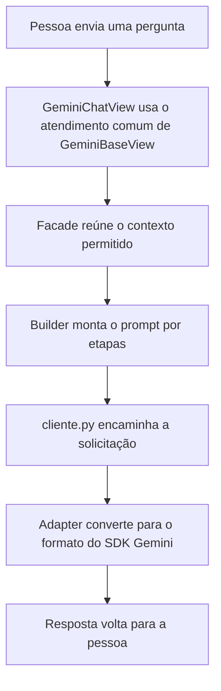
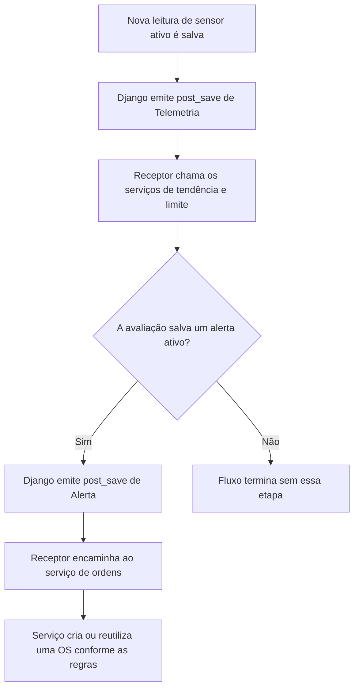

# Padrões de projeto do NanaSmart: guia explicado e verificado

**Data da análise:** 15/11/2026.  
**Código de referência:** arquivos locais do projeto, com base no commit `346f686`.  
**Objetivo:** explicar os padrões realmente encontrados, onde estão, quais classes e funções participam e como conferir seu uso no código.

Este documento foi escrito para quem está começando. Você pode entender a explicação e o exemplo cotidiano antes de ler qualquer trecho de Python. Os nomes das classes foram mantidos exatamente como aparecem no projeto para facilitar a localização.

**Resultado da análise:** foram confirmados **sete padrões GoF** nos fluxos examinados: **Builder, Factory Method, Strategy, Observer, Adapter, Facade e Template Method**. Os seis primeiros já aparecem na verificação mais recente da pasta; Template Method foi identificado adicionalmente na organização das views da IA. Há também fábricas simples de apoio. Singleton, Abstract Factory, Composite e Decorator não foram comprovados como implementações GoF próprias nos trechos analisados.

## Sumário

1. [O que significa padrão de projeto](#1-o-que-significa-padrão-de-projeto)
2. [Como a análise foi feita](#2-como-a-análise-foi-feita)
3. [Mapa rápido dos padrões confirmados](#3-mapa-rápido-dos-padrões-confirmados)
4. [Builder: montar a mensagem da IA por etapas](#4-builder-montar-a-mensagem-da-ia-por-etapas)
5. [Factory Method: criar o exportador adequado](#5-factory-method-criar-o-exportador-adequado)
6. [Strategy: escolher uma regra de acesso](#6-strategy-escolher-uma-regra-de-acesso)
7. [Observer: reagir quando um registro é salvo](#7-observer-reagir-quando-um-registro-é-salvo)
8. [Adapter: traduzir a comunicação com o Gemini](#8-adapter-traduzir-a-comunicação-com-o-gemini)
9. [Facade: reunir os dados por uma entrada simples](#9-facade-reunir-os-dados-por-uma-entrada-simples)
10. [Template Method: reaproveitar uma sequência de atendimento](#10-template-method-reaproveitar-uma-sequência-de-atendimento)
11. [Padrões citados, mas não comprovados como implementação própria](#11-padrões-citados-mas-não-comprovados-como-implementação-própria)
12. [O que foi corrigido em relação aos documentos anteriores](#12-o-que-foi-corrigido-em-relação-aos-documentos-anteriores)
13. [Verificações realizadas e seus limites](#13-verificações-realizadas-e-seus-limites)
14. [Glossário para acompanhar o código](#14-glossário-para-acompanhar-o-código)
15. [Roteiro curto para explicar o projeto](#15-roteiro-curto-para-explicar-o-projeto)

## 1. O que significa padrão de projeto

Um padrão de projeto é uma maneira conhecida de organizar o código para resolver um problema que costuma se repetir. Ele ajuda a dividir o trabalho entre partes do sistema, de modo que cada parte tenha uma responsabilidade compreensível.

Imagine uma oficina. Uma pessoa recebe o pedido, outra escolhe a ferramenta e outra executa o serviço. No software, também precisamos decidir quem recebe uma solicitação, quem escolhe uma regra, quem prepara os dados e quem conversa com um serviço externo.

O NanaSmart gerencia equipamentos, sensores, alertas e ordens de serviço. Também exporta relatórios e oferece recursos opcionais de inteligência artificial. Os padrões descritos aqui organizam essas atividades.

Os padrões GoF, sigla de *Gang of Four*, são um conjunto conhecido de padrões de projeto. Neste guia, suas categorias significam:

| Categoria | Pergunta que ajuda a responder | Padrões confirmados aqui |
|---|---|---|
| Criação | Como construir os objetos de que o sistema precisa? | Builder e Factory Method |
| Estrutura | Como conectar ou simplificar componentes? | Adapter e Facade |
| Comportamento | Como distribuir regras, etapas e reações? | Strategy, Observer e Template Method |

Ter uma classe com um nome parecido com um padrão não basta para comprovar seu uso. É preciso verificar o que ela faz e quem a chama.

## 2. Como a análise foi feita

A documentação existente foi usada como ponto de partida. Em seguida, as afirmações foram confrontadas com os arquivos Python, os locais de chamada, as rotas, o registro dos sinais e os testes existentes.

Para considerar um padrão confirmado, a análise procurou três evidências:

1. **Estrutura:** existem as classes, funções ou mecanismos necessários para aquela organização.
2. **Responsabilidade:** essas partes resolvem o problema característico do padrão.
3. **Uso:** um fluxo atual chama essa implementação; ela não aparece apenas como proposta em um texto.

Os exemplos de código abaixo são recortes dos arquivos atuais. Quando um exemplo é apenas uma sequência explicativa, isso é indicado. Os links apontam para os arquivos do repositório; as linhas correspondem à versão examinada e podem mudar em revisões futuras.

O levantamento se concentra no backend Python/Django e nos padrões discutidos na documentação do projeto. Não é um inventário de todos os padrões internos das bibliotecas nem de todos os detalhes do frontend.

## 3. Mapa rápido dos padrões confirmados

| Padrão | Explicação em uma frase | Onde aparece no NanaSmart | Peças principais |
|---|---|---|---|
| Builder | Montar algo em etapas organizadas. | Preparação de prompts de chat, análise de ordens, ordens sem atribuição e finanças. | `PromptBuilder`, `PromptBuilderConcreto`, `PromptDirector`, `Prompt` |
| Factory Method | Delegar a criação a um criador especializado. | Exportação em CSV, Excel e PDF. | `CriadorExportador` e suas três subclasses; `Exportador` e seus três produtos concretos |
| Strategy | Usar regras diferentes por um mesmo contrato. | Permissões por perfil e método HTTP. | `BasePermissionPolicy`, suas políticas, `PermissionPolicyFactory` e permissões do DRF |
| Observer | Acionar interessados quando acontece um evento. | Reações ao salvamento de leituras, alertas, equipamentos e ordens. | Sinais do Django e funções em `signals.py` |
| Adapter | Traduzir o formato de comunicação entre componentes. | Integração com o SDK Google Gemini. | `AssistenteAdapter`, `GeminiAdapter` e funções de `cliente.py` |
| Facade | Oferecer uma entrada simples para reunir várias operações. | Preparação do contexto das views Gemini. | `GeminiContextFacade` e funções de `context_service.py` |
| Template Method | Compartilhar uma sequência e permitir variar algumas etapas. | Atendimento comum dos endpoints Gemini. | `GeminiBaseView` e suas subclasses |

### Como alguns deles trabalham juntos

No chat da IA, o atendimento tem uma sequência comum, os dados são reunidos, o texto é montado e a comunicação externa é traduzida:



O **Template Method** organiza o atendimento comum desse fluxo. O **Facade** reúne os dados, o **Builder** organiza o texto e o **Adapter** faz a tradução para o serviço externo. Cada padrão atua em um problema diferente.

## 4. Builder: montar a mensagem da IA por etapas

### Ideia para quem não programa

Pense na montagem de um sanduíche: pão, recheio, molho e complementos são adicionados em etapas. Uma receita determina a ordem, e quem monta sabe como colocar cada ingrediente.

No NanaSmart, o resultado é um **prompt**, isto é, o texto preparado para a inteligência artificial. Ele pode conter informações da empresa, alertas, ordens de serviço, leituras dos sensores e a pergunta da pessoa.

### Problema resolvido

O chat, a análise de ordens e a análise financeira precisam de textos com partes diferentes. O Builder separa a preparação de cada bloco da receita que determina quais blocos entram em cada pedido.

### Onde está e quais classes participam

| Classe ou função | Localização | Responsabilidade |
|---|---|---|
| `PromptBuilder` | [prompt_builder_pattern.py, linha 4](../../gemini_api/prompt_builder_pattern.py#L4) | Define as etapas disponíveis: contexto, alertas, ordens, telemetria, financeiro, instruções, pergunta, conclusão e reinicialização. |
| `PromptBuilderConcreto` | [prompt_builder_pattern.py, linha 42](../../gemini_api/prompt_builder_pattern.py#L42) | Guarda os blocos em `_blocos`, formata o texto, limita algumas listas e entrega o produto. |
| `PromptDirector` | [prompt_director.py, linha 4](../../gemini_api/prompt_director.py#L4) | Define as receitas de chat, análise de ordens, ordens não atribuídas e finanças. |
| `Prompt` | [prompt.py, linha 1](../../gemini_api/prompt.py#L1) | Guarda o texto final e o entrega por `obter_texto()`. |
| `build_chat_prompt` e funções semelhantes | [prompt_builder.py, linha 119](../../gemini_api/prompt_builder.py#L119) | Preparam cabeçalhos e instruções, criam o builder e chamam o diretor. |
| `GeminiBaseView.get_prompt` e subclasses | [views.py, linha 218](../../gemini_api/views.py#L218) | Conectam a construção do prompt aos endpoints. |

### Código que mostra o padrão

O começo da receita de chat em `PromptDirector.montar_chat` mostra as etapas:

```python
builder.reset()
builder.com_contexto(context_str)
builder.com_alertas(context.get('alert_summary', []))
builder.com_ordens(context.get('open_order_summary', []), "ORDENS EM ABERTO")
```

A mesma receita acrescenta indicadores quando disponíveis, telemetria e pergunta. No builder concreto, a etapa final é:

```python
def build(self) -> Prompt:
    resultado = "\n".join(self._blocos)
    return Prompt(resultado)
```

Em `build_chat_prompt`, a conexão entre as peças é:

```python
builder = PromptBuilderConcreto()
prompt = PromptDirector.montar_chat(builder, context, context_str, message)
return prompt.obter_texto()
```

Em linguagem simples: cria-se um montador, escolhe-se a receita de chat e obtém-se o texto pronto.

### Exemplo do fluxo real

1. Uma pessoa envia uma pergunta para `POST /api/gemini/chat/`.
2. `GeminiChatView` usa `build_chat_prompt`.
3. A função prepara o cabeçalho e cria `PromptBuilderConcreto`.
4. `PromptDirector.montar_chat` ordena as etapas.
5. O builder gera um `Prompt`, cujo texto será encaminhado à integração com a IA.

### Por que a classificação é válida

Há um contrato de construção, um construtor concreto, um diretor com receitas e um produto final. Além de existirem, eles são chamados pelas funções utilizadas nas views.

**Benefício observado na organização:** a receita de cada solicitação fica separada das regras de formatação dos blocos. Isso facilita localizar onde alterar a ordem das informações ou sua apresentação.

### Limites importantes

- O limite de cinco itens em alguns blocos vem de `_max_linhas = 5`. Ele reduz listas, mas **não garante** um tamanho máximo total de texto ou de tokens da IA.
- `reset()` limpa os blocos antes de uma nova montagem. `build()` não faz essa limpeza automaticamente.
- `com_financeiro()` está definido, mas não foi encontrada uma chamada a ele nos arquivos Python examinados. A receita financeira atual usa cabeçalho, `com_ordens`, instruções e pergunta.
- `build_trend_analysis_prompt`, em [prompt_builder.py, linha 188](../../gemini_api/prompt_builder.py#L188), monta sua própria lista de textos e não usa essas classes Builder.
- A análise de **uma OS específica**, em [order_analysis.py, linha 118](../../gemini_api/order_analysis.py#L118), também tem montagem própria de instruções e JSON. Não se deve afirmar que toda mensagem enviada à IA passa pelo Builder.

## 5. Factory Method: criar o exportador adequado

### Ideia para quem não programa

Imagine pedir um relatório a uma central de impressão. Você escolhe o formato; a central encaminha o pedido a um responsável que sabe produzir aquele tipo de documento.

No NanaSmart, cada criador especializado sabe construir um exportador: CSV, Excel ou PDF. Quem solicita a exportação usa a mesma operação para os três formatos.

### Problema resolvido

Os dados de uma exportação são preparados pela view, enquanto o trabalho de gerar cada formato fica em classes próprias. A escolha e a criação do exportador são encaminhadas aos criadores.

### Onde está e quais classes participam

| Classe ou arquivo | Localização | Papel |
|---|---|---|
| `Exportador` | [base_exporter.py, linha 4](../../exportacao/utils/base_exporter.py#L4) | Contrato do produto: `exportar(nome, titulo, colunas, linhas)`. |
| `ExportadorCSV` | [csv_exporter.py, linha 8](../../exportacao/utils/csv_exporter.py#L8) | Gera CSV com a biblioteca `csv`. |
| `ExportadorExcel` | [excel_exporter.py, linha 11](../../exportacao/utils/excel_exporter.py#L11) | Gera uma planilha `.xlsx` com `openpyxl`. |
| `ExportadorPDF` | [pdf_exporter.py, linha 20](../../exportacao/utils/pdf_exporter.py#L20) | Gera PDF com ReportLab. |
| `CriadorExportador` | [creators.py, linha 9](../../exportacao/utils/creators.py#L9) | Declara o método abstrato `criar_exportador()`. |
| `CriadorExportadorCSV`, `CriadorExportadorExcel`, `CriadorExportadorPDF` | [creators.py, linha 18](../../exportacao/utils/creators.py#L18) | Cada subclasse implementa o método e cria seu exportador. |
| `ExportadorFactory` | [exporter_factory.py, linha 4](../../exportacao/utils/exporter_factory.py#L4) | Localiza a classe criadora pelo nome do formato e delega a criação. |
| Registro dos formatos | [utils/__init__.py](../../exportacao/utils/__init__.py) | Associa `csv`, `excel` e `pdf` aos respectivos criadores. |
| `_despachar_formato` | [exportacao/views.py, linha 50](../../exportacao/views.py#L50) | Pede o exportador e chama `exportar`. |

### Código que mostra o padrão

Em `creators.py`, o criador base define a operação e a subclasse decide qual objeto construir:

```python
class CriadorExportador(ABC):
    """Creator do Factory Method para uma família de exportadores."""

    @abstractmethod
    def criar_exportador(self) -> Exportador:
        """Cria o exportador escolhido pelo criador concreto."""
        raise NotImplementedError


class CriadorExportadorCSV(CriadorExportador):
    def criar_exportador(self) -> ExportadorCSV:
        return ExportadorCSV()
```

As subclasses de Excel e PDF fazem a mesma especialização para seus produtos. Na fábrica de apoio, a delegação aparece nesta linha:

```python
return criador_cls().criar_exportador()
```

Na view, o uso é comum a qualquer formato:

```python
exportador = ExportadorFactory.criar(formato)
return exportador.exportar(nome, titulo, colunas, linhas)
```

### Exemplo do fluxo real

Uma requisição a `GET /api/exportar/equipamentos/pdf/` segue esta sequência explicativa:

```text
ExportarEquipamentosView prepara as colunas e linhas
    -> _despachar_formato recebe "pdf"
    -> ExportadorFactory encontra CriadorExportadorPDF
    -> criar_exportador() produz ExportadorPDF
    -> exportar(...) devolve o arquivo para download
```

O mesmo mecanismo atende ordens de serviço, equipamentos, alertas, telemetria, histórico e dashboard. As rotas estão em [exportacao/urls.py](../../exportacao/urls.py).

### Por que a classificação é válida

O ponto que caracteriza **Factory Method** é o método de criação declarado no criador base e implementado pelas subclasses. O registro de formatos apenas escolhe o criador; ele não é, sozinho, a comprovação do padrão.

**Benefício observado na organização:** a função que despacha a exportação não precisa importar cada gerador concreto nem executar a lógica de geração dos três formatos.

### Limites importantes

Para acrescentar outro formato, seria necessário implementar o produto, seu criador e o registro. Também seria preciso revisar validações, mensagens, documentação e opções da interface que enumerem os formatos. A extensão do mecanismo central não significa que todos esses pontos já aceitem qualquer formato novo.

Um formato sem registro resulta em `ValueError`, tratado pela view com resposta HTTP 400. A mensagem atual orienta usar CSV, Excel ou PDF.

**Por que não é Abstract Factory:** são três alternativas para um mesmo tipo de produto, o exportador. Não há criação coordenada de vários tipos de produtos pertencentes a famílias diferentes. A palavra “família” no comentário do criador não altera essa estrutura.

## 6. Strategy: escolher uma regra de acesso

### Ideia para quem não programa

Pense na portaria de uma empresa. A pergunta é sempre a mesma: “Esta pessoa pode realizar esta ação?”. A resposta muda conforme a regra aplicada ao perfil e à ação solicitada.

No código, as estratégias são políticas com um mesmo método, `can_access`. As permissões do sistema escolhem uma política e pedem sua decisão.

### Problema resolvido

As regras de perfil e método HTTP ficam em políticas separadas. As classes que integram essas regras ao Django REST Framework delegam a avaliação, em vez de repetir cada condição.

### Onde está e quais classes participam

| Classe | Localização | Responsabilidade |
|---|---|---|
| `BasePermissionPolicy` | [permission_policies.py, linha 4](../../accounts/permission_policies.py#L4) | Contrato comum `can_access(user, method, obj=None, request=None)`. |
| `GestorPolicy` | [permission_policies.py, linha 12](../../accounts/permission_policies.py#L12) | Exige autenticação e perfil gestor/admin ou condição de superusuário. |
| `TecnicoPolicy` | [permission_policies.py, linha 19](../../accounts/permission_policies.py#L19) | Exige autenticação e perfil técnico. |
| `GestorOrReadOnlyPolicy` | [permission_policies.py, linha 26](../../accounts/permission_policies.py#L26) | Permite leitura a autenticados e escrita a gestor/admin ou superusuário. |
| `AuthenticatedNoDeleteForTecnicoPolicy` | [permission_policies.py, linha 37](../../accounts/permission_policies.py#L37) | Permite leitura a autenticados; nas demais ações, aplica as restrições de perfil do código. |
| `PermissionPolicyFactory` | [permission_policies.py, linha 51](../../accounts/permission_policies.py#L51) | Fornece a política registrada para um nome. |
| `IsGestor`, `IsTecnico`, `IsGestorOrReadOnly`, `IsAuthenticatedNoDeleteForTecnico` | [accounts/permissions.py](../../accounts/permissions.py) | Integram a decisão das políticas às permissões do DRF. |

### Código que mostra o padrão

Em `accounts/permissions.py`, a permissão escolhe uma regra e delega:

```python
class IsGestorOrReadOnly(permissions.BasePermission):
    """Gestores podem tudo. Técnicos/Outros apenas leitura."""

    def has_permission(self, request, view):
        policy = PermissionPolicyFactory.create('gestor_or_readonly')
        return policy.can_access(request.user, request.method)
```

Em `permission_policies.py`, a estratégia concreta contém a regra:

```python
class GestorOrReadOnlyPolicy(BasePermissionPolicy):
    def can_access(self, user, method: str, obj=None, request=None) -> bool:
        if not user or not getattr(user, 'is_authenticated', False):
            return False

        if method in ['GET', 'HEAD', 'OPTIONS']:
            return True

        return user.tipo_usuario in ['gestor', 'admin'] or getattr(user, 'is_superuser', False)
```

### Exemplo do fluxo real

`EquipamentoViewSet`, em [ativos/views.py, linha 16](../../ativos/views.py#L16), configura `IsGestorOrReadOnly` como permissão.

1. Um técnico autenticado pede uma consulta com `GET`.
2. A permissão obtém `GestorOrReadOnlyPolicy`.
3. A política permite a leitura.
4. Se esse técnico tentar criar um equipamento com `POST`, essa mesma política não autoriza a ação.

Outros usos confirmados são `IsGestor` no cadastro de usuários e nas ações de ajuste de prioridade, e `IsAuthenticatedNoDeleteForTecnico` nos recursos de telemetria.

### Por que a classificação é válida

As políticas implementam um contrato comum e oferecem comportamentos diferentes. As permissões funcionam como os componentes que utilizam essas estratégias. A escolha atual é feita pelo nome da política em cada permissão; não é necessário que uma tela permita trocar a estratégia para que essa organização exista.

**Benefício observado na organização:** uma regra compartilhada pode ser localizada e revisada na política correspondente.

### Limites importantes

- `PermissionPolicyFactory` é uma **fábrica simples com registro de objetos**. Não possui a hierarquia de criadores que caracteriza o Factory Method da exportação.
- `create()` devolve objetos já guardados em `_policies`; ele não cria uma nova política a cada chamada. Isso também não comprova Singleton, pois nada impede construir outra instância dessas classes.
- Apesar do nome `AuthenticatedNoDeleteForTecnicoPolicy`, um técnico também recebe negativa para `POST`, `PUT` e `PATCH` nessa política. Após liberar leitura, o retorno final exige gestor/admin ou superusuário, com bloqueio explícito de `DELETE` para perfil técnico.
- `TecnicoPolicy` e `IsTecnico` existem, mas não foi encontrada uma referência a `IsTecnico` fora de sua própria definição nos arquivos Python pesquisados. O uso ativo de Strategy está comprovado pelas outras permissões citadas.
- Nem toda permissão do projeto usa essas políticas. Por exemplo, `IsCompanyManager` e a permissão de ordens de serviço possuem suas próprias verificações.
- Permitir uma ação e filtrar os dados da empresa são responsabilidades diferentes. As consultas e as verificações de objeto também participam do controle de acesso.

## 7. Observer: reagir quando um registro é salvo

### Ideia para quem não programa

Imagine um alarme ligado a um sensor. Quando acontece algo, os componentes interessados são avisados e executam suas reações.

No NanaSmart, o Django emite sinais quando certos registros são salvos. Funções registradas como receptoras recebem esse aviso e podem verificar limites, atualizar alertas ou encaminhar a criação de uma ordem.

### Problema resolvido

O código que salva uma leitura não precisa chamar diretamente todas as reações em cada lugar. O sistema registra as funções interessadas no evento, e o mecanismo de sinais as aciona.

### Onde está e quem participa

| Evento e modelo | Função receptora | Localização | Reação |
|---|---|---|---|
| `post_save` de `Telemetria` | `checar_limites_telemetria` | [telemetria/signals.py, linha 9](../../telemetria/signals.py#L9) | Em uma nova leitura elegível, chama a sincronização da tendência e dos limites. |
| `post_save` de `Alerta` | `vincular_ordem_servico_ao_alerta` | [alertas/signals.py, linha 6](../../alertas/signals.py#L6) | Se o alerta estiver ativo, encaminha-o ao serviço conforme sua origem e registra o vínculo da ordem. |
| `post_save` de `Equipamento` | `verificar_planos_por_horimetro` | [ativos/signals.py, linha 13](../../ativos/signals.py#L13) | Verifica planos ativos e pode abrir uma OS preditiva por horímetro. |
| `pre_save` de `OrdemServico` | `verificar_manutencao` | [ativos/signals.py, linha 66](../../ativos/signals.py#L66) | Se faltar descrição e houver configuração de chave, tenta obter texto pela integração com a IA. |

As classes de domínio envolvidas são `Telemetria`, `Sensor`, `Alerta`, `Equipamento`, `PlanoManutencao` e `OrdemServico`. Nesta implementação, os observadores são **funções**, registradas no mecanismo de sinais do Django; não há necessidade de uma classe própria chamada `Observer`.

O registro ocorre ao importar os módulos de sinais em `ready()`: [AtivosConfig](../../ativos/apps.py#L4), [AlertasConfig](../../alertas/apps.py#L4) e [TelemetriaConfig](../../telemetria/apps.py#L4). O método `ready()` é executado na inicialização da aplicação pelo Django.

### Código que mostra o padrão

Este é o receptor da telemetria:

```python
@receiver(post_save, sender=Telemetria)
def checar_limites_telemetria(sender, instance, created, raw=False, **kwargs):
    if raw or not created or not instance.sensor.ativo:
        return
    sync_sensor_trend(instance.sensor_id)
    sync_limit_reading(instance)
```

`@receiver` registra a função para o aviso de salvamento de `Telemetria`. A função ignora carregamentos brutos, alterações de leituras existentes e sensores inativos. Se a leitura for elegível, chama os dois serviços na ordem mostrada.

### Exemplo do fluxo real



As decisões de negócio ficam nos serviços, como [sync_limit_reading](../../telemetria/limit_service.py), [sync_sensor_trend](../../telemetria/predictive_service.py#L21) e [PrioridadeOSService](../../manutencao/services.py#L62). O sinal aciona o trabalho; não substitui as regras desses serviços.

### Por que a classificação é válida

Há eventos, receptores registrados e reações a esses eventos. É uma aplicação de Observer fornecida pelo framework, utilizada explicitamente pelo projeto.

**Benefício observado na organização:** diferentes pontos que salvam um modelo pelo fluxo normal podem acionar as mesmas reações registradas.

### Limites importantes

- Esses receptores são síncronos: o trabalho acontece durante o fluxo de salvamento. Não existe, nesses trechos, uma fila em segundo plano ou um serviço de mensagens.
- Nem todo salvamento gera uma ordem nova. Os serviços verificam condições e vínculos existentes. A recuperação do sensor não conclui a manutenção automaticamente.
- O receptor de alertas não restringe a execução a `created=True`. O que efetivamente filtra no começo da função é `raw` e o status ativo, apesar do comentário interno mencionar alerta “novo ou escalado”.
- O vínculo `ordem_servico` é gravado com `QuerySet.update()` para evitar disparar novamente o mesmo sinal apenas para registrar essa associação.
- Operações como `QuerySet.update()` e `bulk_create()` não percorrem o salvamento individual normal com esses sinais. Assim, “salvar por qualquer caminho sempre avisa os observadores” seria uma afirmação ampla demais.
- No fluxo normal de `Telemetria.save()`, o projeto usa transação e bloqueio do sensor. Isso é um mecanismo adicional de consistência, não um padrão Observer separado.

## 8. Adapter: traduzir a comunicação com o Gemini

### Ideia para quem não programa

Um adaptador de tomada permite conectar dois encaixes diferentes. Aqui, a aplicação trabalha com textos e históricos simples, enquanto a biblioteca do Google espera objetos e parâmetros próprios.

O `GeminiAdapter` faz essa tradução.

### Problema resolvido

As views não precisam montar diretamente os objetos `Content`, `Part` e `GenerateContentConfig` do SDK Google GenAI. Essa preparação fica concentrada no adaptador.

### Onde está e quais classes participam

| Classe ou função | Localização | Responsabilidade |
|---|---|---|
| `AssistenteAdapter` | [adapters.py, linha 8](../../gemini_api/adapters.py#L8) | Define o contrato de disponibilidade e geração de conteúdo da aplicação. |
| `GeminiAdapter` | [adapters.py, linha 27](../../gemini_api/adapters.py#L27) | Implementa a tradução e chama o SDK Gemini. |
| `get_ai_adapter` | [adapters.py, linha 112](../../gemini_api/adapters.py#L112) | Fornece uma nova instância de `GeminiAdapter`. |
| `generate_content` e `is_gemini_available` | [cliente.py](../../gemini_api/cliente.py) | Mantêm as funções de entrada usadas pelo restante da aplicação e delegam ao adaptador. |
| `GeminiBaseView.run_gemini` | [views.py, linha 224](../../gemini_api/views.py#L224) | Encaminha a solicitação da view pela função de geração. |
| `OrdemServicoViewSet.analise_ia` | [manutencao/views.py, linha 54](../../manutencao/views.py#L54) | Também usa as funções de `cliente.py` na análise individual de OS. |

### Código que mostra o padrão

Ao converter o histórico, `GeminiAdapter.generate_content` executa:

```python
role = "user" if item.get("role") == "user" else "model"
contents.append(
    types.Content(
        role=role,
        parts=[types.Part.from_text(text=item.get("text", ""))],
    )
)
```

O histórico simples da aplicação vira objetos do SDK, incluindo a conversão do papel da mensagem para `user` ou `model`. Na chamada ao provedor:

```python
response = client.models.generate_content(
    model=model_name,
    contents=contents,
    config=config,
)
return response.text, model_name
```

A aplicação recebe o texto e o nome do modelo utilizado, sem precisar manipular o objeto completo da resposta do SDK.

### Exemplo do fluxo real

```text
View pede uma resposta com instrução, prompt e histórico
    -> cliente.generate_content(...)
    -> get_ai_adapter() fornece GeminiAdapter
    -> adaptador converte os dados para os tipos do SDK
    -> SDK faz a chamada ao Gemini
    -> adaptador devolve texto e modelo utilizado
```

### Por que a classificação é válida

Existe um contrato voltado à aplicação e uma implementação que o traduz para a interface externa. A tradução de dados está presente no código e é utilizada pelos pontos de entrada da IA.

**Benefício observado na organização:** os detalhes de formatação da chamada ao Gemini ficam concentrados no adaptador.

### Limites importantes

- Há apenas um provedor concreto implementado: Gemini. Trocar de provedor exigiria implementar outro adaptador e revisar diferenças de contrato e configuração.
- `get_ai_adapter()` retorna `GeminiAdapter()` a cada chamada. Não é um Singleton.
- `is_available()` verifica se `get_client()` consegue fornecer um cliente com a configuração local. Isso não comprova que uma requisição externa será bem-sucedida ou que haverá cota disponível.
- O código tenta modelos alternativos para determinadas mensagens de erro. Isso descreve a implementação local; não comprova disponibilidade atual desses modelos no provedor.
- `get_gemini_client()` permanece como função de compatibilidade em `cliente.py` e expõe o cliente do SDK. Não foi encontrada uma chamada a essa função nos demais arquivos Python pesquisados.

## 9. Facade: reunir os dados por uma entrada simples

### Ideia para quem não programa

Pense em uma recepção. Você faz um pedido em um único lugar, e a recepção reúne o que precisa dos setores responsáveis.

A fachada da IA permite que a view peça o contexto por uma operação simples. Os serviços internos fazem as consultas e os resumos.

### Problema resolvido

A view precisa de dados de equipamentos, ordens, alertas e telemetria. Algumas solicitações também precisam de informações financeiras. A fachada oferece um ponto para coordenar essa escolha.

### Onde está e quem participa

| Classe ou função | Localização | Responsabilidade |
|---|---|---|
| `GeminiContextFacade` | [facades.py, linha 4](../../gemini_api/facades.py#L4) | Expõe `build_context` e coordena o contexto comum com a inclusão financeira opcional. |
| `build_base_context` | [context_service.py, linha 151](../../gemini_api/context_service.py#L151) | Reúne consultas, contagens e resumos operacionais. |
| `get_financial_summary` | [context_service.py, linha 115](../../gemini_api/context_service.py#L115) | Prepara os números e os resumos financeiros. |
| `get_user_equipment_queryset` e demais funções auxiliares | [context_service.py](../../gemini_api/context_service.py) | Buscam dados e aplicam os recortes usados pelo serviço de contexto. |
| `GeminiBaseView.build_context` | [views.py, linha 232](../../gemini_api/views.py#L232) | Usa a fachada e informa se precisa do resumo financeiro. |
| `GeminiFinanceView` | [views.py, linha 307](../../gemini_api/views.py#L307) | Configura `requires_financial_summary = True`. |

### Código que mostra o padrão

A implementação da fachada é pequena:

```python
class GeminiContextFacade:
    """Oferece às views uma entrada única para montar o contexto da IA."""

    def build_context(self, user, *, include_financial_summary=False):
        context = build_base_context(user)
        if include_financial_summary:
            context["financial_summary"] = get_financial_summary(user)
        return context
```

Na view base, a entrada utilizada é:

```python
def build_context(self, user):
    return self.context_facade_class().build_context(
        user,
        include_financial_summary=self.requires_financial_summary,
    )
```

### Exemplo do fluxo real

No chat, a configuração padrão pede o contexto comum. Na solicitação financeira, `GeminiFinanceView` ativa o resumo financeiro. A fachada recebe essa escolha e coordena os serviços necessários.

### Por que a classificação é válida

A view usa uma entrada de nível mais alto, sem coordenar diretamente a combinação dos dois serviços. A maior parte do trabalho de consulta continua em `context_service.py`; a fachada é uma camada fina de coordenação.

**Benefício observado na organização:** a decisão de incluir os dados financeiros fica concentrada nessa entrada, e a view base mantém uma forma comum de solicitar o contexto.

### Limites importantes

- A fachada não faz a chamada ao Gemini e não monta o texto final do prompt.
- Sua existência não prova redução de consultas ao banco nem ganho de velocidade. O benefício identificado é de organização.
- A fachada não substitui permissões nem validações de acesso. Ela delega a coleta aos serviços e recebe da view a opção financeira.
- A análise individual de uma OS usa `build_order_analysis_context` em `order_analysis.py`, sem passar por essa fachada.

## 10. Template Method: reaproveitar uma sequência de atendimento

### Ideia para quem não programa

Imagine uma ficha de atendimento com etapas comuns: conferir os dados, verificar condições, preparar o pedido, executar e devolver o resultado. Setores diferentes seguem essa sequência, mas preenchem algumas etapas de maneiras diferentes.

No NanaSmart, a classe base das views Gemini contém a sequência comum. As subclasses definem o propósito, o prompt, opções e algumas verificações específicas.

### Problema resolvido

Os endpoints de chat, ordens, finanças e tendências compartilham boa parte do atendimento. O Template Method permite reaproveitar essa sequência e personalizar pontos específicos por herança.

### Onde está e quais classes participam

| Classe ou método | Localização | Papel |
|---|---|---|
| `GeminiBaseView` | [views.py, linha 198](../../gemini_api/views.py#L198) | Classe base com a sequência comum. |
| `GeminiBaseView.post` | [views.py, linha 238](../../gemini_api/views.py#L238) | Método que organiza validação, verificações, contexto, prompt, chamada e resposta. |
| `check_access`, `get_prompt`, `run_gemini`, `build_context` | [views.py, linha 215](../../gemini_api/views.py#L215) | Etapas separadas chamadas pela sequência. Algumas são especializadas nas subclasses. |
| `GeminiChatView` | [views.py, linha 264](../../gemini_api/views.py#L264) | Define a função de prompt de chat, propósito e temperatura. |
| `GeminiOsAnalysisView` | [views.py, linha 279](../../gemini_api/views.py#L279) | Define a função de prompt para análise de ordens em conjunto. |
| `GeminiUnassignedOrdersView` | [views.py, linha 292](../../gemini_api/views.py#L292) | Especializa `get_prompt` para ordens sem atribuição. |
| `GeminiFinanceView` | [views.py, linha 307](../../gemini_api/views.py#L307) | Especializa acesso e prompt, além de solicitar contexto financeiro. |
| `GeminiTrendAnalysisView` | [views.py, linha 330](../../gemini_api/views.py#L330) | Especializa o prompt e envolve o atendimento comum com validações e tratamento próprios. |

### Código que mostra o padrão

Este recorte de `GeminiBaseView.post` mostra a sequência após as verificações iniciais:

```python
context = self.build_context(user)

system_instruction = build_system_instruction(user, self.system_purpose)
user_prompt = self.get_prompt(user, context, message)

try:
    response_text, model_used = self.run_gemini(system_instruction, user_prompt, history)
    return Response({"response": response_text, "model_used": model_used})
except Exception as e:
    return Response({"response": f"Erro ao gerar resposta da IA: {e}"})
```

O método da classe base chama `self.get_prompt`. Na subclasse financeira, esse ponto é especializado:

```python
def get_prompt(self, user, context, message):
    return build_finance_prompt(user, context, message)
```

Assim, a sequência comum permanece na classe base, enquanto a versão financeira determina qual texto preparar. As subclasses de chat e análise de ordens também personalizam o comportamento por atributos usados pela base.

### Exemplo do fluxo real

1. Uma solicitação chega a `POST /api/gemini/gestao/financeira/`.
2. A subclasse chama `super().post(request)`, reutilizando o atendimento da classe base.
3. A classe base valida a mensagem e aplica a verificação de acesso configurada para esse endpoint.
4. Com a IA configurada, solicita contexto, prepara as instruções e chama `self.get_prompt`.
5. O método financeiro prepara o prompt apropriado, e a classe base realiza a chamada e devolve a resposta.

### Por que a classificação é válida

Existe uma sequência de operações na classe base, com pontos chamados por `self` que podem variar nas subclasses. Isso caracteriza Template Method, mesmo sem uma classe com esse nome e sem exigir que todos os passos sejam abstratos.

**Benefício observado na organização:** os endpoints compartilham o atendimento comum, e diferenças específicas ficam em atributos ou métodos especializados.

### Relação com os outros padrões

Template Method organiza **a sequência de atendimento da view**. Builder organiza **a construção do texto**. Facade organiza **a obtenção do contexto**, e Adapter organiza **a tradução da chamada externa**.

Esse padrão é uma identificação adicional desta análise. A [verificação de padrões verdes](Verificacao_Padroes_GoF_Verdes.md) tinha escopo restrito a dez padrões e não avaliava Template Method. Portanto, sua ausência naquele resumo não significa que ele não estivesse no código.

## 11. Padrões citados, mas não comprovados como implementação própria

| Nome | O que seria necessário para confirmar | O que foi encontrado | Classificação neste levantamento |
|---|---|---|---|
| Singleton | Uma classe controlar a criação para garantir uma única instância em um escopo definido. | Políticas compartilhadas em um registro e recursos centralizados do Django, sem uma classe própria com essa garantia. | Não comprovado como Singleton GoF próprio. |
| Abstract Factory | Criar famílias de vários tipos de produtos relacionados por uma interface comum. | Criadores de formatos alternativos de um único tipo de produto: exportadores. | A exportação foi classificada como Factory Method. |
| Composite | Itens e grupos em uma árvore recursiva, com uma interface comum que permita tratá-los de maneira uniforme. | Relações entre empresas, equipamentos, sensores, alertas e ordens, sem essa estrutura de componentes e composições. | Não comprovado nos fluxos examinados. |
| Decorator | Objetos que envolvem outros objetos de mesmo contrato para combinar responsabilidades. | Decoradores Python como `@receiver`, `@action` e `@transaction.atomic`, sem evidência suficiente dessa estrutura GoF própria. | O símbolo `@` não comprova o padrão GoF. |

### Cuidado especial com Singleton

É válido dizer que o Django oferece acesso centralizado a configurações e ao gerenciamento de conexões. Isso não autoriza concluir que existe uma única conexão física com o banco para todos os usuários, processos ou servidores.

No código do NanaSmart, o ORM realiza consultas por modelos e QuerySets. O compartilhamento de políticas em `_policies` também tem um escopo local ao processo e não impede criar outras instâncias das classes. Nenhum desses fatos, sozinho, comprova uma implementação própria de Singleton.

### Outras organizações que não devem ser somadas à lista GoF

O projeto possui modelos, serializers, views, rotas e funções de serviço. São partes da organização da aplicação. A existência de Django, de serviços como `PrioridadeOSService` ou de métodos como `objects.filter()` não comprova automaticamente uma implementação própria de Repository, MVC completo ou outros padrões GoF.

Também seria possível comparar o contrato comum dos exportadores à ideia de comportamentos intercambiáveis. Neste guia, Strategy é demonstrado pelas políticas de permissão, e Factory Method pela criação de exportadores. Essa escolha mantém claras as evidências de cada problema resolvido.

## 12. O que foi corrigido em relação aos documentos anteriores

Os arquivos antigos misturam análise, propostas e retratos de versões anteriores. Eles continuam úteis como histórico, mas uma sugestão escrita não demonstra que o código correspondente foi implementado.

| Documento consultado | Informação relevante encontrada | Resultado ao conferir o código atual |
|---|---|---|
| [RESUMO_PADROES_V2.md](RESUMO_PADROES_V2.md) | Chama a exportação de Abstract Factory, associa Factory Method às políticas e apresenta Facade/Adapter como melhorias. | Exportação tem criadores especializados de Factory Method; políticas usam Strategy com fábrica simples; Facade e Adapter existem e têm chamadas. |
| [RESUMO_PADROES_RAPIDO.md](RESUMO_PADROES_RAPIDO.md) | Repete classificações anteriores e sugestões de implementação. | As sugestões foram separadas do que está efetivamente presente. |
| [DOCUMENTO_PADROES_V3_DIAGRAMAS.md](DOCUMENTO_PADROES_V3_DIAGRAMAS.md) | Associa Abstract Factory aos exportadores e Factory Method às permissões; apresenta Facade e Adapter como parciais. | Os nomes e as relações do código atual sustentam as classificações explicadas neste guia. Diagramas antigos precisam ser lidos considerando essa revisão. |
| [Implementacao_Padroes.md](Implementacao_Padroes.md) | Documenta Builder e Factory Method na exportação. | A estrutura geral foi confirmada. O código atual inclui as classes de criadores e o registro correspondente. Não se presumiu que descrições históricas de “antes” fossem prova do estado atual. |
| [Verificacao_Padroes_GoF_Verdes.md](Verificacao_Padroes_GoF_Verdes.md) | Confirma seis padrões e distingue os recursos compartilhados do Django de Singleton próprio. | Os seis foram confirmados novamente. Este guia detalha limites, pontos apenas definidos e acrescenta Template Method. |
| [ANALISE_OS_IA.md](../ANALISE_OS_IA.md) | Descreve a análise individual de uma OS. | Esse fluxo usa `order_analysis.py` e a integração de `cliente.py`, sem passar pelo Builder e Facade descritos para as views Gemini. |

Exemplos de afirmações que este levantamento evita generalizar:

- “Toda mensagem de IA usa Builder”: há montagens próprias para tendências e análise individual de OS.
- “Todo salvamento sempre gera uma ordem”: há condições nos receptores e nos serviços, além de formas de gravação que não emitem esses sinais.
- “Técnico só não pode excluir”: a política examinada também restringe outras operações de escrita.
- “Ter uma fábrica significa Abstract Factory”: a estrutura de criação precisa ser examinada.
- “Passar em `manage.py check` prova todos os padrões”: essa verificação detecta problemas de configuração do Django, mas não comprova, sozinha, a classificação dos padrões.

## 13. Verificações realizadas e seus limites

### Testes existentes executados

Foi executado o seguinte conjunto de testes, sem alterar o código da aplicação:

```powershell
$env:NANASMART_TEST_POSTGRES_PORT = ''
.\.venv\Scripts\python.exe manage.py test accounts.tests exportacao.tests gemini_api.tests gemini_api.test_order_analysis telemetria.tests telemetria.test_alert_lifecycle --settings=app.test_settings --verbosity=1
```

**Resultado observado em 15/11/2026: 75 testes executados, todos aprovados.** A verificação do Django realizada nessa execução informou zero problemas. O interpretador utilizado foi o Python 3.10.8 do `.venv` existente.

O arquivo [app/test_settings.py](../../app/test_settings.py) permite testes em banco descartável. Nessa execução, a opção de PostgreSQL de testes foi desativada pela variável acima e foi utilizado SQLite em memória. O banco de desenvolvimento não foi utilizado para esse conjunto de testes.

| Conjunto existente | Evidência útil para este documento |
|---|---|
| [accounts/tests.py](../../accounts/tests.py) | Seleção de políticas, acesso de gestor/técnico e comportamentos de contas. |
| [exportacao/tests.py](../../exportacao/tests.py) | Geração de Excel com tratamento de título longo da planilha. |
| [gemini_api/tests.py](../../gemini_api/tests.py) | Respostas dos endpoints, restrição financeira e autorização de sensores. |
| [gemini_api/test_order_analysis.py](../../gemini_api/test_order_analysis.py) | Fluxo individual de OS, contexto, permissões e tratamento de indisponibilidade/falha com simulações. |
| [telemetria/tests.py](../../telemetria/tests.py) | Alertas, limites e restrições de acesso aos recursos de telemetria. |
| [telemetria/test_alert_lifecycle.py](../../telemetria/test_alert_lifecycle.py) | Reação a novas leituras, vínculo de OS, não duplicação e recuperação sem concluir manutenção. Nesses testes, a análise de tendência é simulada para isolar o fluxo de limite. |

### Conferências pontuais adicionais

Além da suíte existente, foram feitas verificações em memória durante a análise:

| Parte conferida | Resultado observado |
|---|---|
| Builder | O diretor produziu um `Prompt` com os blocos esperados; uma nova montagem com o mesmo builder não manteve o alerta anterior. |
| Factory Method | O registro forneceu `ExportadorCSV`, `ExportadorExcel` e `ExportadorPDF`; cada um gerou conteúdo com a assinatura do formato correspondente. Formato inexistente lançou `ValueError`. |
| Facade | Com serviços internos simulados, o contexto comum foi retornado e o resumo financeiro só foi solicitado quando a opção correspondente estava ativa. |
| Adapter | Com cliente simulado, o histórico foi convertido para os tipos do SDK, os papéis ficaram `user`, `model`, `user`, e o retorno trouxe texto e modelo. Nenhuma chamada de rede foi feita nessa conferência. |

Essas conferências foram executadas como um script temporário pelo terminal, sem adicionar arquivos de teste ao repositório.

### O que essas evidências permitem afirmar

A classificação dos padrões vem da estrutura e dos pontos de uso do código. Os testes e as conferências dão evidência adicional sobre os comportamentos descritos.

Eles não comprovam disponibilidade real do Google Gemini, qualidade das respostas da IA, desempenho em produção ou comportamento concorrente específico do PostgreSQL. A geração pontual de arquivos também não equivale a uma revisão visual completa de todos os relatórios. Não foram atribuídos ganhos numéricos de velocidade ou memória aos padrões.

## 14. Glossário para acompanhar o código

| Termo | Explicação simples |
|---|---|
| Classe | Definição de um tipo de componente do programa. |
| Objeto ou instância | Um componente concreto criado a partir de uma classe. |
| Método | Uma função definida em uma classe para executar uma ação. |
| Contrato ou interface | Conjunto de operações que um componente promete oferecer. |
| Classe abstrata / `ABC` | Base que define operações e pode exigir sua implementação nas subclasses. |
| Subclasse / herança | Classe que aproveita uma base e pode especializar seu comportamento. |
| Sobrescrever um método | Fornecer na subclasse uma versão específica de um método da classe base. |
| View | Parte do backend que atende uma requisição e prepara uma resposta. |
| Endpoint | Endereço da API usado para uma operação, como enviar uma pergunta. |
| API | Forma organizada de um programa solicitar operações a outro. |
| DRF | Django REST Framework, biblioteca usada para construir a API do projeto. |
| Modelo | Classe que representa dados persistidos, como equipamento ou ordem de serviço. |
| QuerySet / ORM | Recursos do Django para consultar e manipular dados usando Python. |
| Sinal / receptor | Aviso de um evento e função registrada para reagir a ele. |
| Prompt | Texto com informações e instruções enviado à inteligência artificial. |
| Contexto | Dados usados para orientar uma operação ou resposta. |
| SDK | Biblioteca que facilita conversar com um serviço externo. |
| HTTP `GET` / `POST` / `PATCH` / `DELETE` | Métodos normalmente associados a consultar, enviar/criar, alterar parcialmente e excluir. O comportamento exato depende da rota. |
| Mock ou simulação | Substituto controlado de uma dependência durante uma verificação. |
| OS / O.S. | Ordem de serviço: registro de um trabalho de manutenção. |
| Horímetro | Medida das horas de funcionamento de um equipamento. |
| JSON | Formato de dados estruturados que programas conseguem trocar. |

## 15. Roteiro curto para explicar o projeto

Uma apresentação pode começar assim:

> “O NanaSmart usa padrões de projeto para dividir responsabilidades. O Builder monta alguns textos da IA em etapas. O Factory Method cria o exportador de CSV, Excel ou PDF. O Strategy organiza regras de permissão. O Observer usa sinais para reagir a eventos de salvamento. O Adapter traduz os dados para o Gemini, e o Facade reúne o contexto por uma entrada simples. O Template Method compartilha a sequência de atendimento das views Gemini. Essas classificações foram conferidas nas classes, nos pontos de chamada e em verificações do projeto.”

Para demonstrar no código, estes são pontos de partida pequenos:

| Se precisar mostrar… | Abra primeiro | Depois acompanhe… |
|---|---|---|
| Montagem por etapas | [PromptDirector](../../gemini_api/prompt_director.py#L4) | `PromptBuilderConcreto` e `Prompt`. |
| Criação do gerador de arquivos | [CriadorExportadorCSV](../../exportacao/utils/creators.py#L18) | `ExportadorFactory.criar` e `_despachar_formato`. |
| Escolha de regra de acesso | [IsGestorOrReadOnly](../../accounts/permissions.py#L40) | `GestorOrReadOnlyPolicy` e seu uso em equipamentos. |
| Reação automática a uma leitura | [checar_limites_telemetria](../../telemetria/signals.py#L9) | Os serviços de tendência/limite e o receptor de alertas. |
| Tradução para um serviço externo | [GeminiAdapter.generate_content](../../gemini_api/adapters.py#L43) | Conversão do histórico e chamada do SDK. |
| Entrada simples para os dados | [GeminiContextFacade](../../gemini_api/facades.py#L4) | `build_base_context` e inclusão financeira opcional. |
| Sequência reaproveitada entre views | [GeminiBaseView.post](../../gemini_api/views.py#L238) | `get_prompt` especializado em `GeminiFinanceView`. |

Ao atualizar o projeto, confira novamente as classes e seus pontos de uso antes de reaproveitar este levantamento. A documentação descreve o código analisado na data indicada.
